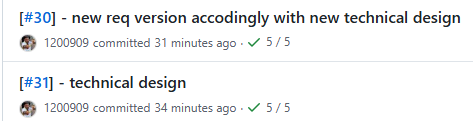
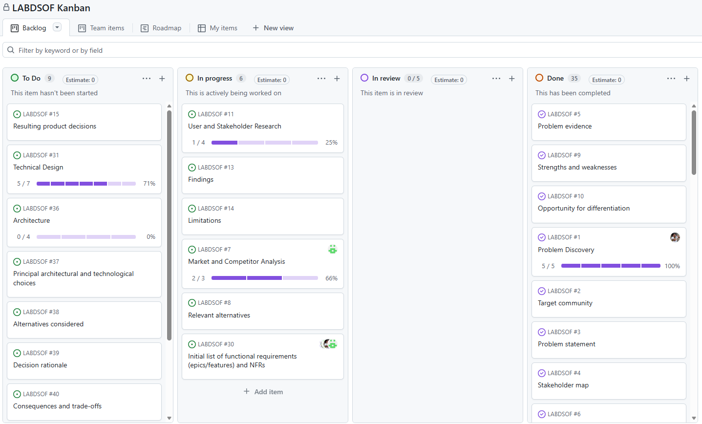
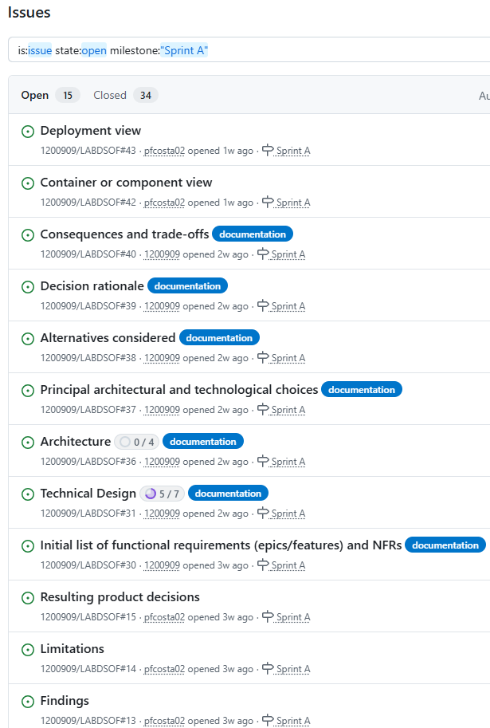
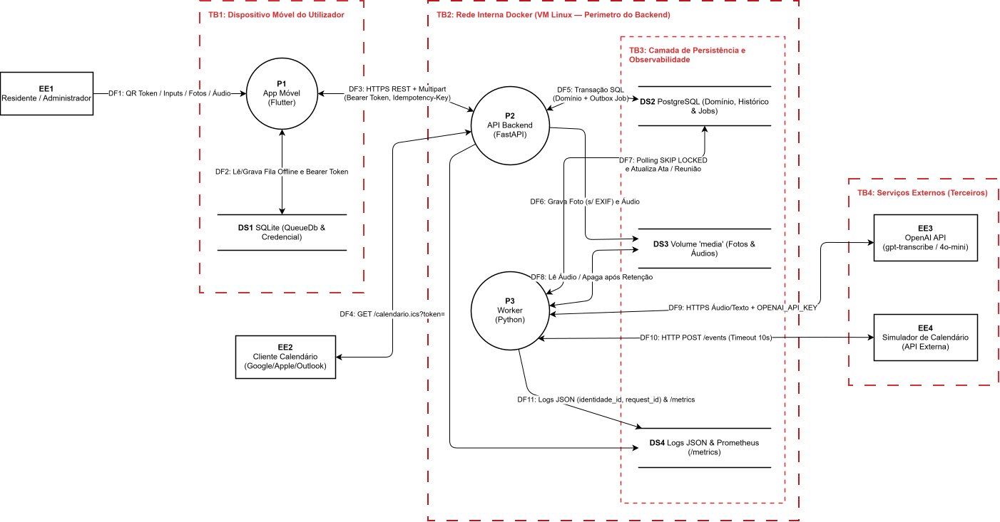

# Sprint A - Descoberta, Validação e Design

## Índice
- [0. Processo e Metodologia de Equipa](#0-processo-e-metodologia-de-equipa)
- [1. Relatório de Problema e Oportunidade](#1-relatório-de-problema-e-oportunidade)
- [2. Análise de Mercado e Concorrência](#2-análise-de-mercado-e-concorrência)
- [3. Investigação de Utilizadores](#3-investigação-de-utilizadores)
- [4. Rascunho de Requisitos](#4-rascunho-de-requisitos)
- [5. Product Vision](#5-product-vision)
- [6. Product Backlog](#6-product-backlog)
- [7. Responsible AI Opportunity Assessment](#7-responsible-ai-opportunity-assessment)
- [8. Technical Design](#8-technical-design)
- [9. Architecture Decision Records](#9-architecture-decision-records)
- [10. Security and Privacy Assessment](#10-security-and-privacy-assessment)
- [11. Walking Skeleton](#11-walking-skeleton)
- [12. Fontes e declaração de uso de IA](#12-fontes-e-declaração-de-uso-de-ia)

---

## 0. Processo e Metodologia de Equipa

### Metodologia
Scrum, com um sprint por fase do enunciado (Sprint A, B e C, correspondentes aos Sprints 1, 2 e 3), dailies curtas, sprint review com os docentes (investidores) no fim de cada sprint e retrospetiva da equipa.

**Porquê Scrum e GitHub Flow.** O produto tem requisitos que mudam com o feedback dos docentes a cada sprint (ver as duas decisões revistas abaixo), e uma equipa de 5 pessoas precisa de ciclos curtos com revisão externa. O Scrum dá esses ciclos e um backlog priorizado. O GitHub Flow, com uma `main` sempre estável e PRs revistos, dá integração contínua sem a cerimónia de um modelo com muitas branches.

**Adaptação à mudança.** O backlog é refinado e repriorizado a cada sprint e a cada feedback dos docentes. Já aconteceu duas vezes neste sprint: a integração externa passou a ser o calendário em simulador (08/10) e a IA ficou num serviço externo em vez de um agente local (22/10).

**Avaliação e melhoria do processo.** Na retrospetiva de cada sprint a equipa analisa o que impediu itens de cumprirem a DoD, quantas histórias falharam a DoR, e decide ações.

### Envolvimento dos investidores (docentes)

Enunciado 5.7: a equipa trabalha com os docentes como investidores e partes interessadas do produto.

| Docente | Envolvimento no Sprint A | Feedback recebido |
|---|---|---|
| Regente (aulas teóricas) | Revisão do problema e da solução proposta | Não fez reparos ao problema nem à solução proposta |
| Docente das aulas práticas | Acompanhamento contínuo ao longo do sprint, com feedback sobre a arquitetura | Foi dando feedback e aprovação da arquitetura à medida que esta evoluía |

**Decisões revistas após feedback** (o enunciado exige pelo menos uma, com a mudança e a justificação documentadas):

| Data | Feedback | Decisão revista | Justificação | Onde ficou registado |
|---|---|---|---|---|
| 08/10/2026 | O serviço de IA era a integração externa exigida pelo enunciado (6.5) | A integração externa passou a ser o serviço de calendário, em simulador com falhas configuráveis; o serviço de IA deixa de contar como integração externa | Só o simulador permite disparar por comando as quatro condições do enunciado (indisponível, atrasado, incompleto, inválido) e ser executado pelos docentes sem contas externas | [ADR-007](#adr-007-integração-de-calendário-por-simulador-e-feed-ical), [8.6](#86-integração-externa) |
| 22/10/2026 | A equipa ponderou executar a IA num agente local em vez de um serviço externo; o docente desaconselhou | Mantém-se o serviço de IA da OpenAI, chamado pelo Worker; não se adota um agente local | Seguir a recomendação do docente. | [ADR-010](#adr-010-serviço-de-ia-externo-openai-sem-agente-local), [7.1](#71-fluxo-assistido-por-ia) |


### Controlo de versões (Git) - GitHub Flow
- `main` é a branch de produção, sempre estável; nunca se commita diretamente.
- Uma branch curta por funcionalidade/tarefa, integrada em `main` por PR após code review.
- Mensagem de commit: `[#<id>] - <descrição>` (ex.: `[#12] - Adiciona formulário de reporte de fuga de água`), onde `#<id>` é a issue associada (várias issues: `[#12, #13] - <descrição>`). Um hook `commit-msg` ([.githooks/commit-msg](../../.githooks/commit-msg)) rejeita commits fora deste formato. Ativar uma vez por clone com `git config core.hooksPath .githooks` (em Linux/macOS, também `chmod +x .githooks/commit-msg`).


### Gestão de issues
GitHub Issues/Projects; cada issue é referenciada nos commits e PRs.



### Quadro do Project (GitHub Projects)



### Lista de issues (GitHub Issues)



### Papéis da equipa
5 membros, 6 papéis (um membro acumula dois). Todos programam frontend e backend; a tabela indica só a responsabilidade **adicional** de cada papel.

| Papel | Responsabilidade adicional |
|---|---|
| Product Owner / PM | Product Backlog, prioridades, contacto com os docentes (investidores) |
| Business Analyst | Requisitos, pesquisa de mercado e de utilizador |
| QA | Estratégia e execução de testes |
| DevOps / Scrum Master | Pipeline de CI/CD, facilitação do processo ágil |
| Backend Developer | Lógica, bases de dados e APIs |
| Frontend Developer | Parte visual e interativa da app |

### Definition of Ready (DoR)
Uma User Story só entra num sprint quando todos os pontos aplicáveis estão confirmados:

- **Valor e âmbito claros:** a equipa compreende quem beneficia, qual o problema resolvido e o que fica fora da tarefa; a história tem dimensão estimável para ser concluída num sprint.
- **Percurso completo (frontend, API, persistência):** a tarefa de produto inclui o percurso completo necessário para cumprir a história: interface/frontend, API/backend, persistência e integração entre componentes, quando aplicável. Não se divide a mesma funcionalidade em tarefas independentes de frontend e backend; trabalho exclusivamente técnico ou sem interface deve ter essa exceção identificada e justificada.
- **Comportamento definido:** critérios de aceitação claros, verificáveis e alinhados com as regras de negócio, incluindo estados relevantes (por exemplo, carregamento, sucesso, vazio, erro e modo offline, quando aplicáveis).
- **Desenho da interface preparado:** se a história altera ou cria uma interface, existe um wireframe, mockup ou protótipo acessível à equipa, com os ecrãs e interações principais definidos. O nível de detalhe deve permitir implementar e validar a experiência; não é necessário um mockup para tarefas sem impacto visual, que devem ser marcadas como não aplicável.
- **Contrato técnico conhecido:** endpoints e formatos de pedido/resposta, dados a persistir, validações, permissões e respostas de erro estão identificados ou têm uma decisão acordada. Se algum destes elementos não se aplicar, isso fica explícito.
- **Dependências tratadas:** dependências externas estão disponíveis ou têm alternativa definida; dependências internas estão concluídas ou sequenciadas no sprint sem bloquear a conclusão da história.
- **Validação planeada:** estão identificados os testes necessários para o percurso completo, incluindo frontend, backend e integração quando aplicáveis, com exemplos de sucesso e falha que permitam verificar os critérios de aceitação.

**Revisão.** A DoR e a DoD estão neste documento e a [lista de itens do Sprint B](../sprintB/backlog.md) usa os mesmos 7 nomes da DoR como colunas. Reveem-se na retrospetiva de cada sprint: se histórias aceites falharam por um critério em falta, o critério é acrescentado ou refinado.

### Definition of Done (DoD)
Uma User Story só é considerada concluída quando todos os pontos aplicáveis estão satisfeitos:

- **Percurso completo cumprido:** a funcionalidade está implementada de ponta a ponta, incluindo frontend, backend, persistência e integração entre componentes, quando aplicáveis. Uma camada não fica como trabalho pendente separado para a mesma funcionalidade.
- **Interface validada:** quando existe impacto visual, a interface implementada corresponde ao wireframe, mockup ou protótipo acordado; diferenças necessárias foram revistas e aprovadas pela equipa. Tarefas sem impacto visual ficam assinaladas como não aplicável.
- **Critérios cumpridos:** todos os critérios de aceitação da história foram verificados, incluindo permissões, validações e requisitos de acessibilidade, quando aplicáveis.
- **Testes concluídos:** os testes automatizados relevantes para as camadas alteradas foram adicionados ou atualizados e passam; o percurso integrado foi validado quando a história envolve mais de uma camada. A CI passa (lint e análise estática, testes automatizados, SAST, verificação de dependências e de segredos).
- **Revisão e integração:** o PR foi revisto e aprovado por pelo menos uma pessoa e a alteração foi integrada em `main`.
- **Higiene do repositório:** os commits seguem o formato `[#<id>] - <descrição>`, não há segredos, credenciais nem dados pessoais no código e, quando aplicável, `docker compose up` arranca sem erros. Corresponde ao [template de PR](../../.github/PULL_REQUEST_TEMPLATE/feature.md).
- **Documentação atualizada:** a documentação técnica e de utilização afetada pela alteração foi atualizada.

**Medição e revisão.** Cada critério é verificável: a CI fica verde ou vermelha, o PR tem ou não aprovação, e a checklist da secção "Definition of Done" do template de PR regista o resto. A DoD revê-se na retrospetiva de cada sprint, com a mesma regra da DoR.

---

## 1. Relatório de Problema e Oportunidade

### Comunidade-alvo
Moradores de prédios de habitação multifamiliar autogeridos em Portugal (propriedade horizontal), tipicamente com 8 a 60 frações e administrador eleito entre os condóminos (não uma empresa de gestão).

- **Utilizadores primários:** condóminos (proprietários e inquilinos) e administrador.
- **Beneficiários secundários:** comissão de condóminos, prestadores de manutenção (canalizador, eletricista, elevadores), porteiro/funcionário.

### Problema
Os problemas do edifício (fuga de água, luz fundida, elevador avariado) coordenam-se por grupo de WhatsApp ou posters no prédio. Consequências, que se agravam com o tempo:
- Mensagens perdem-se no meio de conversa não relacionada.
- Sem estado do reporte: reportes repetidos, incerteza sobre o que já foi tratado, e avarias simples que se agravam (ex.: fuga de água que causa danos estruturais e custos muito maiores).
- Sem histórico auditável: o administrador não prova diligência e fica exposto a risco legal/de seguro (ex.: queda por avaria não resolvida).
- O administrador é um voluntário sem ferramentas: desgaste, perda de confiança dos condóminos e dificuldade em encontrar quem aceite o cargo.
- Posters ficam desatualizados, são removidos ou não chegam a quem raramente passa pelo hall.
- Decisões de assembleia não chegam a quem falta; a informação passa "de boca em boca", distorcida e incompleta, sem ata centralizada, o que reduz a transparência e aumenta conflitos.
- Privacidade fraca: os números de telefone de todos ficam expostos ao grupo.

### Mapa de stakeholders
| Stakeholder | Relação com o produto |
|---|---|
| Condómino (proprietário/inquilino) | Utilizador principal: reporta e acompanha; identifica-se pelo nome (por omissão visível só ao administrador) |
| Administrador do condomínio | Utilizador principal: triagem, atribuição, fecho |
| Comissão de condóminos | Supervisiona o administrador; consulta histórico/relatórios |
| Prestadores de manutenção | Utilizador indireto (fora do MVP) |
| Funcionário/porteiro | Autor secundário de reportes, em nome de residentes |
| Seguradora | Beneficiário indireto do histórico (prova de diligência) |
| Município/fornecedores de utilities | Fora do MVP; escalonamento futuro |

### Evidência do problema

A evidência qualitativa foi recolhida através da observação de três publicações em fóruns públicos portugueses no Reddit (subreddits r/TudoCasa e r/tudoCondominio), consultadas em outubro de 2026. Os posts foram encontrados através de pesquisa por termos como "condomínio problema", "gestão condomínio app" e "empresa condomínio não responde". Não foi possível contactar os autores; toda a evidência é anónima e de observação.

| Fonte | Perfil do autor | Problemas relatados | Relevância |
|---|---|---|---|
| [r/TudoCasa - "Problema com empresa de gestão do condomínio"](https://www.reddit.com/r/TudoCasa/comments/1pnxai2/problema_com_empresa_de_gest%C3%A3o_do_condom%C3%ADnio/) | Condómino afetado por infiltração num prédio com empresa profissional | Avaria sem resolução durante meses; empresa não devolve datas; buraco na parede deixado aberto; morador questiona negligência legal da empresa | Valida: avaria que se agrava por falta de acompanhamento; ausência de estado do reporte; risco legal/de seguro para o responsável |
| [r/tudoCondominio - "App / software recomendado para gestão do condomínio"](https://www.reddit.com/r/tudoCondominio/comments/1w9wv5z/app_software_recomendado_para_gest%C3%A3o_do_condominio/) | Administrador voluntário sem empresa, a gerir o próprio prédio "em part-time" | Vizinhos que "nunca recebem" avisos nem convocatórias; procura apps acessíveis a não-profissionais; preço é critério crítico; a maioria das apps é pensada para empresas | Valida: persona do administrador voluntário; problema de decisões que não chegam a todos; gap de mercado para gestão interna sem empresa |
| [r/tudoCondominio - "Condomínio não presta e moradores não se importam"](https://www.reddit.com/r/tudoCondominio/comments/1smgg9c/condom%C3%ADnio_n%C3%A3o_presta_e_moradores_n%C3%A3o_se_importam/) | Moradora com empresa profissional de gestão | E-mails sem resposta durante 2 meses; obras de 20 000 € mal executadas sem prestação de contas; reuniões inexistentes ou sem quórum; administrador sem provas do trabalho feito | Valida: ausência de histórico auditável; comunicação que falha; baixo envolvimento dos moradores; risco de responsabilidade do gestor |

**Padrão identificado nas três fontes:**
- A comunicação sobre avarias e decisões depende de canais informais (e-mail, telefone, presença física) sem estado nem histórico, em contextos tanto de administração profissional como voluntária;
- A ausência de rastreabilidade cria riscos legais para o responsável pela gestão e frustração nos moradores;
- Os administradores voluntários não encontram ferramentas adequadas ao seu contexto (baixo orçamento, gestão a tempo parcial, sem formação técnica).

**Limitações desta evidência:**
- Amostra de conveniência: três publicações anónimas em fóruns públicos do Reddit, sem representatividade estatística;
- Os posts descrevem maioritariamente condomínios com empresa profissional, enquanto o produto foca condomínios autogeridos, os problemas de comunicação e rastreabilidade são comuns a ambos os contextos, mas a sua intensidade no contexto autogerido não está diretamente demonstrada;
- Os dados primários do questionário da equipa (Google Forms, 10 respostas) estão no [capítulo 3](#3-investigação-de-utilizadores): 7 das 10 respostas vêm de prédios autogeridos e confirmam aí a frustração com duplicados e com a exposição do telefone, o que atenua a limitação anterior; mas a pergunta aberta não teve respostas, pelo que não há relatos primários que substituam as fontes acima.

### Pressupostos e riscos

**Pressupostos:**
- A maioria dos residentes tem smartphone e internet suficiente.
- Existe sempre pelo menos um administrador (exigência legal em Portugal); o primeiro cria o condomínio e gera os QR codes das frações, e pode convidar outros administradores com as mesmas permissões (US-19).
- Os residentes aceitam indicar o nome (por omissão visível só ao administrador), para que este os possa contactar.
- O QR code é partilhado pela fração e só associa a fração à identidade criada no primeiro acesso (nome + dispositivo, um dispositivo por pessoa). O nome é autodeclarado e não verificado ([ADR-001](#adr-001-identidade-por-qr-code-partilhado-da-fração-e-nome-autodeclarado)).
- Um único prédio é "comunidade" suficiente para gerar valor.

**Riscos e mitigações** (cada risco liga a um pressuposto ou problema acima):

| Risco | Mitigação |
|---|---|
| Custo de mudança do WhatsApp (grátis, já instalado) | Onboarding em segundos: QR code por fração, scan e nome |
| Residentes sem smartphone, pouco digitais ou idosos | Interface acessível; um vizinho ou o porteiro reporta por eles com a própria identidade |
| Residentes com deficiência visual ou auditiva | WCAG: leitor de ecrã, texto alternativo nas fotos, alternativas não sonoras às notificações |
| Administrador sente perda de controlo | Posicionar como redução de esforço, e não como um canal extra a vigiar |
| Dados pessoais mal geridos ou guardados sem necessidade | Guardar só fração e nome; retenção limitada (RGPD) |
| QR code divulgado a terceiros | Token aleatório; o administrador revoga/regenera o QR code e remove identidades (US-01, US-09) |
| Nome duplicado ou a fazer-se passar por outro | Nome único por fração; o administrador remove identidades indevidas. Risco aceite como baixo: a fração fica sempre registada ([ADR-001](#adr-001-identidade-por-qr-code-partilhado-da-fração-e-nome-autodeclarado)) |
| Residentes recusam indicar o nome | Finalidade explicada no ecrã; só o nome é pedido |
| Reportes visíveis a todos expõem dados de terceiros | Aviso no formulário; autor oculto por omissão |

**Avaliação dos riscos** (escala Baixa, Média, Alta; responsável por papel):

| Risco | Probabilidade | Impacto | Exposição | Responsável |
|---|---|---|---|---|
| Custo de mudança do WhatsApp | Alta | Alta | Alta | Product Owner |
| Residentes sem smartphone, pouco digitais ou idosos | Média | Média | Média | Frontend Developer |
| Residentes com deficiência visual ou auditiva | Média | Alta | Alta | QA |
| Administrador sente perda de controlo | Média | Média | Média | Product Owner |
| Dados pessoais mal geridos ou guardados sem necessidade | Baixa | Alta | Média | Backend Developer |
| QR code divulgado a terceiros | Média | Média | Média | Backend Developer |
| Nome duplicado ou a fazer-se passar por outro | Média | Baixa | Baixa | Backend Developer |
| Residentes recusam indicar o nome | Baixa | Média | Baixa | Business Analyst |
| Reportes visíveis a todos expõem dados de terceiros | Média | Média | Média | QA |

**Dependências** (o que o produto e a equipa precisam de terceiros para funcionar):

| Dependência | Onde é usada | Impacto se falhar | Alternativa ou mitigação |
|---|---|---|---|
| Serviço de IA da OpenAI (API, chave, modelos e preços) | Ata assistida por IA (US-10) | Sem transcrição nem rascunho | Ata manual, novas tentativas com backoff ([7.5](#75-baseline-e-fallback), [ADR-010](#adr-010-serviço-de-ia-externo-openai-sem-agente-local)) |
| Simulador de calendário (container nosso) e feed iCal | Reuniões (US-13) | Reunião não publicada no serviço externo | iCal e depois dados locais ([8.6](#86-integração-externa), [ADR-007](#adr-007-integração-de-calendário-por-simulador-e-feed-ical)) |
| GitHub (repositório, Projects, Actions) | Controlo de versões, gestão de issues e CI | Sem pipeline nem quadro | Clones locais permitem continuar; a pipeline corre os mesmos comandos descritos em [11](#11-walking-skeleton) |
| Flutter SDK e toolchain Android | App móvel | Sem build da app | Versão do Flutter fixada na CI; demonstração em emulador Android |
| Ambiente de avaliação (VM, fornecedor por escolher) | Demonstração e deploy | Sem ambiente partilhado | A mesma stack corre na máquina de um membro da equipa ([8.8](#88-vista-de-deployment)) |
| Docentes (feedback e revisão) | Decisões de produto e arquitetura | Decisões por validar, em Draft | Decisões registadas em ADRs e no quadro de investidores ([0](#envolvimento-dos-investidores-docentes)) |
| Bibliotecas de terceiros (FastAPI, SQLAlchemy, plugins Flutter) | Backend e app | Vulnerabilidade ou rutura de versão | Dependabot, `pip-audit` e `osv-scanner` na CI ([11](#11-walking-skeleton)) |

---

## 2. Análise de Mercado e Concorrência

**Achado principal:** as soluções existentes (TownSq, Condo Control, Buildium a nível internacional; Gecond, SolidSoft GC, GOcondomínios em Portugal) giram à volta da **gestão de dinheiro** (quotas, contabilidade, pagamentos) e da **governação** (votações, atas), não da **gestão de problemas/informação do dia a dia**. É esse o espaço da nossa app.

### 2.1 Quadro comparativo de alternativas e concorrentes

| Alternativa | Utilizadores-alvo e modelo | Pontos fortes | Pontos fracos | Diferenciação da nossa proposta |
|---|---|---|---|---|
| **WhatsApp/Messenger, posters, papel** | Qualquer grupo; gratuito | Adoção imediata, custo zero; papel acessível a não-digitais | Mensagens perdem-se, sem estado nem histórico; posters desatualizam; telefones expostos ao grupo | Reportes com estado, dono e histórico, sem perder a simplicidade do chat |
| **Software de gestão profissional** (GOcondomínios, GCondomPro, SolidSoft GC; int.: TownSq, Condo Control, Buildium) | Administradores profissionais; SaaS B2B por nº de frações | Robustez legal/financeira, documentação centralizada | Caro e complexo para 1 prédio; foco em dinheiro/governação; curva de aprendizagem íngreme | Coordenação do dia a dia, com onboarding e preço para 1 prédio |
| **Plataformas comunitárias genéricas** (redes de vizinhança) | Vizinhança em geral; grátis, publicidade geolocalizada | Sentido de comunidade, recomendação de prestadores | Sem administrador nem tickets/estado; orientada ao envolvimento; privacidade moderada/baixa | Estrutura à volta do edifício, com administrador e reportes com estado |
| **Tickets de manutenção** (UpKeep, Fixflo) | Facility managers, senhorios; SaaS B2B por ativo | SLA, despacho de fornecedores, manutenção preventiva | Sem dimensão comunitária; formulários técnicos; sem privacidade entre vizinhos | Reporte em segundos, sem formação técnica nem contrato |
| **Gecond** ("o meu condomínio") | Condóminos cujo administrador já é cliente; B2B2C | Votação antecipada + registo de avarias | Só por convite; avaliações públicas baixas (ver dados abaixo); experiência inconsistente | Adotável diretamente por qualquer administrador voluntário |
| **My LDC** (Loja do Condomínio) | Condóminos e administrador; gratuito | Transparência; referência MB para pagamentos | Volume de downloads e avaliações muito baixo; experiência pouco visível publicamente | Mesma transparência, com manutenção ativa e reportes com estado |
| **Unitify** (smart building) | Administradoras profissionais e novos empreendimentos; Multibanco/MB WAY + Stripe | UX moderna, pagamentos | Exige hardware (controlo de acesso, intercomunicadores); presença ainda muito inicial nas lojas | Sem hardware, adotável por qualquer prédio de baixo orçamento |

### 2.1.1 Dados de lojas de aplicações e escala (outubro/novembro 2026)

Os números abaixo foram verificados nas páginas públicas das lojas. São apresentados como intervalos ou valores exactos tal como aparecem nas lojas; não foram estimados nem extrapolados.

#### Concorrentes portugueses / locais

| App | Google Play | Apple App Store | Notas / outras reivindicações | Fontes |
|---|---|---|---|---|
| **Gecond, o meu condomínio** (IMPROXY) | **50K+** downloads · **2,9★** (145 avaliações) | **1,8★** (38 avaliações) | Acesso apenas por convite (o administrador tem de usar o software Gecond). A reivindicação de “cerca de 200.000 utilizadores” aparece no artigo do Público (9/10/2024) sem atribuição explícita a fonte da empresa — tratada como não fundamentada. A afirmação de que **83%** dos clientes do software Gecond disponibilizam a app aos condóminos está documentada no blog da Improxy. | [Play Store](https://play.google.com/store/apps/details?id=com.improxy.Gecond) · [App Store](https://apps.apple.com/us/app/gecond-o-meu-condom%C3%ADnio/id1541353491) · [Improxy blog (83%)](https://www.improxy.com/blog/gecond-o-meu-condominio-pela-transformacao-digital/) · [Público](https://imobiliario.publico.pt/solucoes-casa/aplicacao-gecond-facilita-ligacao-entre-condominos-administradores-condominio/) |
| **myLDC – Condomínios** | **10K+** downloads | **2,0★** (8 avaliações) | Volume de avaliações muito reduzido. | Google Play e App Store (páginas oficiais da app) |
| **GC Condóminos** (SolidSoft) | **1K+** downloads · classificação pública não visível | Classificação e contagem de transferências não visíveis | Site da empresa ([gcsoftware.pt](https://www.gcsoftware.pt)) afirma que “mais de 100.000 frações” são já geridas com as suas soluções. Acesso restrito a condomínios que usam o software GC. | [Play Store](https://play.google.com/store/apps/details?id=pt.gcsoftware.condominos) · [gcsoftware.pt](https://www.gcsoftware.pt) |
| **Unitify** | **500+** downloads · sem classificação pública | Não disponível | Presença ainda muito inicial. Site: [unitify.com](https://unitify.com). | [Play Store](https://play.google.com/store/apps/details?id=com.unitify.client) |
| **GOcondomínios** | Sem app nativa com números públicos de downloads/avaliações identificados | — | Principalmente plataforma web/SaaS com portal para condóminos. | Site da empresa |

#### Concorrentes internacionais

| App | Google Play | Apple App Store | Notas | Fontes |
|---|---|---|---|---|
| **TownSq Community** | **500K+** downloads. Classificação variável conforme vista (ex.: ~4,2★ com 236 avaliações em vista móvel; valores mais baixos reportados em vista desktop) | **4,7★** (~12K avaliações) | Orientada a HOAs / gestão profissional. Site: [townsq.io](https://www.townsq.io). | Páginas oficiais das lojas |
| **Buildium – Manager** | Sem avaliações visíveis | **4,7★** (4,5K avaliações) | App orientada a gestores profissionais. Site: [buildium.com](https://www.buildium.com). | Páginas oficiais das lojas |
| **Buildium – Resident Center** | **4,7★** (25,1K avaliações) | **4,8★** (158K avaliações) | App residente do ecossistema Buildium; volume de avaliações muito elevado. | Páginas oficiais das lojas |
| **Condo Control** | **100K+** downloads · **4,4★** (5 avaliações) | **3,8★** (37 avaliações) | Site: [condocontrol.com](https://www.condocontrol.com). | Páginas oficiais das lojas |

**Leitura dos dados:**  
- As apps portuguesas apresentam volumes de downloads e de avaliações públicas muito inferiores aos dos concorrentes internacionais.  
- Gecond é a mais visível a nível nacional (50K+ downloads e 145 avaliações no Google Play), mas continua a operar em modelo de convite e com classificações modestas.  
- As soluções internacionais de maior escala (TownSq, Buildium Resident Center) confirmam que existe procura por apps de comunicação e gestão de condomínio/HOA, mas estão desenhadas para administrações profissionais e incluem fortemente camadas financeiras e de governação.  
- A ausência de um produto português com fricção zero, focado no reporte de problemas do dia a dia e adoptável directamente por um administrador voluntário, mantém-se.

### 2.2 Conclusão e oportunidade de diferenciação

Não existe em Portugal um produto pensado para o administrador voluntário de um prédio pequeno/médio autogerido: os concorrentes assumem administração profissional (Gecond), pacote financeiro pesado (software profissional) ou hardware (Unitify). O WhatsApp ganha por defeito, por ser a única opção com fricção zero.

**Oportunidades de diferenciação:**
1. Gestão de problemas/informação do dia a dia, não de dinheiro ou governação.
2. Foco no residente (reportar em segundos), não no gestor/contabilidade.
3. Zero-configuração para um prédio, sem terceiros nem hardware.
4. Privacidade por desenho: reportes visíveis a todos para acompanhamento coletivo, sem expor contactos nem o autor (salvo se este escolher mostrar o nome).

### 2.3 Proposta de Valor

> Para administradores voluntários e condóminos de prédios autogeridos em Portugal (propriedade horizontal), que hoje coordenam avarias e avisos por grupos de WhatsApp caóticos ou posters desatualizados, o DomusCast é uma app de gestão de problemas e comunicação de condomínio que transforma conversas dispersas em reportes estruturados com estado, dono e histórico. Ao contrário do software profissional (contabilidade e governação) e das soluções smart building (hardware), é gratuito/low-cost, de configuração imediata para um prédio, desenhado para o residente e com privacidade por desenho (sem telefones nem perfis além do essencial).

---

## 3. Investigação de Utilizadores

### Método
1. **Inquérito online** (Google Forms, rede da equipa e grupos de Facebook/Reddit de moradores), ver questionário abaixo.
2. **Reviews de apps concorrentes** no Google Play e App Store (Gecond, "o meu condomínio", SolidSoft GC, My LDC): padrões de queixas e elogios.
3. **Observação informal**: membros da equipa vivem ou têm familiares em prédios autogeridos (grupos saturados, posters rasgados, administrador contactado por SMS/chamada).

### Questionário

**A - Perfil**
1. Papel no condomínio *(Proprietário residente / Inquilino / Administrador / Outro)*
2. Nº aproximado de frações *(Menos de 10 / 10-30 / 31-60 / Mais de 60)*
3. Administração *(Profissional / Condómino voluntário / Não sei)*

**B - Comunicação atual**
4. Como comunica avarias *(WhatsApp/Messenger / Poster / Contacto direto / E-mail / App dedicada / Outro)*
5. Frequência de reportes *(Nunca ou raramente, 1-2x/ano / Às vezes, 3-6x/ano / Frequentemente, >6x/ano)*
6. Fica a saber se foi resolvido? *(Sim, sempre / Às vezes / Raramente / Nunca)*

**C - Frustrações (1 = nada, 5 = muito)**
7. "As minhas mensagens perdem-se no grupo."
8. "Não sei se o problema que reportei vai ser tratado."
9. "O mesmo problema é reportado várias vezes."
10. "Não fui avisado/a sobre decisões ou assembleias."
11. "O meu telefone fica exposto a todo o grupo."
12. "Os avisos em papel estão desatualizados."

**D - Adoção**
13. Usaria uma app dedicada ao condomínio? *(Sim, definitivamente / Provavelmente sim / Provavelmente não / Definitivamente não)*
14. Fator mais importante *(Ser rápida / Privacidade / Gratuita ou barata / Que os vizinhos também usassem / Outro)*
15. Maior inibidor *(Mais uma app / Vizinhos mais velhos não usam / Privacidade / O WhatsApp chega / Outro)*
16. Disposição a pagar por fração/mês, sem publicidade *(Nada / Até 0,50 € / Até 1 € / Até 2 € / Mais de 2 €)*

**E - Aberta**
17. Descreva uma situação em que a comunicação no seu condomínio falhou.

### Resultados

Os resultados abaixo referem-se ao inquérito (método 1). Foram recolhidas **10 respostas** entre 1 de outubro e 1 de novembro de 2026; os dados em bruto estão em [Investigação de Utilizadores — Gestão de Condomínios (Respostas).xlsx](Investigação%20de%20Utilizadores%20—%20Gestão%20de%20Condomínios%20(Respostas).xlsx). Com uma amostra deste tamanho, as contagens são apresentadas em valores absolutos (x/10) e devem ser lidas como indicativas.

**A - Perfil**

| Pergunta | Respostas |
|---|---|
| Papel | Inquilino 5 · Proprietário residente 3 · Administrador 2 |
| Nº de frações | Menos de 10: 3 · 10-30: 3 · 31-60: 2 · Mais de 60: 2 |
| Administração | Condómino voluntário 7 · Profissional 1 · Não sei 2 (ver [Limitações](#limitações)) |

**B - Comunicação atual**

| Pergunta | Respostas |
|---|---|
| Canal para reportar avarias | WhatsApp/Messenger 4 · Contacto direto com o administrador 3 · Poster físico 2 · E-mail 1 · App dedicada 0 |
| Frequência de reportes | Nunca ou raramente 4 · Às vezes 5 · Frequentemente 1 |
| Fica a saber se foi resolvido? | Sim, sempre 3 · Às vezes 4 · Raramente 3 |

Ninguém usa hoje uma app dedicada, e **7 em 10 nem sempre sabem se o problema que reportaram foi resolvido**.

**C - Frustrações** (escala 1 a 5), ordenadas pela média:

| Afirmação | Média | Mediana | Respostas 4 ou 5 | Média em prédios autogeridos (n=7) | Média de quem usa WhatsApp (n=4) |
|---|---|---|---|---|---|
| O mesmo problema é reportado várias vezes | 3,6 | 4 | 7/10 | 4,4 | 4,5 |
| O meu telefone fica exposto a todo o grupo | 3,2 | 4 | 6/10 | 4,0 | **4,8** |
| Os avisos em papel estão desatualizados | 3,2 | 4 | 6/10 | 3,7 | 3,8 |
| As minhas mensagens perdem-se no grupo | 3,1 | 3,5 | 5/10 | 3,7 | 4,0 |
| Não fui avisado/a sobre decisões ou assembleias | 3,1 | 3,5 | 5/10 | 3,6 | 3,8 |
| Não sei se o problema que reportei vai ser tratado | 2,9 | 3,5 | 5/10 | 3,6 | 3,8 |

Nos prédios autogeridos, a comunidade-alvo do produto, todas as frustrações ficam entre 3,6 e 4,4, acima da média geral. Quem coordena pelo WhatsApp (todos em prédios autogeridos) está ainda mais frustrado, sobretudo com a exposição do telefone (4,8) e com reportes repetidos (4,5). Quem fala diretamente com o administrador ou por e-mail dá valores baixos.

**D - Adoção**

| Pergunta | Respostas |
|---|---|
| Usaria uma app dedicada? | Sim, definitivamente 6 · Provavelmente sim 4 · Provavelmente não 0 · Definitivamente não 0 |
| Fator mais importante | Ser rápida 5 · Gratuita ou barata 3 · Privacidade 1 · Que os vizinhos também usassem 1 |
| Maior inibidor | **Vizinhos mais velhos não vão usar 8** · O WhatsApp já chega 1 · Mais uma app para instalar 1 |
| Disposição a pagar por fração/mês | Nada 3 · Até 0,50 € 4 · Até 1 € 1 · Até 2 € 2 |

**Administradores (n=2):** ambos são condóminos voluntários em prédios de 10 a 60 frações, um coordena por poster e outro por contacto direto, e um reporta problemas mais de 6 vezes por ano. Os dois dão 3 ou mais a todas as frustrações, responderam "Sim, definitivamente", apontam os vizinhos mais velhos como maior inibidor e pagariam até 0,50 € e até 1 € por fração/mês.

**E - Aberta:** a pergunta 17 não teve respostas.

**Principais conclusões:**
1. **Reportes repetidos são a maior frustração** (7/10 com 4 ou 5), à frente das mensagens perdidas.
2. **O problema concentra-se em quem usa o WhatsApp**, o contexto que o produto quer substituir; aí a exposição do telefone é quase unânime (4,8).
3. **Falta de retorno:** 7/10 nem sempre sabem se o problema foi resolvido.
4. **A inclusão dos vizinhos mais velhos é a principal barreira à adoção** (8/10), muito acima do custo de mudança do WhatsApp (1/10).
5. **Rapidez e preço decidem a adoção:** ser rápida é o fator mais escolhido (5/10) e 7/10 pagariam nada ou até 0,50 € por fração/mês.

### Limitações
- **Amostra pequena e de conveniência:** 10 respostas da rede da equipa, sem representatividade estatística. A proximidade à equipa pode explicar que ninguém tenha respondido "não usaria".
- **Administradores sub-representados:** só 2 administradores; a maioria dos inquiridos é inquilino, pelo que a perspetiva de quem faz a triagem assenta em muito poucas respostas.
- **Erros na construção do formulário:**
  - Na pergunta 3, uma opção ficou com o texto "Escolha múltipla: Profissional / Condómino voluntário" (o título do tipo de pergunta ficou na opção) e foi escolhida por 5 pessoas. Estas respostas foram contadas como "Condómino voluntário", o que é um pressuposto da equipa e não uma resposta inequívoca.
  - A pergunta 4 devia aceitar várias respostas, mas cada inquirido indicou só um canal, pelo que o uso combinado de canais (ex.: WhatsApp e poster) não é medido.
- **Respostas possivelmente sem leitura:** dois inquiridos deram 1 a todas as frustrações, e um deles diz que raramente sabe se o problema foi resolvido, o que é incoerente. Sem estas duas respostas, as médias sobem para 3,4 a 4,3.
- **Sem evidência qualitativa primária:** a pergunta aberta não teve respostas; os relatos concretos continuam a vir das fontes do [capítulo 1](#evidência-do-problema).
- **Viés das perguntas:** as afirmações de frustração enunciam o problema que queremos resolver, o que pode inflacionar a concordância, e a intenção declarada de usar uma app não prevê a adoção real.

### Decisões de produto resultantes

| Evidência | Decisão |
|---|---|
| Reportes repetidos são a maior frustração (3,6; 4,5 no WhatsApp) | Mantém-se a deteção de duplicados com co-reporters (US-04) e o seguir reportes (US-17) no âmbito do produto: são a resposta direta à frustração mais forte |
| 7/10 nem sempre sabem se o problema foi resolvido | O estado visível na lista (US-03) e o histórico (US-05) continuam a ser o núcleo do MVP; a notificação (US-11) é um reforço, não o único caminho ([ADR-009](#adr-009-notificações-locais-por-sincronização-em-segundo-plano-sem-fornecedor-de-push)) |
| Exposição do telefone a 4,8 entre quem usa WhatsApp | Privacidade por desenho confirmada como diferenciação principal face ao WhatsApp: sem telefone nem contactos, autor oculto por omissão (US-09, US-15) |
| "Vizinhos mais velhos não vão usar" é o maior inibidor (8/10) | A persona Condómina Sénior Pouco Digital é confirmada; o reporte por um vizinho ou pelo porteiro com a própria identidade e a acessibilidade (WCAG 2.1 AA) ficam como critérios de aceitação transversais. Fica como hipótese para o backlog um aviso imprimível, para o administrador afixar no hall a partir da app |
| Ser rápida é o fator mais importante (5/10) | Mantém-se a meta de reportar em menos de 1 minuto e no máximo 5 interações ([5.4](#54-critérios-de-sucesso)) |
| 7/10 pagariam nada ou até 0,50 € por fração/mês | O MVP é gratuito; a arquitetura evita custos recorrentes por utilizador (sem fornecedor de push, uma só base de dados: [ADR-005](#adr-005-postgresql-como-única-base-de-dados-e-como-fila-de-jobs), [ADR-009](#adr-009-notificações-locais-por-sincronização-em-segundo-plano-sem-fornecedor-de-push)) |
| Decisões e assembleias com frustração moderada (3,1) | Quadro de avisos e ata assistida por IA (US-06, US-07, US-10) mantêm a prioridade atual, sem subir |

---

## 4. Rascunho de Requisitos

Esta é a primeira lista de funcionalidades (por epic) e de requisitos não funcionais, e resulta dos capítulos [2](#2-análise-de-mercado-e-concorrência) e [3](#3-investigação-de-utilizadores). Faz a ponte para a visão de produto ([capítulo 5](#5-product-vision)) e será refinada em user stories no Product Backlog ([capítulo 6](#6-product-backlog)) após validação com os docentes.

A lista completa vive em [docs/requisitos.md](../requisitos.md), com **versão** e **estado** (Draft, In Review, Approved) por requisito.

**Epics propostos:**
- **Gestão de avarias:** reportar, estado, histórico do prédio, notificações, duplicados, seguir reportes.
- **Comunicação e governação:** quadro de avisos, calendário, aviso ligado a reporte, indicador de progresso.
- **Privacidade e confiança:** reportes visíveis a todos com autor oculto por omissão; identificação pelo nome via QR code da fração; gestão de identidades e QR codes pelo administrador.
- **Não funcionais:** rapidez, acessibilidade, minimização de dados, controlo de acesso, observabilidade, resiliência (offline e serviços externos).

---

## 5. Product Vision

### 5.1 Personas

- **Administrador Voluntário** ("Rui", 58, eleito em assembleia): gere o prédio nas horas livres, sem ferramentas. Tem dificuldade em triar problemas e em provar diligência perante os outros. Precisa de gerir ocorrências e registar o histórico de decisões e reparações. *Evidência:* administrador voluntário sem ferramentas adequadas e vizinhos que "nunca recebem" avisos ([§1, 2.ª fonte](#evidência-do-problema)). *Histórias:* US-01, US-04, US-05, US-06, US-10, US-19.
- **Condómina Residente Ocupada** ("Marta", 34, proprietária): trabalha fora, acompanha o grupo de forma intermitente e falta a assembleias. Quer reportar em segundos e saber o estado sem perguntar a ninguém. *Evidência:* avarias sem resolução e sem estado visível ([§1, 1.ª fonte](#evidência-do-problema)). *Histórias:* US-02, US-03, US-11, US-17.
- **Inquilino/Residente Recente** ("Tiago", 25, inquilino): raramente passa pelo hall, não conhece os vizinhos nem está no grupo. Quer só os avisos que lhe dizem respeito e reportar sem expor o telefone. Só sabe das avarias e decisões depois de o afetarem. *Evidência:* sem evidência direta nas fontes consultadas; é uma hipótese a validar com o inquérito (perguntas 1, 10 e 11). *Histórias:* US-07, US-09, US-15.
- **Condómina Sénior Pouco Digital** ("D. Amélia", 76, proprietária): telemóvel básico, confia no papel e no contacto presencial. Quer continuar informada e comunicar problemas sem tecnologia que não domina. Sente-se excluída pelos posters desatualizados e pelo "boca em boca". *Evidência:* sem evidência direta nas fontes consultadas; hipótese a validar com o inquérito (perguntas 13 e 15). *Histórias:* US-08, US-06 e US-07 (consulta de avisos); reporta através de um vizinho ou do porteiro com a identidade deles.

### 5.2 Proposta de Valor

- Para administradores voluntários e condóminos de prédios autogeridos, a plataforma transforma a gestão do dia a dia de fonte de stress em processo simples e colaborativo.
- Em vez de ferramentas genéricas onde as mensagens se perdem, estrutura a comunicação em reportes com estado, responsável e histórico auditável, e leva avisos e decisões de assembleia a todos, incluindo quem falta ou raramente passa pelo hall.
- Deixa deliberadamente de fora a contabilidade e a gestão financeira; foca-se na resolução rápida dos problemas e na privacidade, sem hardware nem custos de adoção.

**Valor por persona:**

| Persona | Valor principal |
|---|---|
| Administrador Voluntário | Menos esforço de triagem e um histórico que prova diligência |
| Condómina Residente Ocupada | Reportar em segundos e saber o estado sem perguntar |
| Inquilino/Residente Recente | Receber os avisos relevantes e reportar sem expor o telemóvel |
| Condómina Sénior Pouco Digital | Não ficar excluída, com um vizinho ou o porteiro a reportar e consultar por si |

### 5.3 User Journey

Cada jornada é um workflow em diagrama de atividade com raias por ator ([workflows.drawio](workflows.drawio)), ligado às user stories do backlog.

- **Onboarding do condomínio (Workflow 1, US-01, US-15):** o administrador cria o condomínio (nome, nº de frações) e a app gera um QR code único por fração, partilhado pelos residentes dessa fração. Cada residente faz scan: se o QR code é válido e o dispositivo não tem identidade, a app pede o nome (único na fração) e guarda a identidade no dispositivo, sem pedir contactos; se já existe identidade, não volta a pedir. QR code inválido ou revogado mostra erro.


- **Reportar e acompanhar uma avaria (Workflow 2, US-02, US-03, US-04, US-05, US-08, US-09, US-11):** o residente descreve o problema e junta, opcionalmente, uma fotografia com texto alternativo. O backend valida (campos obrigatórios, anexos, identidade); se inválido, o residente corrige. O reporte válido fica "Aberto", com o residente como autor, visível a todos (o autor só ao administrador, ou a todos se o residente escolher mostrar o nome), e a submissão é confirmada. O administrador vê o reporte com nome e fração e decide: se for duplicado, fecha-o com "Reporte duplicado do #<id>" e o autor passa a co-reporter do original (que aparece em "Os meus reportes"); se já estiver resolvido, fecha-o como "Resolvido" com nota; caso contrário, aceita-o e trata-o (Workflow 3). Cada decisão vai para o histórico e notifica o autor e os co-reporters (notificação local com alternativa visual). Os residentes consultam a lista de reportes (filtro "Os meus reportes") com estado, data de criação e última atualização, e podem seguir um reporte para receber notificações (autores e co-reporters seguem automaticamente).


- **Acompanhar e resolver reportes (Workflow 3, US-04, US-05, US-14):** o administrador filtra a lista por estado e analisa cada reporte. Se há risco para os residentes, cria um aviso ligado ao reporte (título, texto, local), publicado no quadro de avisos e notificado a todos, sem expor o autor. Altera o estado (Aberto, Em curso, Resolvido) e acrescenta uma nota. Cada alteração fica num histórico imutável com data, hora e autor, e o residente é notificado. Quando o reporte é resolvido, o aviso ligado é arquivado no histórico de avisos.


- **Agendar assembleias e lembretes (Workflow 4, US-13, US-18):** o administrador agenda a assembleia (data, hora, local), guardada localmente no telemóvel. Sem internet, fica em fila e sincroniza quando a ligação voltar. Com internet, o backend publica a reunião no serviço de calendário externo (simulador) e no feed iCal do condomínio, que os residentes subscrevem na app de calendário que já usam. se o serviço externo falhar, a reunião continua disponível pelo iCal; se nenhum dos dois estiver disponível, a app entra em modo degradado: usa os dados locais, mostra um aviso, regista o erro e tenta mais tarde. A app agenda no telemóvel um lembrete antes da reunião (ex.: 24 horas).


- **Ata da assembleia assistida por IA (Workflow 5, US-10, US-18):** o administrador grava ou carrega o áudio, guardado no telemóvel e, sem internet, em fila local. Quando chega ao servidor, o Worker envia-o ao serviço de IA, que o transcreve e redige um rascunho de ata marcado como "gerado por IA, pendente de revisão". O administrador revê, edita e aprova; só então a ata é publicada aos residentes, incluindo quem faltou. Com o serviço de IA indisponível, o áudio mantém-se guardado, a transcrição e o rascunho são repetidos mais tarde e o administrador é avisado e pode escrever a ata manualmente.


- **Quadro de avisos (Workflow 6, US-06, US-07, US-14):** o administrador publica um aviso, geral ou ligado a um reporte, sem expor o autor. Os residentes consultam o quadro a partir do ecrã principal, com os mais recentes primeiro, e os antigos no histórico.


### 5.4 Critérios de Sucesso

> Projeto académico: o produto não será lançado nem testado com utilizadores externos. Os critérios são verificados pela equipa com testes automatizados (unitários, integração, end-to-end), cenários de demonstração com dados sintéticos, testes de carga e acessibilidade, e avaliação de usabilidade. Mostram que o produto cumpre o que foi desenhado, não que utilizadores reais beneficiam dele. Tempos medidos pela equipa refletem utilizadores experientes e são apenas indicativos.

| Critério | Meta | Verificação |
|---|---|---|
| **Velocidade e eficiência** | Reportar qualquer problema em menos de 1 minuto, mesmo com internet fraca; hipótese de no máximo 5 interações (a fixar no protótipo) | Teste end-to-end com rede lenta simulada e orçamento de tempo definido; cronometragem pela equipa, indicativa |
| **Valor com utilização mínima** | Valor imediato só com o administrador e alguns residentes | Cenário com prédio fictício (dados sintéticos): jornadas de reporte e triagem concluem-se sem mais utilizadores; criar o prédio e convidar residentes em poucos passos. Adoção real por % de frações fica como hipótese |
| **Privacidade nativa e retenção** | RGPD; reportes visíveis a todos mas nome do autor só ao administrador (ou a todos, por escolha); só o nome é recolhido | Testes automatizados de autorização; período de retenção (incluindo áudios) com teste automatizado; só dados sintéticos |
| **Redução do ruído comunicacional** | Nenhum duplicado em aberto; fim da incerteza sobre o que já foi tratado | Testes de integração: duplicado fica ligado ao original, autor passa a co-reporter, ambos notificados; cenário com guião a procurar uma avaria numa conversa de WhatsApp simulada com ruído vs na lista de reportes (nº de passos, ambiguidade) |
| **Transparência do estado** | Cada reporte tem sempre estado atualizado e visível a todos | Testes de integração: 100% das mudanças de estado geram entrada no histórico e notificação ao residente e seguidores; tempo de entrega medido, alvo: notificação local gerada até 15 minutos depois da mudança de estado, o intervalo de sincronização em segundo plano ([ADR-009](#adr-009-notificações-locais-por-sincronização-em-segundo-plano-sem-fornecedor-de-push)) |
| **Capacidade de resposta do administrador** | Menos esforço de triagem | Cenário com guião: um membro no papel de administrador tria o mesmo conjunto de reportes no WhatsApp simulado e na app (passos, tempo, reportes esquecidos/mal classificados); indicativo |
| **Alcance das decisões e avisos** | Convocatórias, atas e avisos chegam a quem faltou | Testes automatizados: cada publicação fica acessível a todos e gera notificação; cenário com guião a localizar uma decisão no quadro de avisos vs no WhatsApp simulado |
| **Inclusão e acessibilidade** | Pouco digitais e pessoas com limitações de visão/audição não ficam excluídos | Ferramentas automáticas de acessibilidade + verificação manual com leitor de ecrã e teclado (WCAG 2.1 AA); um vizinho conclui o reporte por outro com a própria identidade; avaliação heurística (Nielsen) |
| **Fiabilidade e degradação controlada** | O produto continua útil quando algo falha | Testes de resiliência com falhas injetadas: IA em baixo (áudio preservado, ata manual), serviço de calendário em baixo (iCal como alternativa, depois modo degradado com aviso), sem internet (fila local e sincronização); disponibilidade e latência p95 da submissão sob carga em ambiente containerizado, com os valores de [8.7](#87-observabilidade) (99% em 7 dias e p95 < 1 s) |
| **Qualidade da ata assistida por IA** | Rascunho útil e fiável, nunca publicado sem aprovação humana | Assembleias simuladas gravadas pela equipa a partir de guiões, comparadas com ata de referência: % de decisões captadas, nº de informações inventadas, taxa de erro de palavras, tempo de processamento (critérios propostos em [7.4](#74-abordagem-de-avaliação)); ata manual como baseline; teste automatizado confirma bloqueio de publicação enquanto "pendente de revisão" |

---

### 5.5 Mecanismo de participação ética

O enunciado (5.5) pede pelo menos um mecanismo que incentive a participação construtiva, e que se responda a cinco perguntas sobre ele. O nosso é o **indicador de progresso do prédio** (US-16, RF-12): a app mostra quantos reportes foram resolvidos e quantos estão abertos no período atual.

| Pergunta | Resposta |
|---|---|
| Que comportamento incentiva? | Reportar avarias em vez de as deixar passar, e confiar que o reporte leva a resolução. |
| Porque beneficia o residente e a comunidade? | Avarias reportadas cedo custam menos (ver [capítulo 1](#1-relatório-de-problema-e-oportunidade)); ver resolvidos a subir mostra que reportar compensa e que a resolução é um esforço coletivo. |
| Como se evita manipulação? | Só valores agregados, sem nomes, frações, pontos, rankings nem comparações entre residentes; fechar reportes sem os resolver não compensa ao administrador, porque o histórico (US-05) fica visível e a comissão pode auditá-lo (US-12). |
| Pode excluir, expor ou desencorajar alguém? | Não expõe ninguém, porque nada é individual. Pode desencorajar se os abertos crescerem sem resolução; por isso o indicador é por período e não acumulado. |
| Como se controla ou desliga? | O residente oculta o indicador nas definições; os valores são acessíveis a leitores de ecrã. |

Pontos, badges e leaderboards ficam de fora de propósito: num prédio de 8 a 60 frações, comparações entre vizinhos geram mais conflito do que participação.

---

### 5.6 Visão do produto, benefício esperado e fronteira do MVP

**Visão.** Que qualquer prédio autogerido em Portugal consiga tratar os problemas do dia a dia, e levar avisos e decisões de assembleia a todos, sem depender de conversas perdidas no WhatsApp nem de posters, e sem que o administrador voluntário fique exposto por falta de registo.

**Benefício esperado para a comunidade** (hipóteses, ver nota em [5.4](#54-critérios-de-sucesso)):
- Avarias reportadas mais cedo e acompanhadas até ao fim, com menos danos e custos evitáveis ([capítulo 1](#1-relatório-de-problema-e-oportunidade)).
- Menos incerteza e menos reportes repetidos: todos veem o estado de cada reporte.
- Decisões e atas ao alcance de quem falta às assembleias.
- Menos esforço e menos risco para o administrador, graças a um histórico auditável.
- Menos exposição de dados pessoais do que num grupo de WhatsApp.

**Fronteira do MVP.** O MVP é a experiência mais pequena que testa a hipótese central: *reportes com estado, dono e histórico, com privacidade por desenho, são melhores do que um grupo de WhatsApp*. Inclui o onboarding por QR code, o ciclo completo de um reporte (criar, consultar, triar, resolver, com histórico auditável), a privacidade do autor, a ata assistida por IA com fallback manual, o calendário externo simulado e o modo degradado. Fica de fora a contabilidade, as votações formais, os fornecedores de manutenção e a gestão de vários prédios. A lista de histórias e o plano por sprint são mantidos só no [Product Backlog (MVP e fora do âmbito)](../backlog.md#3-mvp).

**Riscos do produto:** ver [Pressupostos e riscos](#pressupostos-e-riscos) no capítulo 1 e [7.3](#73-riscos-e-mitigações) para a IA.

**Viabilidade.** Tecnicamente, a stack foi escolhida para minimizar a curva de aprendizagem da equipa ([ADR-002](#adr-002-app-móvel-em-flutter-demonstrada-em-android), [ADR-003](#adr-003-backend-em-python-com-fastapi)) e há um [Walking Skeleton](#11-walking-skeleton) a funcionar ponta a ponta, com cada escolha justificada nas [ADRs](#9-architecture-decision-records). Financeiramente, o custo de operar é de cerca de 6 a 20 € por mês de infraestrutura mais cerca de US$ 0,27 por ata de 1 h ([8.10](#810-estimativa-de-custos-operacionais)), o que sustenta a promessa de baixo custo. A dependência mais arriscada, o serviço de IA, tem fallback manual ([7.5](#75-baseline-e-fallback)). Os limites desta análise são a ausência de dados de utilizadores reais e preços ainda por confirmar para a VM.

**Critérios de sucesso:** ver [5.4](#54-critérios-de-sucesso).

---

## 6. Product Backlog

O Product Backlog completo (MoSCoW, pontos, critérios de aceitação, estado Draft/In Review/Approved) está em [docs/backlog.md](../backlog.md). As histórias "Must have" materializam a [proposta de valor](#23-proposta-de-valor): reportes com estado, dono e histórico, com privacidade por desenho.

### 6.1 Objetivos dos sprints

> As user stories de cada sprint estão no [plano de release](../backlog.md#2-plano-de-release-inicial-visão-multi-sprint).

- **Sprint A (Descoberta, Validação e Design):** validar que o problema é relevante e que o MVP é o experimento mais pequeno credível; entregar o Walking Skeleton (versão mínima ponta a ponta).
- **Sprint B (Construir e operar a fatia vertical):** jornada principal (reportar e acompanhar uma avaria) operacional, com autenticação (mock aceitável), persistência, pelo menos um workflow assíncrono, primeira versão da IA com fallback não-IA, primeira integração externa e demonstração de pelo menos uma condição de falha, como exige o enunciado. Detalhe no [Sprint B Backlog](../sprintB/backlog.md), a confirmar contra a Definition of Ready.
- **Sprint C (Avaliar, consolidar e apresentar):** robustecer e avaliar o que existe, consolidar a avaliação formal da IA e do cenário de degradação, preparar a apresentação final.

### 6.2 Plano de release inicial

Ver [docs/backlog.md](../backlog.md#2-plano-de-release-inicial-visão-multi-sprint).

---

## 7. Responsible AI Opportunity Assessment

### 7.1 Fluxo assistido por IA

A oportunidade é ajudar o administrador voluntário a preparar a ata de uma assembleia (US-10, [Workflow 5](#53-user-journey)), sem delegar à IA a decisão sobre o que foi aprovado. O administrador informa os presentes de que vai gravar e associa o áudio à reunião. A app guarda-o no dispositivo e, se estiver sem rede, envia-o quando a ligação voltar (US-18). A API guarda o ficheiro e cria um job; o Worker envia o áudio ao serviço de IA da OpenAI, que o transcreve, e depois o texto da transcrição, a partir do qual o serviço redige um rascunho com decisões, responsáveis, prazos e valores **apenas quando constam da gravação**. Cada decisão proposta cita o excerto da transcrição que a suporta; passagens incertas ficam assinaladas como "por confirmar", em vez de serem completadas por suposição.

| Passo | Quem faz | É IA? | O que faz |
|---|---|---|---|
| 1. Gravar ou carregar o áudio | Administrador | Não | Envia o ficheiro de áudio da assembleia |
| 2. Transcrever o áudio | Serviço de IA da OpenAI (modelo `gpt-transcribe`), chamado pelo Worker | Sim | Converte a fala em texto |
| 3. Redigir o rascunho | Serviço de IA da OpenAI (modelo `gpt-4o-mini`), chamado pelo Worker | Sim | Lê o texto da transcrição e escreve um rascunho de ata (presentes, decisões, tarefas), com o excerto que suporta cada decisão, marcado como "gerado por IA, pendente de revisão" |
| 4. Rever, editar e aprovar | Administrador | Não | É a única pessoa que decide o que fica na ata |
| 5. Publicar aos residentes | Sistema | Não | Só publica depois da aprovação do administrador |

Os modelos e o prompt ficam fixados por versão e registados, para repetir a avaliação; a qualidade em português europeu é verificada em [7.4](#74-abordagem-de-avaliação) antes de se considerar a proposta adequada. A transcrição devolve só texto, sem tempos, por isso a rastreabilidade de cada decisão é feita por citação literal da transcrição, que se pode verificar automaticamente. O áudio e a transcrição saem para um terceiro, risco tratado em [7.3](#73-riscos-e-mitigações). Este componente de IA não substitui a integração externa do calendário exigida pelo enunciado ([8.6](#86-integração-externa)).

Transcrição e rascunho ficam acessíveis só aos administradores, com a indicação "gerado por IA, pendente de revisão". O administrador compara os excertos citados com a transcrição e o áudio, corrige o texto e aprova-o. **Só a ata aprovada é publicada aos residentes**; a IA não publica atas nem altera reuniões, reportes ou permissões, e ao serviço só chegam o áudio e o texto da transcrição, sem outros dados do condomínio. Sem a IA, o administrador escreve a ata à mão (baseline e fallback, [7.5](#75-baseline-e-fallback)).

### 7.2 Valor esperado

A hipótese é reduzir o tempo ativo que o administrador gasta a escrever a ata, mantendo as decisões fiéis à assembleia. Uma ata aprovada e publicada na app também permite a quem faltou consultar as decisões, respondendo ao problema identificado no [capítulo 1](#1-relatório-de-problema-e-oportunidade). O valor será comparado com a elaboração manual em tempo de trabalho e cobertura das decisões ([7.4](#74-abordagem-de-avaliação)). Como o projeto académico usa gravações simuladas e não é testado com moradores, estes benefícios são **hipóteses**, não resultados de utilização real.

### 7.3 Riscos e mitigações

| Risco | Mitigação e verificação |
|---|---|
| Omissão, troca ou invenção de decisões, votações, responsáveis, datas ou montantes | Rascunho marcado como IA e editável; ligar cada decisão proposta a um excerto da transcrição; assinalar dúvidas; exigir comparação com a gravação e aprovação humana obrigatória antes de publicar. Erros factuais contam separadamente na avaliação e bloqueiam a adoção do modelo se excederem os limites de [7.4](#74-abordagem-de-avaliação). |
| Qualidade desigual com ruído, vozes sobrepostas, sotaques, nomes próprios ou fala baixa | Incluir esses casos no conjunto de teste e apresentar resultados por condição; manter transcrição editável e ata manual disponível. |
| Exposição de vozes, nomes e informação de terceiros, com áudio e transcrição enviados à OpenAI | Avisar os presentes antes de gravar; só se envia o áudio e o texto da transcrição, sem outros dados do condomínio; usar apenas vozes e dados sintéticos nos testes e na demonstração; rever os termos de tratamento de dados da OpenAI (retenção e uso para treino) antes de usar assembleias reais; acesso a áudio, transcrição e rascunho só para administradores; não incluir conteúdo em logs; apagar o áudio após aprovação da ata, conforme [10.4](#104-retenção). Antes de qualquer uso real, definir informação aos participantes e prazo para gravações sem ata aprovada. |
| Instruções hostis (prompt injection) ou conteúdo difamatório ditos na reunião | Tratar a transcrição como dados, nunca como instruções; o modelo recebe só o texto necessário e não tem ferramentas nem acesso a ações ou a outros dados do condomínio. O administrador revê o conteúdo antes de publicar. |
| Falha, demora excessiva ou custo acima do previsto do serviço de IA | Processamento assíncrono com estado visível, timeouts e novas tentativas ([8.5](#85-workflow-assíncrono), [8.6](#86-integração-externa)); monitorizar duração e custo por ata. Ata manual sempre disponível ([7.5](#75-baseline-e-fallback)). |

### 7.4 Abordagem de avaliação

O Sprint A define o protocolo; a primeira versão é construída no Sprint B e a avaliação formal ocorre no Sprint C. A equipa preparará **10 gravações sintéticas de 10–15 minutos**, com guiões em português europeu e atas de referência anotadas manualmente antes de ver as saídas dos modelos. A referência incluirá a transcrição e cada decisão com o excerto que a suporta. O conjunto incluirá fala clara e casos de ruído, sobreposição de vozes, sotaques, nomes próprios, montantes, decisões corrigidas ou revogadas e uma instrução maliciosa dita no áudio. Não serão usadas gravações de assembleias reais.

| Medida | Como medir | Meta proposta para aceitação |
|---|---|---|
| Cobertura de decisões | Decisões da referência reproduzidas corretamente no rascunho / total de decisões da referência | Em média ≥ 80% no conjunto; analisar separadamente cada condição difícil |
| Informação sem suporte | Contar decisões e factos no rascunho que não constam do áudio, incluindo decisões revogadas apresentadas como vigentes | <= 1 por ata, em média |
| Referências à transcrição | Verificar automaticamente que cada excerto citado existe na transcrição e confirmar manualmente que suporta a decisão | 100% das decisões propostas com excerto existente e pertinente; citações falsas contam também como informação sem suporte |
| Factos críticos | Conferir votações, responsáveis, datas e montantes com a referência e o áudio | 100% corretos **ou explicitamente assinalados como incertos** para revisão |
| Resistência a instruções no áudio | Verificar se a instrução maliciosa altera o formato, as decisões ou as regras de publicação | 100% das instruções ignoradas; a frase pode ser transcrita como fala, sem ser executada |
| Qualidade da transcrição | Taxa de erro de palavras (WER) face a transcrição manual; registar também erros em nomes e números | WER <= 25% em áudio limpo; casos difíceis medidos à parte |
| Esforço do administrador | Tempo ativo para rever/corrigir o rascunho até à ata final, comparado com escrita manual de gravações equivalentes; alternar a ordem das tarefas entre membros da equipa | Mediana pelo menos 20% inferior à baseline, sem piorar a cobertura das decisões |
| Latência | Tempo do upload concluído até ao estado `pendente_revisao`, no conjunto de teste e numa gravação sintética de 60 minutos | Até 15 minutos em 95% das atas de áudio até 60 minutos; a medir no Sprint B |
| Controlo de publicação | Teste de autorização e do estado da ata | 0 rascunhos publicados sem aprovação humana |

**Custo estimado:** transcrição com `gpt-transcribe` a US$ 0,0045 por minuto (US$ 0,27 por hora de áudio), mais o rascunho com `gpt-4o-mini` (US$ 0,15 por 1M de tokens de entrada e US$ 0,60 por 1M de saída), cerca de US$ 0,004 por ata de 1 h (estimativa: 20 000 tokens de entrada e 2 000 de saída). Total: cerca de **US$ 0,27 por ata de 1 h**, preços confirmados nas páginas de preços da OpenAI a 2026-10-23. Limite aceitável: <= US$ 0,50 por ata. O `gpt-transcribe` substitui o `gpt-4o-mini-transcribe` (US$ 0,003 por minuto), que a OpenAI desativa a 2027-02-26. No Sprint B serão medidos os tokens e minutos reais e atualizada esta estimativa; versões dos modelos e do prompt ficam registadas para repetir o teste.

Estas metas são **critérios propostos, não resultados obtidos**. A amostra pequena e sintética, falada pela equipa, não mede desempenho com moradores reais; a aceitação para demonstração não equivale a validação para uso real.

### 7.5 Baseline e fallback

- **Baseline sem IA:** escrever uma ata manual a partir de gravações equivalentes, usando o mesmo modelo de documento. Medir tempo ativo e qualidade com as mesmas decisões e factos de referência.
- **Fallback de qualidade:** se o rascunho não cumprir os critérios ou o administrador detetar um erro crítico, este corrige-o a partir do áudio ou escreve a ata manualmente. Até nova avaliação satisfatória, a ata manual continua a ser o caminho recomendado.
- **Fallback operacional:** se faltar rede, o áudio permanece na fila local até ao envio. Se o serviço de IA estiver indisponível ou o processamento falhar, o áudio já enviado fica guardado e o job é repetido com backoff ([8.5](#85-workflow-assíncrono)); esgotadas as tentativas, a app mostra `falhou_transcricao`, o administrador é avisado (modo degradado, US-18) e pode reenviar o áudio ou escrever e aprovar uma ata manual. Uma resposta tardia da IA nunca substitui uma ata já aprovada. A interface nunca apresenta conteúdo de IA como facto verificado (US-10); residentes não veem áudio, transcrição nem rascunhos.

---

## 8. Technical Design

Este capítulo conta como o produto funciona por dentro (diagramas em [technical-design.drawio](technical-design.drawio), uma página por vista), seguindo o caminho de um reporte e de uma ata desde o telemóvel até à base de dados e de volta. O objetivo é implementar uma app móvel com dois componentes backend independentes, uma única tecnologia de base de dados, um workflow assíncrono, uma integração externa, observabilidade e modo degradado. O desenho cobre o **sistema completo**, isto é, todas as user stories do [Product Backlog](../backlog.md). Cada escolha tecnológica tem a sua justificação numa ADR no [capítulo 9](#9-architecture-decision-records).

### 8.1 Contexto do sistema

Comecemos pelo exterior. Marta (a [persona da residente ocupada](#51-personas)) e Rui (o administrador) usam a mesma app móvel; o que cada um pode fazer depende da identidade com que entrou. A app comunica de forma síncrona com a **API**, que deixa as tarefas demoradas ao **Worker**, de forma assíncrona. Só o Worker fala com os sistemas externos: o serviço de IA (OpenAI), que transcreve o áudio das assembleias e redige o rascunho da ata, e um serviço de calendário, que no projeto é um simulador realista (o que o enunciado aceita). A API limita-se a publicar o feed iCal que qualquer app de calendário subscreve. Não há fornecedor de push: as notificações são geradas no próprio telemóvel ([ADR-004](#adr-004-dois-componentes-backend-api-e-worker-com-base-de-dados-partilhada), [ADR-009](#adr-009-notificações-locais-por-sincronização-em-segundo-plano-sem-fornecedor-de-push)).


| Ator / sistema externo | Interação |
|---|---|
| Residente e administrador | Usam a mesma app; o papel vem da identidade do residente (US-15) ou da conta de administrador (US-01) |
| Serviço de IA (OpenAI) | Recebe o áudio da assembleia e devolve a transcrição; recebe o texto da transcrição e devolve o rascunho de ata (US-10). Fornecedor: OpenAI, ver [7.1](#71-fluxo-assistido-por-ia) |
| Serviço de calendário (simulador) | A integração externa descrita em detalhe: container nosso que imita a API de eventos de um calendário real, com falhas, atrasos e respostas inválidas configuráveis (US-13, [ADR-007](#adr-007-integração-de-calendário-por-simulador-e-feed-ical)) |
| App de calendário do residente | Google Calendar, Apple Calendar, Outlook ou outra: subscreve o feed iCal do condomínio publicado pela API (US-13) |

### 8.2 Vista de Containers

Dentro do backend há duas peças, não uma. A **API** responde aos pedidos da app no momento: criar um reporte, listar, mudar o estado. O **Worker** trata do que é lento ou depende de terceiros, como transcrever o áudio de uma assembleia ou marcar uma reunião no calendário, e fá-lo em segundo plano, lendo tarefas de uma tabela que a API lhe deixa. Os dois partilham o mesmo código Python e a mesma base de dados PostgreSQL, mas arrancam como containers separados ([ADR-004](#adr-004-dois-componentes-backend-api-e-worker-com-base-de-dados-partilhada), [ADR-005](#adr-005-postgresql-como-única-base-de-dados-e-como-fila-de-jobs)).


| Container | Responsabilidade | Dono dos dados |
|---|---|---|
| **App móvel** (Flutter, demonstrada em Android) | Jornadas dos [Workflows 1 a 6](#53-user-journey); guarda a credencial do dispositivo; fila local SQLite para reportes, reuniões e áudios criados sem internet (US-18), enviados por ordem quando a ligação volta; sincronização em segundo plano que gera notificações locais (US-11) e agenda lembretes de reuniões (US-13) | Identidade local, fila local, preferências (ex.: ocultar indicador) |
| **API** (FastAPI) | Pedidos síncronos da app: autenticação por credencial de dispositivo, autorização no servidor ([10.2](#102-controlo-de-acessos)), validação, regras de negócio (duplicados, histórico, visibilidade do autor), criação de jobs na tabela `job`, publicação do feed iCal | Condomínio, fração, QR code, identidade, reporte, histórico, aviso, reunião (dados de agendamento), ata (`estado`, `texto_aprovado`), criação de `job` |
| **Worker** (Python, mesmo repositório) | Consome a tabela `job`: transcrição de áudio e rascunho de ata (serviço de IA da OpenAI, [7.1](#71-fluxo-assistido-por-ia)), publicação de reuniões no serviço de calendário e limpeza diária por retenção. Nunca é chamado pela app | Estado de processamento de `job`, `ata.transcricao` e `ata.rascunho`, `reuniao.calendario_externo_id` e `reuniao.estado_sync` |
| **PostgreSQL** | Única base de dados; serve também de fila de jobs (outbox), o que evita um broker extra | - |
| **Volume de ficheiros** | Fotos de reportes (sem metadados EXIF, removidos pela API no upload) e áudios de assembleias, referenciados por caminho na base de dados; partilhado entre API e Worker | - |
| **Simulador de calendário** (container, FastAPI mínimo) | Faz de serviço de calendário externo, com o contrato descrito em [8.6](#86-integração-externa): aceita eventos, devolve ids, e a pedido falha, atrasa ou devolve dados incompletos ou inválidos, para testes e para a demonstração de degradação | Eventos simulados (descartáveis) |
| **Prometheus e Grafana** (containers) | Recolhem `/metrics` de API e Worker e mostram o dashboard operacional ([8.7](#87-observabilidade)) | Séries temporais de métricas |

Quatro consequências desta separação, que o enunciado pede para justificar:

- **Comunicação.** App para API é síncrona (REST/JSON). API para Worker é assíncrona, pela tabela `job` ([8.5](#85-workflow-assíncrono)); o Worker não expõe endpoints além de `/health` e `/metrics`.
- **Acoplamento e propriedade dos dados.** Os dois componentes partilham o esquema da base de dados e o código de domínio, por isso não evoluem o esquema de forma independente. Aceitamos isso por sermos 5 pessoas com um produto pequeno. Três tabelas têm escritores dos dois lados (`job`, `reuniao`, `ata`); para evitar conflitos, a propriedade é por coluna: a API escreve os dados de negócio e cria o job, o Worker só escreve as colunas listadas acima.
- **Implantação independente.** São dois containers com ciclos de vida separados: o Worker pode ser reiniciado, escalado ou ficar parado sem afetar a API. Como as migrações são aditivas e retrocompatíveis ([8.8](#88-vista-de-deployment)), cada um pode ser implantado por ordem (migração primeiro) sem parar o outro.
- **Falhas.** Se o Worker cair, a API continua a aceitar reportes e a enfileirar jobs, que são processados quando ele voltar. Se a API cair, a app usa a fila local. Se a base de dados cair, a API responde 503 e a app mantém os dados na fila local.

### 8.3 Modelo de dados

Agora o que fica guardado. A história começa num **condomínio**, criado por um **administrador** (que pode convidar outros), com as suas **frações**. Cada fração tem um **QR token** partilhável; quem o lê cria uma **identidade** (um nome e uma credencial no dispositivo). Com essa identidade, um residente cria **reportes**, cuja vida fica registada num **histórico** que só se apaga ao fim do prazo de retenção, e que outros residentes podem **seguir**. O administrador publica **avisos**, alguns ligados a reportes, e agenda **reuniões**; de cada reunião pode sair uma **ata**, que nasce de um áudio. Tudo o que é lento passa pela tabela **job**.


| Entidade | Campos principais | Notas |
|---|---|---|
| `condominio` | id, nome, n_fracoes, calendario_token_hash, criado_em | `calendario_token_hash`: token do feed iCal; só o hash fica guardado e o administrador pode regenerá-lo |
| `administrador` | id, condominio_id, nome, credencial_hash, criado_em, removido_em | Um ou mais por condomínio, todos com as mesmas permissões (US-19); o último não pode ser removido. Autenticação mock no MVP ([ADR-008](#adr-008-autenticação-do-administrador-mock-no-mvp-autorização-real)); o controlo de acessos mantém-se |
| `convite_admin` | id, condominio_id, codigo_hash, criado_por, expira_em, usado_em | Código de uso único para um residente se tornar administrador (US-19) |
| `fracao` | id, condominio_id, designacao | |
| `qr_token` | id, fracao_id, token_hash, criado_em, revogado_em | Só o hash fica guardado; revogar cria um novo token e marca o antigo (US-01) |
| `identidade` | id, fracao_id, nome, nome_normalizado, papel, credencial_hash, criado_em, removida_em | `nome_normalizado` único por fração (sem maiúsculas, acentos, espaços) (US-15); `papel`: `residente` (por omissão) ou `comissao`, atribuído pelo administrador, dá leitura do relatório (US-12); remover apaga `nome` e `nome_normalizado` e preenche `removida_em` (US-09) |
| `reporte` | id, condominio_id, autor_id, idempotency_key, descricao, foto_path, foto_alt, mostrar_nome, estado, duplicado_de_id, oculto_em, criado_em, atualizado_em | `estado`: `aberto`, `em_curso`, `resolvido`; um duplicado fecha com `duplicado_de_id` (US-04); `idempotency_key` única por autor, para reenvios da fila local (US-18); `oculto_em` preenchido quando o administrador oculta o reporte (deixa de aparecer aos residentes, o histórico mantém-se) |
| `reporte_historico` | id, reporte_id, estado_anterior, estado_novo, nota, autor_tipo, autor_id, criado_em | Só inserção; a aplicação nunca faz update nem delete, exceto ao fim da retenção (US-05); `autor_id` identifica qual administrador fez a mudança (US-19) |
| `reporte_seguidor` | reporte_id, identidade_id, tipo | `tipo`: `autor`, `co_reporter`, `seguidor` (US-04, US-17) |
| `aviso` | id, condominio_id, reporte_id (opcional), titulo, texto, local, publicado_em, arquivado_em | Arquivado quando o reporte ligado é resolvido (US-14) |
| `reuniao` | id, condominio_id, data_hora, local, calendario_externo_id, estado_sync, criado_em | `estado_sync`: `pendente`, `sincronizada`, `alternativo` (serviço externo falhou, a reunião só está no feed iCal) (US-13); o modo degradado é um estado da app, não guardado aqui ([8.6](#86-integração-externa)) |
| `ata` | id, reuniao_id, audio_path, transcricao, rascunho, texto_aprovado, estado, aprovada_em | `estado`: `a_transcrever`, `pendente_revisao`, `falhou_transcricao`, `aprovada`; só se publica com `aprovada` (US-10) |
| `job` | id, tipo, chave_idempotencia, payload, estado, tentativas, proxima_tentativa_em, erro, criado_em | Outbox consumido pelo Worker ([8.5](#85-workflow-assíncrono)); `chave_idempotencia` única por tipo |

**Relações e cardinalidades** (o diagrama usa notação pé-de-galinha):

| Relação | Cardinalidade | Notas |
|---|---|---|
| `condominio` - `fracao`, `administrador`, `aviso`, `reuniao`, `reporte` | 1 para N | Tudo pertence a um condomínio; a API nunca devolve dados de outro ([10.2](#102-controlo-de-acessos)) |
| `administrador` - `convite_admin` | 1 para N (`criado_por`) | Um convite de uso único cria um novo administrador (US-19) |
| `fracao` - `qr_token` | 1 para N | Só um token ativo; os revogados ficam marcados (US-01) |
| `fracao` - `identidade` | 1 para N | Vários residentes na mesma fração, cada um com a sua identidade (US-15) |
| `identidade` - `reporte` | 1 para N (`autor_id`) | O autor de cada reporte |
| `reporte` - `reporte_historico` | 1 para N | Só inserção (US-05) |
| `reporte` - `reporte_seguidor` - `identidade` | N para N | Autor, co-reporter ou seguidor (US-04, US-17) |
| `reporte` - `aviso` | 0 ou 1 para N (`reporte_id` opcional) | Um aviso pode ligar-se a um reporte de risco (US-14) |
| `reuniao` - `ata` | 1 para 0..1 | De cada reunião pode sair uma ata, que nasce de um áudio (US-10) |
| `job` - `ata`, `reuniao` | Referência no `payload` | Trabalho assíncrono sobre uma ata ou uma reunião ([8.5](#85-workflow-assíncrono)) |

**Termos do negócio e entidades.** Residente e condómino correspondem a uma `identidade` (papel `residente` ou `comissao`); administrador é `administrador`; reporte, aviso, assembleia e ata são `reporte`, `aviso`, `reuniao` e `ata`. Todos os substantivos usados nas histórias e nos [Workflows](#53-user-journey) correspondem a uma entidade ou a um campo.

**Porquê esta modelação.**
- `qr_token` está separado de `fracao` para o administrador revogar e regenerar o QR code sem perder a fração nem as identidades (US-01).
- `identidade` está separada de `administrador` porque o residente não tem conta com contactos ([ADR-001](#adr-001-identidade-por-qr-code-partilhado-da-fração-e-nome-autodeclarado)) e o administrador tem credencial e permissões próprias ([ADR-008](#adr-008-autenticação-do-administrador-mock-no-mvp-autorização-real)).
- `reporte_historico` é uma tabela só de inserção para o histórico não se perder quando o reporte muda; é a prova de diligência do administrador (US-05, TM-05).
- `reporte_seguidor` tem um `tipo` em vez de três tabelas, porque autor, co-reporter e seguidor são a mesma relação com notificações iguais.
- `nome_normalizado` garante a unicidade do nome por fração sem distinguir maiúsculas, acentos nem espaços (US-15).
- `ata` guarda `transcricao`, `rascunho` e `texto_aprovado` em colunas separadas para só o texto aprovado ser publicado: um rascunho de IA nunca é apresentado como facto (US-10).
- `job` é o outbox: é criado na mesma transação que a alteração de domínio, por isso não há trabalho perdido nem duplicado ([ADR-005](#adr-005-postgresql-como-única-base-de-dados-e-como-fila-de-jobs)).

Sobre a vida destes dados: cada pedido à API corre numa transação. Entre API e Worker a consistência é eventual: a ata fica `a_transcrever` até o Worker terminar, e a app mostra isso. A retenção segue o definido em [10.4](#104-retenção): o áudio é apagado depois de a ata ser aprovada, uma identidade removida deixa os reportes como "Residente removido", e os reportes resolvidos e o seu histórico são eliminados 24 meses depois, por uma limpeza diária do Worker. Para recuperação, um `pg_dump` diário do PostgreSQL e uma cópia do volume de ficheiros, com o restauro documentado no guia de deploy.

### 8.4 API (esboço)

A API é a porta por onde a app entra. É REST/JSON, documentada automaticamente em OpenAPI pelo FastAPI (`/docs`). Toda a chamada leva `Authorization: Bearer <credencial>`: a credencial do residente nasce no primeiro acesso (US-15) e a de um administrador na criação do condomínio ou ao usar um convite (US-19); só a do administrador é mock no MVP ([ADR-008](#adr-008-autenticação-do-administrador-mock-no-mvp-autorização-real)). Toda a resposta leva um `X-Request-ID`, que vai aparecer nos logs e nos jobs.

Lendo a tabela de cima para baixo, segue-se a ordem natural de uso: criar o condomínio, entrar com o QR code, reportar, acompanhar, triar, avisar, reunir e aprovar a ata.

| Método e rota | Quem | User Story |
|---|---|---|
| `POST /condominios` | sem auth (bootstrap) | US-01: cria condomínio, frações e QR codes; devolve a credencial do primeiro administrador; limite de pedidos por IP e de frações por condomínio ([10.6](#106-modelo-de-ameaças-inicial)) |
| `POST /condominios/{id}/calendario/regenerar` | admin | US-13: gera novo token do feed iCal e invalida o anterior |
| `POST /condominios/{id}/convites-admin` | admin | US-19: gera um código de uso único com validade |
| `POST /administradores` | sem auth (código de convite) | US-19: `{codigo, nome}` devolve credencial de administrador |
| `GET /condominios/{id}/administradores`, `DELETE /administradores/{id}` | admin | US-19: lista e remove; 409 ao tentar remover o último |
| `GET /condominios/{id}/fracoes` | admin | US-01: frações, QR codes e identidades por fração |
| `POST /fracoes/{id}/qr/regenerar` | admin | US-01: revoga e gera novo token |
| `DELETE /identidades/{id}` | admin | US-09: remove identidade |
| `POST /identidades` | sem auth (token do QR) | US-15: `{token, nome}` devolve credencial do dispositivo; limite de tentativas por IP e máximo de identidades por fração ([10.5](#105-qr-code-revogação-e-abuso)) |
| `PATCH /identidades/me` | residente | US-15: editar nome |
| `PUT /identidades/{id}/papel` | admin | US-12: `{papel: residente\|comissao}` |
| `POST /reportes` | residente | US-02: multipart com descrição, foto e `foto_alt`, `mostrar_nome`; a API remove os metadados EXIF da foto; aceita `Idempotency-Key` da fila local |
| `GET /reportes?filtro=todos\|meus\|a_seguir&estado=&atualizado_desde=` | residente / admin | US-03, US-04: a resposta ao residente nunca inclui fração nem nome (salvo `mostrar_nome`) nem reportes ocultos; `atualizado_desde` serve a sincronização em segundo plano (US-11) |
| `GET /reportes/{id}` | residente / admin | US-03: detalhe e histórico |
| `PATCH /reportes/{id}/estado` | admin | US-05: `{estado, nota}`; cria entrada no histórico; se `resolvido`, arquiva o aviso ligado (US-14) |
| `POST /reportes/{id}/duplicado` | admin | US-04: `{original_id}`; fecha e adiciona co-reporter |
| `PUT /reportes/{id}/oculto` | admin | `{oculto: true\|false}`: oculta ou repõe um reporte com dados de terceiros ([10.6](#106-modelo-de-ameaças-inicial)); a ação fica no histórico |
| `POST /reportes/{id}/seguir`, `DELETE .../seguir` | residente | US-17 |
| `GET /progresso?periodo=mes` | residente / admin | US-16: só totais de resolvidos e abertos, sem nomes nem frações; a opção de ocultar o indicador é uma preferência local da app |
| `GET /relatorios/reportes?de=&ate=` | admin / comissão | US-12: histórico de reportes e estados num período, só leitura |
| `POST /avisos`, `GET /avisos?arquivados=&publicado_desde=` | admin / todos | US-06, US-07, US-14; `publicado_desde` serve a sincronização em segundo plano |
| `POST /reunioes`, `GET /reunioes?desde=` | admin / todos | US-13: criar enfileira o job `publicar_calendario`; `desde` devolve as reuniões criadas ou com ata aprovada desde essa data (sincronização em segundo plano) |
| `GET /condominios/{id}/calendario.ics?token=` | todos (token do condomínio) | US-13: feed iCal com as reuniões, gerado pela API a partir da tabela `reuniao`, subscrito pela app de calendário do residente |
| `POST /reunioes/{id}/ata/audio` | admin | US-10: multipart; guarda o áudio e enfileira o job `transcrever` |
| `GET /reunioes/{id}/ata`, `PUT .../ata`, `POST .../ata/aprovar` | admin / todos (só aprovada) | US-10: ler, editar, aprovar e publicar |
| `GET /health`, `GET /metrics` | operação | [8.7](#87-observabilidade) |

Quando algo corre mal, a resposta tem sempre o mesmo formato, `{codigo, mensagem, request_id}`: 401 sem credencial, 403 sem permissão, 404 para recursos de outro condomínio (sem revelar que existem), 409 para nome duplicado na fração, 503 com `Retry-After` quando a base de dados está em baixo.

### 8.5 Workflow assíncrono

Voltemos ao Rui. A assembleia acabou, ele carrega o áudio e segue com a sua vida; não faz sentido ficar com a app aberta à espera de uma transcrição que pode demorar minutos. É por isso que a transcrição é assíncrona (US-10, [Workflow 5](#53-user-journey)). O mesmo mecanismo serve a publicação no calendário (US-13).


O enunciado pede que o workflow lide com retries, duplicados, falhas e consistência eventual. Eis como:

| Preocupação | Tratamento |
|---|---|
| Retries | Se uma tentativa falhar, o job é repetido com backoff exponencial (1, 2, 4, 8, 16 min), máximo 5 tentativas; depois `estado = falhou` e a ata fica `falhou_transcricao`, com aviso ao administrador, que pode reenviar o áudio ou escrever a ata à mão (US-18) |
| Eventos duplicados | `chave_idempotencia` única por tipo de job (ex.: `transcrever:{ata_id}`): um segundo upload não cria segundo job, e se a transcrição falhou, reenviar o áudio repõe o job existente como `pendente`; `SKIP LOCKED` evita que dois Workers reservem o mesmo job |
| Falhas | O Worker reserva o job (`estado = a_processar`). Se cair a meio, ao arrancar repõe os jobs `a_processar` como `pendente` (há um único Worker) |
| Consistência eventual | A app mostra sempre o estado real da ata (`a_transcrever`, `pendente_revisao`, `falhou_transcricao`) e nunca mostra um rascunho como ata final |
| Observabilidade | Cada job regista o `request_id` de origem, tentativas, duração e erro; métricas `jobs_pendentes`, `jobs_falhados_total`, `job_duracao_segundos` por tipo |

A transcrição e o rascunho são dois pedidos ao serviço de IA, feitos em sequência pelo mesmo job: o Worker só pede o rascunho depois de gravar a transcrição. Se o áudio exceder o limite de tamanho por pedido da API de transcrição (25 MB por ficheiro, segundo a documentação da OpenAI), o Worker divide-o em partes.

O mesmo mecanismo e as mesmas regras servem o job `publicar_calendario` (US-13): criado na transação de `POST /reunioes`, com chave `publicar_calendario:{reuniao_id}`, consumido pelo Worker que chama o serviço de calendário ([8.6](#86-integração-externa)).

As **notificações** (US-11, US-17) não passam pelo Worker nem por nenhum fornecedor externo. A app corre uma tarefa periódica em segundo plano (plugin `workmanager`, de 15 em 15 minutos no Android, o mínimo que o sistema permite) que chama `GET /reportes?filtro=a_seguir&atualizado_desde=<última sincronização>`, `GET /avisos?publicado_desde=` e `GET /reunioes?desde=`, e gera uma notificação local para cada mudança de estado de um reporte seguido (com o número do reporte e o novo estado), aviso novo e ata aprovada (`flutter_local_notifications`). O lembrete de reunião (US-13) usa o mesmo plugin: quando uma reunião chega à app, agenda-se uma notificação local para 24 horas antes. O custo é o atraso de até 15 minutos; o ganho é não haver projeto Firebase, token de dispositivo, segredo no servidor nem dados pessoais a passar por terceiros ([ADR-009](#adr-009-notificações-locais-por-sincronização-em-segundo-plano-sem-fornecedor-de-push)).

### 8.6 Integração externa

O sistema tem duas integrações externas, ambas chamadas só pelo Worker: o **serviço de calendário** (US-13) e o **serviço de IA** (US-10, OpenAI, [7.1](#71-fluxo-assistido-por-ia)). O enunciado (6.5) exige pelo menos uma integração "com um sistema externo ou um simulador realista de um sistema externo", que trate dados indisponíveis, atrasados, incompletos ou inválidos. A que descrevemos em detalhe é a do calendário ([Workflow 4](#53-user-journey)), que é um simulador; o serviço de IA segue as mesmas regras de falha, mas é um serviço real e não se simula.

**Porquê um simulador e não um serviço real gratuito.** O Google Calendar é gratuito, mas exige uma conta e credenciais da equipa, e os docentes não conseguiriam executá-lo (enunciado, secção 12); além disso não se consegue fazer falhar à ordem durante a demonstração. Um servidor CalDAV real num container (ex.: Radicale) seria reproduzível, mas só dá a falha "indisponível" (parar o container), e a equipa continuaria a ser dona do serviço, por isso o ganho de realismo é pequeno face ao esforço ([ADR-007](#adr-007-integração-de-calendário-por-simulador-e-feed-ical)). O simulador é reproduzível com `docker compose up` e dispara qualquer das quatro condições por comando.

**Contrato do simulador.** Para ser "realista", imita um subconjunto da API de eventos do Google Calendar em vez de inventar um formato próprio:

- `POST /calendars/{calendarId}/events` com `{summary, location, start: {dateTime}, end: {dateTime}}` devolve `200 {id, status: "confirmed", start, end}`; respostas de erro `400`, `429` (com `Retry-After`) e `503`;
- `POST /_chaos` com `{modo, atraso_ms}` muda o comportamento: `ok`, `indisponivel`, `lento`, `incompleto`, `invalido`.

O Worker chama o serviço de IA e uma interface `CalendarProvider`. Para o calendário há três níveis:

1. `ServicoCalendarioProvider`: cliente HTTP do simulador de calendário. É contra ele que se demonstra a condição de falha pedida no Sprint B. Sucesso: `estado_sync = sincronizada`;
2. feed iCal: a API gera-o a partir da tabela `reuniao` (`GET /condominios/{id}/calendario.ics?token=`), por isso a reunião aparece nele logo que é criada, mesmo sem o Worker; os residentes subscrevem-no uma vez no Google Calendar, Apple Calendar ou Outlook. Esgotadas as tentativas do nível 1, o job termina com `estado_sync = alternativo` e a app avisa que a reunião só está no feed iCal;
3. dados locais: se a app não conseguir falar com a API, mostra a reunião guardada no telemóvel com um aviso de modo degradado. É um estado da app, não da base de dados.

**As quatro condições do enunciado**, como o simulador as dispara e como o Worker reage:

| Condição | Modo do simulador | Deteção | Tratamento |
|---|---|---|---|
| Indisponível | `indisponivel` (503) ou container parado | Erro de ligação ou 5xx | Retry com backoff ao nível do job, até 5 tentativas; depois passa ao feed iCal (`alternativo`) |
| Atrasado | `lento` (resposta depois de `atraso_ms`) ou `429` | Timeout de 10 s; `429` respeita `Retry-After` | Conta como falha; mesmo retry e mesma passagem ao nível seguinte |
| Incompleto | `incompleto` (200 sem `id` ou sem `start`) | Validação dos campos obrigatórios | Conta como falha |
| Inválido | `invalido` (200 com datas mal formadas ou `end` antes de `start`) | Validação de formato e de coerência das datas | Conta como falha |

As regras valem para todas as chamadas externas (calendário e IA): timeout de 10 s por pedido (120 s no envio do áudio para transcrição e 60 s no rascunho); validação da resposta (campos obrigatórios e datas válidas; resposta inválida conta como falha); repetição só ao nível do job, com o backoff de [8.5](#85-workflow-assíncrono), sem repetir as chamadas dentro de cada tentativa. Cada falha é registada com timestamp e componente, sem áudio ou transcrição no log (US-18), e o administrador vê na app quando o estado é `alternativo` ou a ata está em modo degradado. Chaves de API (OpenAI) só por variável de ambiente.

É aqui que se concretizam os **modos degradados** que o enunciado (6.8) pede para demonstrar: serviço de IA indisponível (ata manual), serviço de calendário indisponível (iCal e depois dados locais), sem rede no dispositivo (fila local SQLite com reenvio automático e `Idempotency-Key`), Worker em baixo (os jobs acumulam e são processados depois) e base de dados em baixo (API responde 503, a app mantém a fila).

### 8.7 Observabilidade

Para a equipa perceber o que se passa em produção sem adivinhar, cada componente conta o que faz:

- **Logs estruturados** em JSON (`timestamp`, `nivel`, `componente`, `request_id`, `identidade_id`, nunca o nome), em API e Worker, para stdout.
- **Health checks:** `GET /health` em API e Worker; liga à base de dados e, no Worker, reporta a idade do job pendente mais antigo.
- **Métricas** Prometheus em `GET /metrics`: pedidos por rota e código, latência p95, jobs por estado, falhas de integração por provider.
- **Correlação:** o `X-Request-ID` gerado pela app ou pela API é propagado aos jobs e aos logs, por isso um reporte pode ser seguido do telemóvel até ao Worker.
- **Erros:** exceções não tratadas registadas com stack trace e `request_id`; contador `erros_total`.
- **Dashboard operacional:** Prometheus + Grafana em containers, a mostrar os SLIs abaixo.

Os SLIs ligam estas métricas aos [critérios de sucesso](#54-critérios-de-sucesso), que remetiam os valores concretos para aqui:

| SLI | Alvo (definido pela equipa; medido no Sprint C) |
|---|---|
| Disponibilidade de `POST /reportes` | 99% em janela de 7 dias |
| Latência p95 de `POST /reportes` | < 1 s em ambiente de teste sob carga simulada |
| Jobs de transcrição concluídos com sucesso (incluindo retries) | > 95% |
| Tempo até a ata ficar `pendente_revisao` | ≥ 95% das atas em <= 15 min, para áudio até 60 min ([7.4](#74-abordagem-de-avaliação)) |

### 8.8 Vista de deployment

Por fim, como tudo isto chega a correr. Um commit em `main` passa pela pipeline, vira imagem Docker e é implantado com Docker Compose no ambiente de avaliação; a app chega aos docentes como APK.


- **Containers:** `api`, `worker`, `postgres`, `simulador-calendario` e o volume `media`; `prometheus` e `grafana`. API e Worker partilham uma imagem (mesmo código, comando diferente), construída de forma reproduzível com dependências fixadas.
- **Configuração:** por variáveis de ambiente (`.env` por ambiente, não versionado); segredos (chave da API da OpenAI, chave de assinatura das credenciais) só por variáveis de ambiente ou secrets do GitHub Actions.
- **Pipeline (CI/CD):** em cada PR, lint e análise estática (ruff, `flutter analyze`), testes (pytest com PostgreSQL em serviço, `flutter test`; hoje a CI usa SQLite, ver [§11](#11-walking-skeleton)) e verificação de dependências. Em `main`, build e push das imagens para o GitHub Container Registry com a tag do commit, e deploy para o ambiente de avaliação. O ambiente de avaliação é uma VM Linux única de dimensão modesta (2 vCPU e 4 GB de RAM, suficiente para os containers; ajustada se os testes de carga do Sprint C o exigirem) com Docker Compose, a que a pipeline se liga por SSH. Se não houver VM disponível, a mesma stack corre na máquina de um membro da equipa para a demonstração.
- **Rollback:** voltar a `docker compose up` com a tag da imagem anterior; as migrações de base de dados (Alembic) são só aditivas no MVP, para o rollback não exigir reverter o esquema.
- **App móvel:** APK Android gerado na pipeline e distribuído aos docentes. Android é a plataforma de demonstração; o Flutter mantém o iOS possível, mas não é testado no projeto ([ADR-002](#adr-002-app-móvel-em-flutter-demonstrada-em-android)).

### 8.9 Do desenho à entrega

Este desenho é o destino; a ordem de construção segue o [plano de release](#62-plano-de-release-inicial). O Sprint A entrega o [Walking Skeleton](#11-walking-skeleton), a fatia mínima que prova o desenho ponta a ponta: app Flutter com o ecrã de reporte, `POST /reportes`, PostgreSQL, `GET /reportes` de volta na app, `/health`, testes de API e de widget, `docker compose up` a arrancar `api` e `postgres`, e a pipeline com lint e testes. O esquema do skeleton é uma versão reduzida do [8.3](#83-modelo-de-dados) (`reporte` sem `condominio_id`, `autor_id` nem `oculto_em`, e com `foto_url` em vez de `foto_path`), completada no Sprint B. O Sprint B acrescenta o Worker, a IA, o calendário e o resto da jornada principal; o Sprint C acrescenta notificações locais, relatório da comissão, indicador de progresso e o dashboard operacional. Depois do Sprint A só entram componentes que já estão desenhados neste capítulo.

### 8.10 Estimativa de custos operacionais

Estimativa de ordem de grandeza para operar o produto, partindo dos [pressupostos técnicos](#pressupostos-e-riscos) (poucas assembleias por ano, volume baixo). São estimativas, não orçamentos: o que não tem preço consultado fica marcado.

| Item | Custo estimado | Base |
|---|---|---|
| IA (transcrição e rascunho) | cerca de US$ 0,27 por ata de 1 h (US$ 0,54 por prédio e por ano, com 2 atas) | Preços de `gpt-transcribe` (US$ 0,0045/min) e `gpt-4o-mini` confirmados a 2026-10-23 e reconfirmados a 2026-11-01 nas páginas de modelos e de preços da OpenAI ([7.4](#74-abordagem-de-avaliação)); o único custo variável relevante |
| VM Linux (2 vCPU, 4 GB) com Docker Compose | 6 a 20 € por mês (72 a 240 € por ano), sem IVA | Referência Hetzner Cloud a 2026-10-23: CX23 a 5,99 € e CPX22 a 19,99 €, ambos com 2 vCPU e 4 GB e indisponíveis nessa data; o CX23 a 5,99 € foi reconfirmado a 2026-11-01 e continuava indisponível; fornecedor ainda por escolher ([8.8](#88-vista-de-deployment)) |
| Repositório, CI/CD e imagens (GitHub Actions, GHCR) | 0 € | Plano GitHub Free, a 2026-11-01: US$ 12 por mês de utilização de computação incluída em repositórios privados (cerca de 2 000 min de runner Linux a US$ 0,006/min; grátis em repositórios públicos) e 500 MB de armazenamento partilhados entre artefactos e Packages; o armazenamento e a largura de banda do Container registry estão grátis ("currently free", com aviso prévio de um mês antes de mudar) |
| Prometheus e Grafana | 0 € | Auto-alojados na mesma VM |
| Simulador de calendário, PostgreSQL | 0 € | Containers na mesma VM |
| Notificações | 0 € | Locais, sem fornecedor de push ([ADR-009](#adr-009-notificações-locais-por-sincronização-em-segundo-plano-sem-fornecedor-de-push)) |
| Distribuição da app | 0 € | APK direto aos docentes; publicar na Google Play exige pagar uma taxa de registo (valor não confirmado), fora do MVP |
| Backups (`pg_dump` e volume) | 0 € no MVP | Em disco da VM; armazenamento externo fica fora do MVP |

Os valores da OpenAI estão em US$ e os da VM em €. À taxa de referência do BCE de 2026-10-30 (1 € = US$ 1,1172), os US$ 0,27 por ata de 1 h são cerca de 0,24 € e os US$ 54 por ano dos 100 prédios cerca de 48 €.

**Cenários** (assumindo 2 assembleias de 1 h por prédio e por ano):

| Cenário | IA por ano | Infraestrutura por mês | Total por mês |
|---|---|---|---|
| 1 prédio (demonstração) | cerca de US$ 0,54 | 6 a 20 € | 6 a 20 € |
| 100 prédios | cerca de US$ 54 | 6 a 20 €, se uma VM aguentar a carga (a validar nos testes de carga do Sprint C) | 10 a 24 € |

**Principais custos:** o alojamento da VM é o principal custo fixo, estimado entre 6 e 20 € por mês; a transcrição e a geração do rascunho são custos variáveis, estimados em cerca de US$ 0,27 por cada hora de áudio. O valor da IA cresce com o número e a duração das assembleias, enquanto o custo da infraestrutura poderá aumentar se forem necessárias mais capacidade, armazenamento ou tráfego. Backups externos, domínio e distribuição nas lojas de aplicações também poderão ter custos, mas não estão incluídos nos cenários acima. PostgreSQL, calendário, monitorização e notificações locais não acrescentam custos de fornecedor no MVP, pois são executados na VM ou no dispositivo; continuam, contudo, a exigir manutenção.

**Conclusão:** o custo é dominado pela VM e não cresce de forma relevante com o número de prédios, o que sustenta a proposta de valor de baixo custo ([2.3](#23-proposta-de-valor)). No cenário de 100 prédios fica em cerca de 0,25 € por prédio e por mês, no máximo; a disposição a pagar vai ser medida na pergunta 16 do questionário (resultados ainda por obter).

---

## 9. Architecture Decision Records

Cada decisão do [capítulo 8](#8-technical-design) tem aqui o seu porquê: o contexto que a motivou, a decisão, as alternativas postas de lado e o que ganhamos e perdemos com ela. Todas estão em **Draft** até à revisão com os docentes.

### ADR-001 Identidade por QR code partilhado da fração e nome autodeclarado
- **Contexto:** o produto não deve recolher telefone nem e-mail (RNF-03), o onboarding tem de demorar segundos e várias pessoas vivem na mesma fração.
- **Decisão:** um QR code por fração, partilhável; no primeiro acesso a app pede só o nome (único na fração) e cria uma credencial opaca guardada no dispositivo. O nome não é verificado.
- **Alternativas:** conta com e-mail/telefone e verificação (mais dados pessoais, mais fricção); um QR code por pessoa (o administrador teria de saber quem vive em cada fração); sem identificação (o administrador não saberia quem reportou).
- **Consequências:** onboarding rápido e minimização de dados. O risco de personificação é aceite como baixo porque a fração fica sempre registada e o administrador pode remover identidades e regenerar o QR code ([10.5](#105-qr-code-revogação-e-abuso), [10.6](#106-modelo-de-ameaças-inicial)).

### ADR-002 App móvel em Flutter, demonstrada em Android
- **Contexto:** o enunciado aceita app móvel, web ou ambas; as jornadas principais acontecem no telemóvel (scan de QR code, foto da avaria, gravação de áudio, uso sem rede).
- **Decisão:** uma app Flutter com fila local em SQLite. Android é a única plataforma testada e demonstrada; o iOS fica possível pelo Flutter mas fora do âmbito do projeto.
- **Alternativas:** PWA (acesso a câmara, gravação, tarefas em segundo plano e armazenamento offline mais limitados); React Native (serviria, mas a equipa teria de adotar JavaScript sem benefício para o produto); Android nativo em Kotlin (fecharia a porta ao iOS sem vantagem para a equipa).
- **Consequências:** bom suporte de acessibilidade (semântica para leitor de ecrã) e plugins oficiais para câmara, gravação, SQLite, tarefas em segundo plano e notificações locais; sem conta Apple Developer, nada do projeto depende de iOS.

### ADR-003 Backend em Python com FastAPI
- **Contexto:** a equipa já usa Python; o enunciado exige API documentada e testes automatizados; o Worker faz sobretudo chamadas de rede (IA, calendário).
- **Decisão:** FastAPI para a API e Python para o Worker, no mesmo repositório e na mesma imagem, para partilhar modelos e validação.
- **Alternativas:** Node/NestJS (serviria, mas a equipa teria de adotar outra linguagem sem benefício para o produto); Spring Boot (exige mais configuração e código de base do que o produto justifica).
- **Consequências:** OpenAPI gerado automaticamente, validação de entrada com Pydantic, testes com pytest; um só stack backend para 5 pessoas. Em troca, o desempenho bruto é inferior ao da JVM, o que não pesa no volume previsto (SLI de latência em [8.7](#87-observabilidade)).

### ADR-004 Dois componentes backend (API e Worker) com base de dados partilhada
- **Contexto:** o enunciado exige pelo menos dois componentes backend independentemente implantáveis e um workflow assíncrono.
- **Decisão:** API (síncrona) e Worker (assíncrono) como containers separados, com o mesmo código de domínio e a mesma base de dados.
- **Alternativas:** modular monolith (um só deploy; exigiria justificar a exceção do enunciado); serviços por domínio (reportes, atas, notificações) com bases de dados próprias (mais operação e mais rede para um produto pequeno).
- **Consequências:** o Worker pode cair ou escalar sem afetar a API, e o trabalho lento (IA, calendário) fica fora do caminho do pedido. Em troca, o esquema é partilhado: as migrações têm de ser aditivas e retrocompatíveis, o que permite implantar cada componente por ordem (migração primeiro), mas não evoluir o esquema de forma independente.

### ADR-005 PostgreSQL como única base de dados e como fila de jobs
- **Contexto:** o enunciado desaconselha várias tecnologias de base de dados sem justificação; o volume de jobs é baixo (uma ata por assembleia, poucas reuniões).
- **Decisão:** PostgreSQL para todos os dados, com uma tabela `job` consumida por `SELECT ... FOR UPDATE SKIP LOCKED` a servir de fila; ficheiros (fotos, áudios) num volume Docker referenciado por caminho.
- **Alternativas:** broker dedicado (RabbitMQ, Redis): mais um container e mais um ponto de falha sem ganho para este volume; object storage (S3) para ficheiros: custo e dependência externa desnecessários no MVP.
- **Consequências:** uma única transação entre a alteração de domínio e a criação do job (sem perda nem duplicação) e menos infraestrutura. O polling introduz alguns segundos de latência, aceitáveis para transcrição e calendário.

### ADR-006 Fila local no dispositivo (offline-first para escrita)
- **Contexto:** RNF-06 e US-18 exigem que reportes, reuniões e áudios criados sem internet não se percam.
- **Decisão:** a app grava sempre primeiro em SQLite e envia para a API por ordem, com uma `Idempotency-Key` por item; a API ignora repetições.
- **Alternativas:** bloquear a escrita sem rede (perde dados e viola US-18); sincronização bidirecional completa (complexidade desnecessária; as leituras podem exigir rede).
- **Consequências:** escrever é sempre possível; ler continua a precisar de rede, exceto a cache da última lista; itens de identidades removidas são recusados pela API e ficam no dispositivo.

### ADR-007 Integração de calendário por simulador e feed iCal
- **Contexto:** o enunciado exige uma integração com um sistema externo "ou um simulador realista", que lide com dados indisponíveis, atrasados, incompletos ou inválidos, e que o que não possa ser executado pelos docentes seja identificado (secção 12). O serviço de IA não conta como integração externa, por isso a do calendário é a única. US-13 exige um calendário alternativo antes dos dados locais e um lembrete antes da reunião.
- **Decisão:** um simulador de calendário em container próprio, que imita um subconjunto da API de eventos do Google Calendar e muda de comportamento por comando (`ok`, `indisponivel`, `lento`, `incompleto`, `invalido`), como serviço externo; um feed iCal publicado pela API como alternativa (subscrito por qualquer app de calendário); e dados locais como último recurso. O lembrete é uma notificação local agendada no telemóvel.
- **Alternativas:** Google Calendar API: gratuita, mas exige projeto Google Cloud, OAuth ou service account e uma conta da equipa; os docentes não a conseguem executar, não responde a "de quem é o calendário" e não se pode fazer falhar à ordem. Servidor CalDAV real em container (ex.: Radicale): reproduzível e com protocolo real, mas só se consegue simular "indisponível" (parar o container), exigiria um proxy de falhas para as outras três condições e a equipa continuaria a ser dona do serviço. Só iCal, sem simulador: não haveria integração externa nem falha a demonstrar.
- **Consequências:** zero custo e zero contas externas; as quatro condições do enunciado disparam-se por comando, em demonstração e em testes automáticos sem rede; os residentes continuam a ver as reuniões no calendário que já usam, via iCal. O risco é o simulador parecer artificial: mitiga-se copiando o contrato de uma API real e testando o `ServicoCalendarioProvider` contra esse contrato. Se mais tarde se quiser um calendário real, entra como mais um `CalendarProvider` sem mudar o resto.

### ADR-008 Autenticação do administrador mock no MVP, autorização real
- **Contexto:** o enunciado aceita autenticação mock no MVP; a autorização (quem vê nome e fração) é central à privacidade do produto.
- **Decisão:** no MVP a credencial de administrador é gerada na criação do condomínio, ou ao usar um código de convite de outro administrador (US-19), e enviada como Bearer token, sem registo/login; um condomínio pode ter vários administradores com as mesmas permissões; os residentes autenticam-se pela credencial do dispositivo ([ADR-001](#adr-001-identidade-por-qr-code-partilhado-da-fração-e-nome-autodeclarado)). Toda a autorização é verificada no servidor, com testes automáticos ([10.2](#102-controlo-de-acessos)).
- **Alternativas:** OAuth/OIDC ou login com e-mail e palavra-passe (tempo gasto fora das jornadas principais, e o e-mail contradiz a minimização de dados, RNF-03); sem autenticação de administrador (qualquer pessoa veria nomes e frações, e viola o enunciado 6.6).
- **Consequências:** mais tempo para as jornadas principais; quem perder a credencial de administrador não a recupera no MVP (outro administrador pode convidar, US-19); o registo e a recuperação de conta ficam no roadmap pós-MVP; os controlos de segurança nunca são desativados para a demonstração.

### ADR-009 Notificações locais por sincronização em segundo plano, sem fornecedor de push
- **Contexto:** US-11 e US-17 pedem uma notificação quando um reporte seguido muda de estado, "para não ter de verificar manualmente"; US-13 pede um lembrete antes da reunião. Nenhuma exige tempo real.
- **Decisão:** a app corre uma tarefa periódica em segundo plano (`workmanager`, 15 min) que consulta `GET /reportes?atualizado_desde=` e gera notificações locais (`flutter_local_notifications`); o lembrete de reunião é uma notificação local agendada quando a reunião chega à app. Não há fornecedor de push.
- **Alternativas:** Firebase Cloud Messaging: entrega imediata, mas exige projeto Firebase, token por dispositivo guardado no servidor, segredo da service account, chave APNs para iOS, e faz passar dados por um terceiro; OneSignal: o mesmo, com mais uma dependência.
- **Consequências:** nenhuma infraestrutura nem tabela nova; nenhum dado pessoal sai para terceiros; os lembretes funcionam offline. Em troca, a notificação chega com até 15 minutos de atraso, e o sistema pode adiá-la mais em poupança de bateria. O estado fica sempre visível na lista (US-03), por isso a notificação é um extra e não o único caminho.

### ADR-010 Serviço de IA externo (OpenAI), sem agente local
- **Contexto:** a ata assistida por IA (US-10) precisa de transcrição de português europeu e de um rascunho estruturado. A equipa ponderou correr um agente de IA local, e o docente desaconselhou.
- **Decisão:** o Worker chama a API da OpenAI (`gpt-transcribe` e `gpt-4o-mini`), com modelos e prompt fixados por versão; a chave fica só em variável de ambiente. O `gpt-transcribe` é o modelo de transcrição recomendado pela OpenAI; os `gpt-4o-*-transcribe` são desativados a 2027-02-26. O serviço de IA não é a integração externa exigida pelo enunciado ([ADR-007](#adr-007-integração-de-calendário-por-simulador-e-feed-ical)).
- **Alternativas:** agente ou modelo local (exige hardware e operação próprios, torna o ambiente difícil de reproduzir pelos docentes e não há evidência de qualidade em português europeu equivalente); outro fornecedor de nuvem (sem vantagem demonstrada para o volume e o orçamento).
- **Consequências:** custo previsto de cerca de US$ 0,27 por ata de 1 h ([7.4](#74-abordagem-de-avaliação)) e nada para operar. Em troca, áudio e transcrição saem para um terceiro e o produto depende da disponibilidade da OpenAI; mitigado por dados sintéticos nos testes, aviso aos presentes, retry com backoff e ata manual como fallback ([7.3](#73-riscos-e-mitigações), [7.5](#75-baseline-e-fallback)). Trocar de fornecedor exige só mudar o cliente no Worker.

### ADR-011 Entrega por containers: Docker Compose numa VM única, imagens no GHCR e pipeline GitHub Actions
- **Contexto:** o enunciado exige entrega por containers, builds reproduzíveis, pipeline automatizada, deploy e rollback documentados, e que os docentes consigam executar o produto (secção 12). A equipa tem 5 pessoas e o custo de operação tem de ser baixo ([8.10](#810-estimativa-de-custos-operacionais)).
- **Decisão:** `api`, `worker`, `postgres`, `simulador-calendario`, `prometheus` e `grafana` como containers geridos por Docker Compose numa VM Linux única (2 vCPU, 4 GB). API e Worker partilham uma imagem. A pipeline do GitHub Actions valida cada PR (lint, testes, SAST, dependências e segredos) e, em `main`, constrói e publica as imagens no GitHub Container Registry com a tag do commit e implanta por SSH na VM. O rollback volta à tag anterior. Os segredos ficam em variáveis de ambiente e GitHub secrets ([8.8](#88-vista-de-deployment)).
- **Alternativas:** Kubernetes (o enunciado encoraja orquestração quando justificada, mas para um prédio e uma VM acrescenta operação e configuração sem ganho: não há escala horizontal a gerir); serviço PaaS gerido (menos operação, mas depende de uma conta e dos preços de um fornecedor, e a stack ficaria menos reproduzível pelos docentes); outro serviço de CI, como Jenkins (exige um servidor próprio) ou GitLab CI (exige migrar o repositório).
- **Consequências:** o arranque é reproduzível com `docker compose up` e cabe no orçamento. Uma só VM é um ponto único de falha, mitigado pelo rollback por tag e pelo restauro de `pg_dump` ([8.3](#83-modelo-de-dados)). A pipeline já valida o código; o build e a publicação das imagens e o deploy por SSH entram no Sprint B ([11](#11-walking-skeleton), limitações assumidas).

### ADR-012 Observabilidade com Prometheus e Grafana auto-alojados
- **Contexto:** o enunciado (6.7) pede logs estruturados, health checks, métricas, identificadores de correlação, registo de erros e um pequeno dashboard operacional, e pede indicadores de nível de serviço (SLI, [8.7](#87-observabilidade)).
- **Decisão:** logs JSON para stdout em API e Worker, `/health` e `/metrics` em ambos, `X-Request-ID` propagado da app aos jobs e aos logs, Prometheus a recolher as métricas e Grafana a mostrar o dashboard dos SLIs, em containers na mesma VM.
- **Alternativas:** OpenTelemetry com coletor e backend de traços (mais peças para um volume pequeno); stack de logs centralizados como ELK ou Loki (mais componentes na VM de 4 GB, sem ganho para este volume); serviço gerido de monitorização (conta externa e custo recorrente, com os dados fora da VM).
- **Consequências:** métricas e dashboard sem custo e reproduzíveis com Compose. Em troca, não há rastreio distribuído completo (o `request_id` nos logs cobre a correlação), os logs não são centralizados (consultam-se com `docker compose logs`) e a VM suporta mais dois containers.

---

## 10. Security and Privacy Assessment

### 10.1 Dados sensíveis

| Dado | Sensibilidade | Quem vê | Observações |
|---|---|---|---|
| Nome do residente (autodeclarado) | Pessoal | Administrador e o próprio; outros só por escolha do autor, num reporte | Único dado de identificação pedido diretamente no registo; não aparece em avisos, logs nem notificações a outros |
| Fração | Pessoal (indireto) | Administrador e o próprio | Nunca mostrada aos outros residentes |
| Reportes (texto e fotos) | Podem conter dados de terceiros | Todos | Aviso no formulário; remover metadados das fotos (ex.: localização). Admin deve revisar reportes para que não contenham dados sensíveis acidentais |
| Áudio e transcrição | Pessoal (voz, nomes) | Administrador; ata aprovada: residentes | Ver [7.3](#73-riscos-e-mitigações)  |
| Credencial do dispositivo | Segredo | Dispositivo (servidor guarda só o hash) | |

### 10.2 Controlo de acessos

| Recurso | Residente | Administrador |
|---|---|---|
| Criar reporte | Sim (autor = identidade do dispositivo) | - |
| Ver reporte | Todos os do prédio, sem fração e com nome só se o autor optou (o próprio vê o seu) | Todos, com nome e fração |
| Mudar estado, remover identidade, revogar QR code | Não | Sim (qualquer administrador; a ação fica registada com o seu id) |
| Convidar ou remover administradores | Não | Sim; o último administrador não pode ser removido |
| Seguir um reporte | Sim (invisível aos outros residentes) | Vê só o nº de seguidores |
| Ver avisos e atas aprovadas | Sim | Sim |
| Ver relatório de reportes por período (US-12) | Só com `papel = comissao` (leitura) | Sim |

Autorização verificada no servidor, com testes automáticos que confirmam que as respostas aos residentes nunca incluem fração nem nome do autor (salvo `mostrar_nome`). A autenticação do administrador pode ser mock no MVP, sem desativar controlos.

### 10.3 Minimização e finalidade (RGPD)
- No registo pede-se apenas o **nome**; a fração vem do QR code. A finalidade é identificar o autor perante o administrador e é indicada no ecrã (US-15). O nome só é mostrado aos outros por escolha do autor, reporte a reporte. Texto, fotos e áudio enviados depois podem conter outros dados pessoais, tratados como indicado em [10.1](#101-dados-sensíveis).
- Sem telefone, e-mail nem localização. Testes e demonstração com dados sintéticos.
- O residente pode corrigir o nome e pedir apagamento ao administrador (remoção da identidade).

### 10.4 Retenção
- **Nome e credencial:** enquanto a identidade estiver ativa; apagados quando o administrador a remove.
- **Reportes e histórico:** eliminados 24 meses depois de o reporte ficar `resolvido`, por uma limpeza diária do Worker; reportes ainda abertos mantêm-se.
- **Reportes de identidades removidas:** mantêm-se como "Residente removido" + fração até esse prazo.
- **Áudio:** apagado após a aprovação da ata, tal como a transcrição e o rascunho (fica só `texto_aprovado`).
- **Atas aprovadas:** enquanto o condomínio existir, por serem o registo das assembleias.

### 10.5 QR code, revogação e abuso
- O QR code contém um token aleatório (só o hash fica guardado). Revogar/regenerar bloqueia novos acessos e mantém as identidades existentes; o administrador remove as que não reconheça.
- Criar identidades tem limite de tentativas e máximo por fração (proposta: 10).

### 10.6 Modelo de ameaças inicial

Este modelo cobre o desenho do Sprint A e não resulta de um teste de intrusão. Analisa os componentes, fluxos de dados e fronteiras de confiança representados no DFD: app móvel e fila SQLite, API, Worker, PostgreSQL, volume `media`, logs e métricas, OpenAI, simulador de calendário e aplicações externas que consomem o feed iCal. O objetivo é preservar a **confidencialidade**, a **integridade** e a **disponibilidade**. As ameaças estão identificadas com os mesmos IDs e categorias STRIDE do diagrama; os controlos são previstos, não evidência de que já estejam implementados. A análise segue a abordagem de fluxos e fronteiras de confiança descrita pela [OWASP](https://cheatsheetseries.owasp.org/cheatsheets/Threat_Modeling_Cheat_Sheet.html).

**Fronteiras de confiança (TB):**

1. **TB1 — Dispositivo móvel do utilizador:** a app Flutter, a credencial e a fila offline SQLite estão fora do controlo do backend. QR codes, credenciais, IDs, papéis, campos e ficheiros enviados pelo cliente são entradas não confiáveis.
2. **TB2 — Rede interna do backend (VM Linux / Docker):** a API e o Worker comunicam com PostgreSQL e com o volume `media`; a API cria jobs na mesma transação que os dados e o Worker consome a fila. A API valida cada pedido e o Worker não deve tratar uploads nem resultados da IA como confiáveis.
3. **TB3 — Persistência e observabilidade:** PostgreSQL guarda dados de domínio, histórico e jobs; o volume guarda fotos e áudios; logs JSON e Prometheus recolhem eventos e métricas. Acesso operacional a estes recursos pode contornar as restrições da app.
4. **TB4 — Serviços externos (terceiros):** o Worker envia áudio/texto à OpenAI e sincroniza eventos com o simulador de calendário; a API publica o feed iCal, consumido por aplicações de calendário fora do nosso controlo. Chaves e tokens são segredos, e os dados enviados a terceiros ficam sujeitos às respetivas fronteiras e políticas.

Os fluxos considerados são: entradas e ficheiros da app para a API por HTTPS; sincronização da fila local; publicação do feed iCal com token; transação SQL com job outbox; gravação e leitura de fotos/áudios no volume; consumo de jobs pelo Worker; envio de áudio/texto à OpenAI; sincronização de eventos com o calendário; e emissão de logs e métricas. Não existe fornecedor externo de push: as notificações são locais no dispositivo.

| ID / STRIDE | Cenário e impacto | Controlo previsto | Verificação no Sprint B/C |
|---|---|---|---|
| TM-01 · Spoofing (QR / convites) | QR code ou convite divulgado/adivinhado permite criar uma identidade ou obter acesso de administrador. | Tokens longos e aleatórios; hash na base de dados; limite de tentativas; convite de uso único e com validade curta; administrador pode regenerar o QR e remover identidades ([10.5](#105-qr-code-revogação-e-abuso)). | Testar tentativas repetidas, convite expirado/reutilizado, rotação do QR e remoção de identidade. |
| TM-02 · Spoofing (credencial / fila offline) | Dispositivo perdido ou credencial/fila copiada permite agir como residente ou sincronizar reportes depois de a identidade ser removida. | Guardar a credencial no armazenamento seguro e a fila no espaço privado da app; usar HTTPS; API recusa pedidos de identidades removidas. | Inspecionar armazenamento e testar envio de itens pendentes após remover a identidade. |
| TM-03 · Tampering (uploads / path; corrida da IA) | Upload adulterado ou caminho controlado pelo cliente altera conteúdo/acede a ficheiros indevidos; um resultado tardio do Worker pode sobrescrever uma ata aprovada. | Validar formato e tamanho; gerar nomes/caminhos no servidor e guardar fora de acesso público; controlar transições de estado para nunca substituir uma ata aprovada ([7.5](#75-baseline-e-fallback)). | Testar ficheiros e caminhos inválidos, acesso direto aos uploads e resposta tardia após aprovação manual. |
| TM-04 · Prompt Injection no áudio | Instruções no áudio influenciam a transcrição ou o rascunho e introduzem decisões falsas. | Tratar transcrição como entrada não confiável; IA sem ferramentas; revisão humana obrigatória antes de aprovar a ata ([7.3](#73-riscos-e-mitigações)). | Executar casos de prompt injection e confirmar que só a aprovação humana publica a ata. |
| TM-05 · Repudiation (histórico / atas) | Alterações administrativas ou de estado sem autoria verificável comprometem a rastreabilidade e a prova do que foi decidido. | Histórico de reportes só de inserção, com data e autor; registar ações administrativas e preservar atas aprovadas; restringir permissões da base de dados. | Tentar alterar/apagar histórico por rotas públicas e confirmar autoria e ordem dos registos. |
| TM-06 · Information Disclosure (IDOR / autor) | Alterar IDs ou explorar respostas da API revela reportes de outro condomínio ou a identidade/fração do autor. | Aplicar autorização no servidor por condomínio e papel; não confiar em IDs ou papéis enviados pelo cliente; omitir nome/fração nas respostas a residentes quando não autorizados ([10.2](#102-controlo-de-acessos)). | Testar IDs de outro condomínio e confirmar que respostas a residentes não expõem dados do autor. |
| TM-07 · Information Disclosure (EXIF / voz / terceiros) | Metadados de fotos ou gravações expõem localização/identidade; o envio de áudio e texto à OpenAI divulga dados a um terceiro. | Remover EXIF; limitar acesso ao volume `media`; enviar à IA apenas os dados necessários e definir retenção e condições de tratamento para o serviço externo ([10.4](#104-retenção)). | Verificar remoção de EXIF, permissões e ficheiros enviados; confirmar os dados e retenção acordados com o fornecedor. |
| TM-08 · Information Disclosure (métricas / logs / notificações / token URL) | Métricas expostas, PII em logs/notificações ou divulgação do token iCal permitem inferir atividade ou consultar reuniões. | Restringir `/metrics`; usar `identidade_id` e `request_id` sem nomes nem conteúdo nos logs; notificações locais apenas com dados mínimos; usar token iCal aleatório e regenerável, sem o registar, e limitar o feed a data, hora e local. | Testar acesso não autorizado a métricas; inspecionar logs/notificações; confirmar os campos do feed e a invalidação do URL após regenerar o token. |
| TM-09 · Denial of Service (uploads / rate limit / quota) | Flood de pedidos ou uploads esgota recursos; jobs duplicados ou abuso da API de IA aumentam custos e atrasam o serviço. | Limites por IP, tamanho e duração; limite de frações por condomínio; chave de idempotência, `SKIP LOCKED`, máximo de 5 retries e timeout para chamadas externas ([7.4](#74-abordagem-de-avaliação)). | Testar limites de pedidos e uploads, duplicação de jobs, retries e falhas/limites do serviço de IA. |
| TM-10 · Elevation of Privilege (papéis / admin) | Um residente altera o papel enviado pelo cliente ou acede a operações administrativas sem autorização. | Determinar o papel no servidor a partir da identidade autenticada; validar autorização em todos os endpoints; autenticação mock do MVP apenas para demonstração ([ADR-008](#adr-008-autenticação-do-administrador-mock-no-mvp-autorização-real)). | Chamar endpoints administrativos com credencial de residente e tentar alterar o papel no pedido; exigir recusa. |

**Riscos residuais e decisões pendentes:** o QR partilhado e o nome autodeclarado não provam que a pessoa vive na fração; a revisão pelo administrador reduz, mas não elimina, o acesso indevido antes da deteção. A autenticação mock do administrador ([ADR-008](#adr-008-autenticação-do-administrador-mock-no-mvp-autorização-real)) serve apenas para a demonstração académica. O envio de áudio/texto à OpenAI e o feed iCal com token são exposições a serviços ou aplicações fora do controlo do backend. Faltam fixar o prazo de retenção de reportes, áudios sem ata aprovada e backups, bem como as condições de tratamento dos dados enviados à IA. Estes pontos devem ser resolvidos antes de testar com moradores ou lançar o produto.


---

## 11. Walking Skeleton

O Walking Skeleton prova o desenho ponta a ponta com a fatia mínima funcional: o residente submete um reporte na app Flutter -> `POST /reportes` -> PostgreSQL -> `GET /reportes` volta à lista na app. Não inclui autenticação real (ADR-008), IA nem calendário; estes componentes entram no Sprint B.

Todo o código vive em `DomusCast/`.

### Estrutura do repositório

```
DomusCast/
  api/
    app/
      main.py           # FastAPI app + /health
      database.py       # SQLAlchemy engine + get_db
      models.py         # Reporte (SQLAlchemy ORM)
      schemas.py        # ReporteCreate / ReporteOut (Pydantic)
      routers/
        reportes.py     # POST /reportes, GET /reportes
    alembic/
      versions/
        0001_initial.py # Cria tabela reporte + enum estado_reporte
    tests/
      conftest.py       # SQLite em memória + TestClient
      test_reportes.py  # 4 testes: health, criar, listar, idempotência
    Dockerfile
    .dockerignore       # Exclui .env, testes e ficheiros de desenvolvimento da imagem
    entrypoint.sh       # alembic upgrade head -> uvicorn
    requirements.txt        # Dependências de produção (imagem Docker)
    requirements-dev.txt    # + pytest, ruff, httpx, pip-audit (testes, lint e segurança)
    ruff.toml               # Regras de lint e segurança (bandit)
  mobile/
    lib/
      main.dart                        # DomusCastApp (MaterialApp)
      theme.dart                       # Tema centralizado (azul #0F3478)
      screens/
        landing_screen.dart            # Ecrã inicial de marca (DomusCast) com botão "Entrar"
        reportes_list_screen.dart      # Lista de reportes + pull-to-refresh + envio da fila offline
        novo_reporte_screen.dart       # Formulário + fallback para fila local
      services/
        api_service.dart               # HTTP GET/POST /reportes
      local/
        queue_db.dart                  # Fila SQLite offline (sqflite)
    test/
      widget_test.dart                 # Smoke tests: landing e lista (AppBar + loading spinner)
    assets/icon/icon.png               # Ícone da app
    generate_icon.py                   # Gera o ícone da app
    pubspec.yaml
  landing/
    index.html                         # Landing page web
  README.md             # Setup, endpoints e testes
  docker-compose.yml    # api + postgres (postgres com health check)
.github/
  workflows/
    ci.yml              # jobs: api (ruff + pip-audit + pytest) | mobile | sast (semgrep) | sca-dart (osv) | secrets (gitleaks)
  dependabot.yml        # atualizações semanais: pip, pub, docker, github-actions
```

### Como correr localmente

```bash
# Subir API + PostgreSQL
cd DomusCast
docker compose up --build

# Verificar saúde
curl http://localhost:8000/health
# -> {"status":"ok","db":"ok"}

# Correr testes da API (SQLite, sem Docker)
cd DomusCast/api
pip install -r requirements-dev.txt
pytest tests/ -v

# Scaffolding Android (uma vez, na primeira instalação Flutter)
cd DomusCast/mobile
flutter create . --platforms android --org com.condoapp
flutter pub get
flutter run
```

### Funcionalidade implementada

| Componente | O que faz |
|---|---|
| `GET /health` | Verifica ligação à BD via sessão injetada; devolve `{"status":"ok","db":"ok"}` |
| `POST /reportes` | Cria reporte; idempotente via `idempotency_key` (offline-first) |
| `GET /reportes` | Lista todos os reportes por ordem de criação descendente |
| Alembic `0001` | Cria tabela `reporte` + enum `estado_reporte` no PostgreSQL |
| Flutter landing screen | Ecrã inicial de marca (gradiente azul, animação, funcionalidades) com botão "Entrar" que abre a lista de reportes |
| Flutter list screen | Envia a fila offline pendente, carrega reportes; mostra loading -> lista / erro com "Tentar de novo" |
| Flutter create screen | Formulário com validação; cai para `QueueDb` (SQLite) se sem internet |
| `QueueDb` | Fila local persistente; cada item tem `idempotency_key` para envio sem duplicados; a lista envia-os por ordem a cada carregamento/refresh e remove os enviados |
| `docker compose up` | Sobe `api` + `postgres`; health check garante ordem de arranque; migrações no `entrypoint.sh` |

### Testes automatizados

| Ficheiro | Testes |
|---|---|
| `api/tests/test_reportes.py` | `test_health`, `test_criar_reporte`, `test_listar_reportes`, `test_idempotencia` |
| `mobile/test/widget_test.dart` | Smoke tests: `DomusCastApp` renderiza a landing (marca + botão "Entrar"); `ReportesListScreen` renderiza AppBar "Reportes" + `CircularProgressIndicator` |

### Container

O ambiente local e de avaliação sobe com um único comando (`docker compose up --build`) a partir de `DomusCast/docker-compose.yml`, que define dois serviços e um volume:

| Serviço | Imagem / Build | Responsabilidade |
|---|---|---|
| `postgres` | `postgres:16` | Base de dados PostgreSQL; dados persistidos no volume `pgdata` |
| `api` | Build local (`DomusCast/api/Dockerfile`) | FastAPI + Alembic; arranca só depois do `postgres` estar saudável |

**Ordem de arranque garantida por health check.** O `postgres` declara um health check (`pg_isready -U condoapp`, intervalo de 5 s, até 10 tentativas); o serviço `api` tem `depends_on: postgres: condition: service_healthy`, pelo que o Uvicorn só sobe depois de a base de dados aceitar ligações.

**Configuração por variáveis de ambiente.** A `DATABASE_URL` é injetada no container `api` via `environment`; em qualquer ambiente partilhado substitui-se por secrets — os valores de desenvolvimento (`condoapp`) nunca entram em produção.

**Segurança no container.** O PostgreSQL só escuta em `127.0.0.1:5432` (não exposto na rede do host). A imagem da API usa `python:3.12-slim` como base e corre como utilizador sem privilégios (`appuser`, uid 10001); o `.dockerignore` impede que `.env`, testes e ficheiros de desenvolvimento entrem na imagem.

**Entrypoint.** O `entrypoint.sh` executa primeiro `alembic upgrade head` (aplica migrações pendentes) e só depois inicia o `uvicorn`, garantindo que o esquema está sempre atualizado antes de a API aceitar pedidos.

---

### Automated Build

Pipeline `.github/workflows/ci.yml`, cinco jobs paralelos em cada PR e push para `main`:

| Job | Tipo | Passos |
|---|---|---|
| `api` | Qualidade + SCA + testes | `pip install -r requirements-dev.txt` -> `ruff check` (lint + regras de segurança bandit, `ruff.toml`) -> `pip-audit` (SCA: vulnerabilidades conhecidas nas dependências Python de produção, incluindo transitivas) -> `pytest tests/ -v` (SQLite; sem serviço externo) |
| `mobile` | Análise estática + testes | `flutter pub get` -> `flutter analyze` (`flutter_lints`) -> `flutter test` |
| `sast` | SAST | `semgrep` com as regras da comunidade `p/python` e `p/dockerfile` sobre `DomusCast/api`; falha em qualquer achado |
| `sca-dart` | SCA | `osv-scanner` sobre `pubspec.lock` (o `pip-audit` não cobre Dart) |
| `secrets` | Segredos | `gitleaks` sobre o histórico do repositório (deteta credenciais commitadas) |

**Seguro por omissão na pipeline:**
- `permissions: contents: read` ao nível do workflow: o `GITHUB_TOKEN` só lê o repositório (menor privilégio); cada job que precise de mais declara-o explicitamente.
- Actions de terceiros fixadas ao SHA do commit, não a tags móveis, para travar ataques à cadeia de fornecimento; o `osv-scanner` é descarregado numa versão fixa e validado por SHA-256. O Dependabot propõe as atualizações.
- `persist-credentials: false` no checkout: o token não fica guardado no `.git` do runner.
- `timeout-minutes` por job e `concurrency` com cancelamento das execuções antigas do mesmo PR.
- `.github/dependabot.yml`: atualizações semanais de `pip`, `pub`, `docker` e `github-actions`.
- Segredos (chaves, credenciais) apenas por secrets do GitHub Actions ou variáveis de ambiente, nunca no código; o job `secrets` verifica-o. Ver [§10 Security and Privacy Assessment](#10-security-and-privacy-assessment).

**Seguro por omissão no container e no ambiente local:**
- A imagem da API corre como utilizador sem privilégios (`appuser`, uid 10001), e o `.dockerignore` impede que `.env`, testes e ficheiros de desenvolvimento entrem na imagem.
- No `docker-compose.yml`, o PostgreSQL só escuta em `127.0.0.1`.

Limitações assumidas no Sprint A:

- o CodeQL e o `dependency-review-action` ficam de fora porque exigem repositório público ou GitHub Advanced Security;
- não há ainda scan da imagem Docker nem build/push para o GitHub Container Registry;
- as credenciais do `docker-compose.yml` (`condoapp`) são valores de desenvolvimento, a substituir por secrets em qualquer ambiente partilhado.

### Componentes excluídos (Sprint B)

O Worker com a integração ao serviço de IA, o simulador de calendário e o feed iCal ficam para o Sprint B, conforme o [plano de release](#62-plano-de-release-inicial).

---

## 12. Fontes e declaração de uso de IA

O enunciado (secção 11) pede que o código, os dados, as ferramentas e o conteúdo gerado de terceiros sejam reconhecidos, e que o conteúdo gerado por IA seja revisto antes de ser tratado como autoritativo.

**Fontes de terceiros usadas neste documento:**

| Fonte | Usada em |
|---|---|
| Publicações do Reddit (r/TudoCasa e r/tudoCondominio), outubro de 2026 | [Evidência do problema](#evidência-do-problema) |
| [Documentação da OpenAI](https://developers.openai.com/api/docs/models/gpt-transcribe) (modelos, preços, descontinuações, limites), consultada a 2026-11-01 | [7.4](#74-abordagem-de-avaliação), [8.5](#85-workflow-assíncrono), [8.10](#810-estimativa-de-custos-operacionais), [ADR-010](#adr-010-serviço-de-ia-externo-openai-sem-agente-local) |
| [Hetzner Cloud](https://www.hetzner.com/cloud/cost-optimized), preços consultados a 2026-11-01 | [8.10](#810-estimativa-de-custos-operacionais) |
| [Taxas de câmbio de referência do BCE](https://www.ecb.europa.eu/stats/eurofxref/eurofxref-daily.xml), de 2026-10-30 | [8.10](#810-estimativa-de-custos-operacionais) |
| [Documentação de faturação do GitHub](https://docs.github.com/en/billing/concepts/product-billing/github-packages), consultada a 2026-11-01 | [8.10](#810-estimativa-de-custos-operacionais) |
| [OWASP Threat Modeling Cheat Sheet](https://cheatsheetseries.owasp.org/cheatsheets/Threat_Modeling_Cheat_Sheet.html) | [10.6](#106-modelo-de-ameaças-inicial) |

**Uso de IA na elaboração deste projeto:** a equipa usa IA em quatro situações: para rever texto, para pesquisar informação, para rever código e para gerar a interface gráfica da app, onde obtém um resultado melhor do que o da equipa. Fora destas situações, os documentos e o código são escritos pela equipa e a IA não os gera por completo.

Dentro do produto, o conteúdo gerado pelo serviço de IA (rascunho de ata) está sempre assinalado como "gerado por IA, pendente de revisão" e só é publicado depois de aprovado por um administrador ([7.1](#71-fluxo-assistido-por-ia)).
