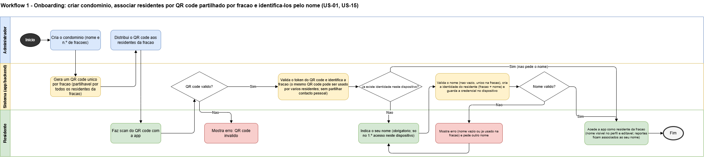
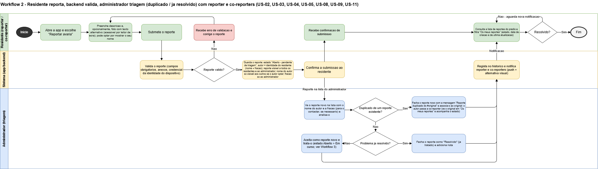
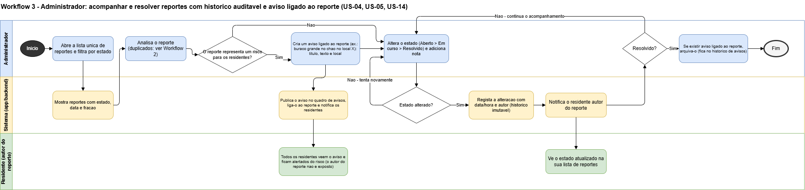
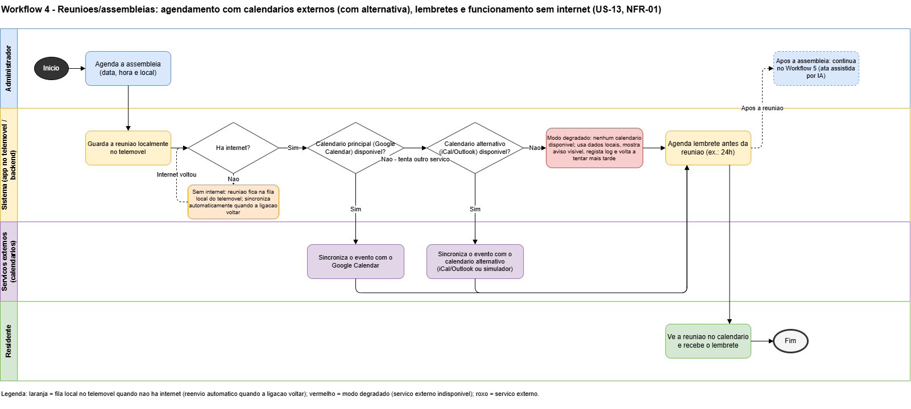
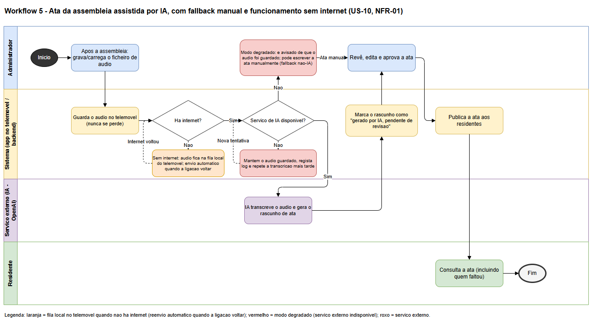
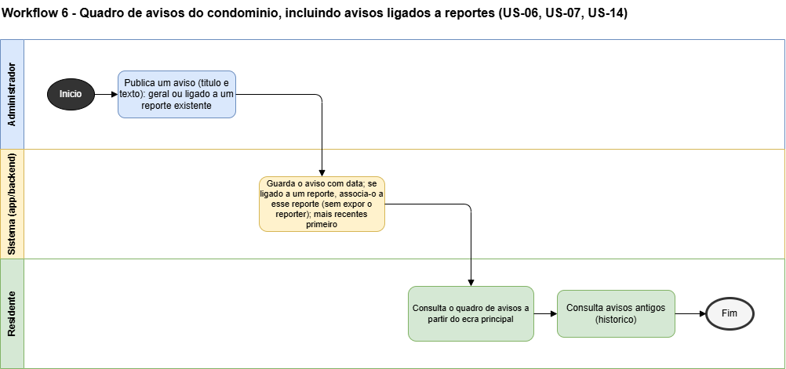

# Sprint A - Descoberta, Validação e Design

## Índice
- [0. Processo e Metodologia de Equipa](#0-processo-e-metodologia-de-equipa)
- [1. Relatório de Problema e Oportunidade](#1-relatório-de-problema-e-oportunidade)
- [2. Análise de Mercado e Concorrência](#2-análise-de-mercado-e-concorrência)
- [3. Investigação de Utilizadores](#3-investigação-de-utilizadores)
- [4. Rascunho de Requisitos](#4-rascunho-de-requisitos)
- [5. Product Vision](#5-product-vision)
- [6. Product Backlog](#6-product-backlog)
- [7. Responsible AI Opportunity Assessment](#7-responsible-ai-opportunity-assessment)
- [8. Technical Design](#8-technical-design)
- [9. Architecture Decision Records](#9-architecture-decision-records)
- [10. Security and Privacy Assessment](#10-security-and-privacy-assessment)
- [11. Walking Skeleton](#11-walking-skeleton)

---

## 0. Processo e Metodologia de Equipa

### Metodologia
Scrum, com sprints alinhados com o enunciado (Sprint 1/2/3), dailies curtas, sprint review com os docentes (investidores) no fim de cada sprint e retrospetiva da equipa.

### Controlo de versões (Git) - GitHub Flow
- `main` é a branch de produção, sempre estável; nunca se commita diretamente.
- Uma branch curta por funcionalidade/tarefa, integrada em `main` por PR após code review.
- Mensagem de commit: `[#<id>] - <descrição>` (ex.: `[#12] - Adiciona formulário de reporte de fuga de água`), onde `#<id>` é a issue associada.

### Gestão de issues
GitHub Issues/Projects; cada issue é referenciada nos commits e PRs.

### Papéis da equipa
5 membros, 6 papéis (um membro acumula dois). Todos programam frontend e backend; a tabela indica só a responsabilidade **adicional** de cada papel.

| Papel | Responsabilidade adicional |
|---|---|
| Product Owner / PM | Product Backlog, prioridades, contacto com os docentes (investidores) |
| Business Analyst | Requisitos, pesquisa de mercado e de utilizador |
| QA | Estratégia e execução de testes |
| DevOps / Scrum Master | Pipeline de CI/CD, facilitação do processo ágil |
| Backend Developer | Lógica, bases de dados e APIs |
| Frontend Developer | Parte visual e interativa da app |

### Definition of Ready (DoR)
Uma User Story entra num sprint quando: tem critérios de aceitação claros e testáveis; não depende de outra tarefa; está estimada pela equipa; o seu valor é compreendido por todos sem ambiguidade.

### Definition of Done (DoD)
Uma User Story está concluída quando: o PR foi revisto e aprovado por pelo menos 1 pessoa; a CI passa (build, testes automatizados, linting/análise estática); tem testes automatizados relevantes; está integrada em `main`; a documentação foi atualizada; cumpre os critérios de aceitação.

---

## 1. Relatório de Problema e Oportunidade

### Comunidade-alvo
Moradores de prédios de habitação multifamiliar autogeridos em Portugal (propriedade horizontal), tipicamente com 8 a 60 frações e administrador eleito entre os condóminos (não uma empresa de gestão).

- **Utilizadores primários:** condóminos (proprietários e inquilinos) e administrador.
- **Beneficiários secundários:** comissão de condóminos, prestadores de manutenção (canalizador, eletricista, elevadores), porteiro/funcionário.

### Problema
Os problemas do edifício (fuga de água, luz fundida, elevador avariado) coordenam-se por grupo de WhatsApp ou posters no prédio. Consequências, que se agravam com o tempo:
- Mensagens perdem-se no meio de conversa não relacionada.
- Sem estado do reporte: reportes repetidos, incerteza sobre o que já foi tratado, e avarias simples que se agravam (ex.: fuga de água que causa danos estruturais e custos muito maiores).
- Sem histórico auditável: o administrador não prova diligência e fica exposto a risco legal/de seguro (ex.: queda por avaria não resolvida).
- O administrador é um voluntário sem ferramentas: desgaste, perda de confiança dos condóminos e dificuldade em encontrar quem aceite o cargo.
- Posters ficam desatualizados, são removidos ou não chegam a quem raramente passa pelo hall.
- Decisões de assembleia não chegam a quem falta; a informação passa "de boca em boca", distorcida e incompleta, sem ata centralizada, o que reduz a transparência e aumenta conflitos.
- Privacidade fraca: os números de telefone de todos ficam expostos ao grupo.

### Mapa de stakeholders
| Stakeholder | Relação com o produto |
|---|---|
| Condómino (proprietário/inquilino) | Utilizador principal: reporta e acompanha; identifica-se pelo nome (por omissão visível só ao administrador) |
| Administrador do condomínio | Utilizador principal: triagem, atribuição, fecho |
| Comissão de condóminos | Supervisiona o administrador; consulta histórico/relatórios |
| Prestadores de manutenção | Utilizador indireto (fora do MVP) |
| Funcionário/porteiro | Reportador secundário, em nome de residentes |
| Seguradora | Beneficiário indireto do histórico (prova de diligência) |
| Município/fornecedores de utilities | Fora do MVP; escalonamento futuro |

### Evidência do problema

A evidência qualitativa foi recolhida através da observação de três publicações em fóruns públicos portugueses no Reddit (subreddits r/TudoCasa e r/tudoCondominio), consultadas em outubro de 2026. Os posts foram encontrados através de pesquisa por termos como "condomínio problema", "gestão condomínio app" e "empresa condomínio não responde". Não foi possível contactar os autores; toda a evidência é anónima e de observação.

| Fonte | Perfil do autor | Problemas relatados | Relevância |
|---|---|---|---|
| [r/TudoCasa — "Problema com empresa de gestão do condomínio"](https://www.reddit.com/r/TudoCasa/comments/1pnxai2/problema_com_empresa_de_gest%C3%A3o_do_condom%C3%ADnio/) | Condómino afetado por infiltração num prédio com empresa profissional | Avaria sem resolução durante meses; empresa não devolve datas; buraco na parede deixado aberto; morador questiona negligência legal da empresa | Valida: avaria que se agrava por falta de acompanhamento; ausência de estado do reporte; risco legal/de seguro para o responsável |
| [r/tudoCondominio — "App / software recomendado para gestão do condomínio"](https://www.reddit.com/r/tudoCondominio/comments/1w9wv5z/app_software_recomendado_para_gest%C3%A3o_do_condominio/) | Administrador voluntário sem empresa, a gerir o próprio prédio "em part-time" | Vizinhos que "nunca recebem" avisos nem convocatórias; procura apps acessíveis a não-profissionais; preço é critério crítico; a maioria das apps é pensada para empresas | Valida: persona do administrador voluntário; problema de decisões que não chegam a todos; gap de mercado para gestão interna sem empresa |
| [r/tudoCondominio — "Condomínio não presta e moradores não se importam"](https://www.reddit.com/r/tudoCondominio/comments/1smgg9c/condom%C3%ADnio_n%C3%A3o_presta_e_moradores_n%C3%A3o_se_importam/) | Moradora com empresa profissional de gestão | E-mails sem resposta durante 2 meses; obras de 20.000€ mal executadas sem prestação de contas; reuniões inexistentes ou sem quórum; administrador sem provas do trabalho feito | Valida: ausência de histórico auditável; comunicação que falha; baixo envolvimento dos moradores; risco de responsabilidade do gestor |

**Padrão identificado nas três fontes:**
- A comunicação sobre avarias e decisões depende de canais informais (e-mail, telefone, presença física) sem estado nem histórico, em contextos tanto de administração profissional como voluntária;
- A ausência de rastreabilidade cria riscos legais para o responsável pela gestão e frustração nos moradores;
- Os administradores voluntários não encontram ferramentas adequadas ao seu contexto (baixo orçamento, gestão a tempo parcial, sem formação técnica).

**Limitações desta evidência:**
- Amostra de conveniência: três publicações anónimas em fóruns públicos do Reddit, sem representatividade estatística;
- Os posts descrevem maioritariamente condomínios com empresa profissional, enquanto o produto foca condomínios autogeridos — os problemas de comunicação e rastreabilidade são comuns a ambos os contextos, mas a sua intensidade no contexto autogerido não está diretamente demonstrada;
- Os resultados do questionário distribuído pela equipa (Google Forms) ainda não estão disponíveis; quando estiverem, esta secção será atualizada com dados primários.

### Pressupostos e riscos

**Pressupostos:**
- A maioria dos residentes tem smartphone e internet suficiente.
- Existe sempre pelo menos um administrador (exigência legal em Portugal); o primeiro cria o condomínio e gera os QR codes das frações, e pode convidar outros administradores com as mesmas permissões (US-19).
- Os residentes aceitam indicar o nome (por omissão visível só ao administrador), para que este os possa contactar.
- O QR code é partilhado pela fração e só associa a fração à identidade criada no primeiro acesso (nome + dispositivo, um dispositivo por pessoa). O nome é autodeclarado e não verificado ([ADR-001](#adr-001-identidade-por-qr-code-partilhado-da-fração-e-nome-autodeclarado)).
- Um único prédio é "comunidade" suficiente para gerar valor.

**Riscos e mitigações** (cada risco liga a um pressuposto ou problema acima):

| Risco | Mitigação |
|---|---|
| Custo de mudança do WhatsApp (grátis, já instalado) | Onboarding em segundos: QR code por fração, scan e nome |
| Residentes sem smartphone, pouco digitais ou idosos | Interface acessível; um vizinho ou o porteiro reporta por eles com a própria identidade |
| Residentes com deficiência visual ou auditiva | WCAG: leitor de ecrã, texto alternativo nas fotos, alternativas não sonoras às notificações |
| Administrador sente perda de controlo | Posicionar como redução de esforço, não canal extra a vigiar |
| Dados pessoais mal geridos ou guardados sem necessidade | Guardar só fração e nome; retenção limitada (RGPD) |
| QR code divulgado a terceiros | Token aleatório; o administrador revoga/regenera o QR code e remove identidades (US-01, US-09) |
| Nome duplicado ou a fazer-se passar por outro | Nome único por fração; o administrador remove identidades indevidas. Risco aceite como baixo: a fração fica sempre registada ([ADR-001](#adr-001-identidade-por-qr-code-partilhado-da-fração-e-nome-autodeclarado)) |
| Residentes recusam indicar o nome | Finalidade explicada no ecrã; só o nome é pedido |
| Reportes visíveis a todos expõem dados de terceiros | Aviso no formulário; autor oculto por omissão |

---

## 2. Análise de Mercado e Concorrência

TODO: adicionar dados/fontes/evidências da pesquisa.

*Método: sites oficiais dos principais produtos (setembro 2026) + observação direta. Dados de lojas de apps e datas de lançamento a validar antes da entrega final.*

**Achado principal:** as soluções existentes (TownSq, Condo Control, Buildium a nível internacional; Gecond, SolidSoft GC, GOcondomínios em Portugal) giram à volta da **gestão de dinheiro** (quotas, contabilidade, pagamentos) e da **governança** (votações, atas), não da **gestão de problemas/informação do dia a dia**. É esse o espaço da nossa app.

### 2.1 Quadro comparativo de alternativas e concorrentes

| Alternativa | Utilizadores-alvo e modelo | Pontos fortes | Pontos fracos | Diferenciação da nossa proposta |
|---|---|---|---|---|
| **WhatsApp/Messenger, posters, papel** | Qualquer grupo; gratuito | Adoção imediata, custo zero; papel acessível a não-digitais | Mensagens perdem-se, sem estado nem histórico; posters desatualizam; telefones expostos ao grupo | Reportes com estado, dono e histórico, sem perder a simplicidade do chat |
| **Software de gestão profissional** (GOcondomínios, GCondomPro, SolidSoft GC; int.: TownSq, Condo Control, Buildium) | Administradores profissionais; SaaS B2B por nº de frações | Robustez legal/financeira, documentação centralizada | Caro e complexo para 1 prédio; foco em dinheiro/governança; curva de aprendizagem íngreme | Coordenação do dia a dia, com onboarding e preço para 1 prédio |
| **Plataformas comunitárias genéricas** (redes de vizinhança) | Vizinhança em geral; grátis, publicidade geolocalizada | Sentido de comunidade, recomendação de prestadores | Sem administrador nem tickets/estado; orientada a engajamento; privacidade moderada/baixa | Estrutura à volta do edifício, com administrador e reportes com estado |
| **Tickets de manutenção** (UpKeep, Fixflo) | Facility managers, senhorios; SaaS B2B por ativo | SLA, despacho de fornecedores, manutenção preventiva | Sem dimensão comunitária; formulários técnicos; sem privacidade entre vizinhos | Reporte em segundos, sem formação técnica nem contrato |
| **Gecond** ("o meu condomínio") | Condóminos cujo administrador já é cliente; B2B2C | Votação antecipada + registo de avarias | Só por convite; avaliação 1,7/5 nas lojas; experiência inconsistente | Adotável diretamente por qualquer administrador voluntário |
| **My LDC** (Loja do Condomínio) | Condóminos e administrador; gratuito | Transparência; referência MB para pagamentos | Sem atualizações desde 2017 (possível abandono, a validar); sem política de privacidade pública | Mesma transparência, com manutenção ativa e reportes com estado |
| **Unitify** (smart building) | Administradoras profissionais e novos empreendimentos; Multibanco/MB WAY + Stripe | UX moderna, pagamentos, foco em Portugal | Exige hardware (controlo de acesso, intercomunicadores) | Sem hardware, adotável por qualquer prédio de baixo orçamento |

### 2.2 Conclusão e oportunidade de diferenciação

Não existe em Portugal um produto pensado para o administrador voluntário de um prédio pequeno/médio autogerido: os concorrentes assumem administração profissional (Gecond), pacote financeiro pesado (software profissional) ou hardware (Unitify). O WhatsApp ganha por defeito, por ser a única opção com fricção zero.

**Oportunidades de diferenciação:**
1. Gestão de problemas/informação do dia a dia, não de dinheiro ou governança.
2. Foco no residente (reportar em segundos), não no gestor/contabilidade.
3. Zero-configuração para um prédio, sem terceiros nem hardware.
4. Privacidade por desenho: reportes visíveis a todos para acompanhamento coletivo, sem expor contactos nem o autor (salvo se este escolher mostrar o nome).

### 2.3 Proposta de Valor

> Para administradores voluntários e condóminos de prédios autogeridos em Portugal (propriedade horizontal), que hoje coordenam avarias e avisos por grupos de WhatsApp caóticos ou posters desatualizados, o [Nome do Produto] é uma app de gestão de problemas e comunicação de condomínio que transforma conversas dispersas em reportes estruturados com estado, dono e histórico. Ao contrário do software profissional (contabilidade e governança) e das soluções smart building (hardware), é gratuito/low-cost, de configuração imediata para um prédio, desenhado para o residente e com privacidade por desenho (sem telefones nem perfis além do essencial).

---

## 3. Investigação de Utilizadores

### Método
1. **Inquérito online** (Google Forms, rede da equipa e grupos de Facebook/Reddit de moradores), ver questionário abaixo.
2. **Reviews de apps concorrentes** no Google Play e App Store (Gecond, "o meu condomínio", SolidSoft GC, My LDC): padrões de queixas e elogios.
3. **Observação informal**: membros da equipa vivem ou têm familiares em prédios autogeridos (grupos saturados, posters rasgados, administrador contactado por SMS/chamada).

### Questionário

**A - Perfil**
1. Papel no condomínio *(Proprietário residente / Inquilino / Administrador / Outro)*
2. Nº aproximado de frações *(<8 / 8-30 / 31-60 / >60)*
3. Administração *(Profissional / Condómino voluntário / Não sei)*

**B - Comunicação atual**
4. Como comunica avarias *(WhatsApp/Messenger / Poster / Contacto direto / E-mail / App dedicada / Outro)*
5. Frequência de reportes *(Nunca / 1-2x/ano / 3-6x/ano / >6x/ano)*
6. Fica a saber se foi resolvido? *(Sempre / Às vezes / Raramente / Nunca)*

**C - Frustrações (1 = nada, 5 = muito)**
7. "As minhas mensagens perdem-se no grupo."
8. "Não sei se o problema que reportei vai ser tratado."
9. "O mesmo problema é reportado várias vezes."
10. "Não fui avisado/a sobre decisões ou assembleias."
11. "O meu telefone fica exposto a todo o grupo."
12. "Os avisos em papel estão desatualizados."

**D - Adoção**
13. Usaria uma app dedicada ao condomínio? *(Sim, definitivamente / Provavelmente sim / Provavelmente não / Definitivamente não)*
14. Fator mais importante *(Rapidez / Privacidade / Preço / Vizinhos também usarem / Outro)*
15. Maior inibidor *(Mais uma app / Vizinhos mais velhos não usam / Privacidade / O WhatsApp chega / Outro)*
16. Disposição a pagar por fração/mês, sem publicidade *(Nada / Até 0,50 € / Até 1 € / Até 2 € / Mais de 2 €)*

**E - Aberta**
17. Descreva uma situação em que a comunicação no seu condomínio falhou.

### Resultados
> *A aguardar resultados do inquérito.*

### Limitações
> *A aguardar resultados do inquérito.*

### Decisões de produto resultantes
> *A aguardar resultados do inquérito.*

---

## 4. Rascunho de Requisitos

Primeira lista de funcionalidades (por epic) e requisitos não funcionais, resultante dos capítulos [2](#2-análise-de-mercado-e-concorrência) e [3](#3-investigação-de-utilizadores). Faz a ponte para a visão de produto ([capítulo 5](#5-product-vision)) e será refinada em user stories no Product Backlog ([capítulo 6](#6-product-backlog)) após validação com os docentes.

A lista completa vive em [docs/requisitos.md](../requisitos.md), com **versão** e **estado** (Draft, In Review, Approved) por requisito.

**Epics propostos:**
- **Gestão de avarias:** reportar, estado, histórico do prédio, notificações, duplicados, seguir reportes.
- **Comunicação e governança:** mural de avisos, calendário, aviso ligado a reporte, indicador de progresso.
- **Privacidade e confiança:** reportes visíveis a todos com autor oculto por omissão; identificação pelo nome via QR code da fração; gestão de identidades e QR codes pelo administrador.
- **Não funcionais:** rapidez, acessibilidade, minimização de dados, controlo de acesso, observabilidade, resiliência (offline e serviços externos).

---

## 5. Product Vision

### 5.1. Personas

- **Administrador Voluntário** ("Rui", 58, eleito em assembleia): gere o prédio nas horas livres, sem ferramentas. Tem dificuldade em triar problemas e em provar diligência perante os outros. Precisa de gerir ocorrências e registar o histórico de decisões e reparações.
- **Condómina Residente Ocupada** ("Marta", 34, proprietária): trabalha fora, acompanha o grupo de forma intermitente e falta a assembleias. Quer reportar em segundos e saber o estado sem perguntar a ninguém.
- **Inquilino/Residente Recente** ("Tiago", 25, inquilino): raramente passa pelo hall, não conhece os vizinhos nem está no grupo. Quer só os avisos que lhe dizem respeito e reportar sem expor o telefone. Só sabe das avarias e decisões depois de o afetarem.
- **Condómina Sénior Pouco Digital** ("D. Amélia", 76, proprietária): telemóvel básico, confia no papel e no contacto presencial. Quer continuar informada e comunicar problemas sem tecnologia que não domina. Sente-se excluída pelos posters desatualizados e pelo "boca em boca".

### 5.2. Proposta de Valor

- Para administradores voluntários e condóminos de prédios autogeridos, a plataforma transforma a gestão do dia a dia de fonte de stress em processo simples e colaborativo.
- Em vez de ferramentas genéricas onde as mensagens se perdem, estrutura a comunicação em reportes com estado, responsável e histórico auditável, e leva avisos e decisões de assembleia a todos, incluindo quem falta ou raramente passa pelo hall.
- Deixa deliberadamente de fora a contabilidade e a gestão financeira; foca-se na resolução rápida dos problemas e na privacidade, sem hardware nem custos de adoção.

**Valor por persona:**

| Persona | Valor principal |
|---|---|
| Administrador Voluntário | Menos esforço de triagem e um histórico que prova diligência |
| Condómina Residente Ocupada | Reportar em segundos e saber o estado sem perguntar |
| Inquilino / Residente Recente | Receber os avisos relevantes e reportar sem expor o telemóvel |
| Condómina Sénior Pouco Digital | Não ficar excluída, com um vizinho ou o porteiro a reportar e consultar por si |

### 5.3. User Journey

Cada jornada é um workflow em diagrama de atividade com raias por ator ([workflows.drawio](workflows.drawio)), ligado às user stories do backlog.

- **Onboarding do condomínio (Workflow 1, US-01, US-15):** o administrador cria o condomínio (nome, nº de frações) e a app gera um QR code único por fração, partilhado pelos residentes dessa fração. Cada residente faz scan: se o QR code é válido e o dispositivo não tem identidade, a app pede o nome (único na fração) e guarda a identidade no dispositivo, sem pedir contactos; se já existe identidade, não volta a pedir. QR code inválido ou revogado mostra erro.

<!-- TODO (equipa): reexportar o SVG a partir de workflows.drawio (páginas 1 e 2 foram alteradas para incluir o nome do residente) -->

- **Reportar e acompanhar uma avaria (Workflow 2, US-02, US-03, US-04, US-05, US-08, US-09, US-11):** o residente descreve o problema e junta, opcionalmente, uma fotografia com texto alternativo. O backend valida (campos obrigatórios, anexos, identidade); se inválido, o residente corrige. O reporte válido fica "Aberto", com o residente como autor, visível a todos (o autor só ao administrador, ou a todos se o residente escolher mostrar o nome), e a submissão é confirmada. O administrador vê o reporte com nome e fração e decide: duplicado, fecha-o com "Reporte duplicado do #<id>" e o autor passa a co-reporter do original (que aparece em "Os meus reportes"); já resolvido, fecha-o como "Resolvido" com nota; caso contrário, aceita-o e trata-o (Workflow 3). Cada decisão vai para o histórico e notifica reporter e co-reporters (push com alternativa visual). Os residentes consultam a lista de reportes (filtro "Os meus reportes") com estado, data de criação e última atualização, e podem seguir um reporte para receber notificações (autores e co-reporters seguem automaticamente).

- **Acompanhar e resolver reportes (Workflow 3, US-04, US-05, US-14):** o administrador filtra a lista por estado e analisa cada reporte. Se há risco para os residentes, cria um aviso ligado ao reporte (título, texto, local), publicado no quadro de avisos e notificado a todos, sem expor o autor. Altera o estado (Aberto, Em curso, Resolvido) e acrescenta uma nota. Cada alteração fica num histórico imutável com data, hora e autor, e o residente é notificado. Quando o reporte é resolvido, o aviso ligado é arquivado no histórico de avisos.

- **Agendar assembleias e lembretes (Workflow 4, US-13, US-18):** o administrador agenda a assembleia (data, hora, local), guardada localmente no telemóvel. Sem internet, fica em fila e sincroniza quando a ligação voltar. Com internet, o backend publica a reunião no serviço de calendário externo (simulador) e no feed iCal do condomínio, que os residentes subscrevem na app de calendário que já usam. Se o serviço externo falhar, a reunião continua disponível pelo iCal; sem nenhum, a app entra em modo degradado: usa os dados locais, mostra um aviso, regista o erro e tenta mais tarde. A app agenda no telemóvel um lembrete antes da reunião (ex.: 24 horas).

- **Ata da assembleia assistida por IA (Workflow 5, US-10, US-18):** o administrador grava ou carrega o áudio, guardado no telemóvel e, sem internet, em fila local. Com o serviço de IA disponível, este gera a transcrição e um rascunho de ata marcado como "gerado por IA, pendente de revisão". O administrador revê, edita e aprova; só então a ata é publicada aos residentes, incluindo quem faltou. Com o serviço indisponível, o áudio mantém-se guardado, a transcrição é repetida mais tarde e o administrador é avisado e pode escrever a ata manualmente.

- **Quadro de avisos (Workflow 6, US-06, US-07, US-14):** o administrador publica um aviso, geral ou ligado a um reporte, sem expor o reporter. Os residentes consultam o quadro a partir do ecrã principal, com os mais recentes primeiro, e os antigos no histórico.

### 5.4. Critérios de Sucesso

> Projeto académico: o produto não será lançado nem testado com utilizadores externos. Os critérios são verificados pela equipa com testes automatizados (unitários, integração, end-to-end), cenários de demonstração com dados sintéticos, testes de carga e acessibilidade, e avaliação de usabilidade. Mostram que o produto cumpre o que foi desenhado, não que utilizadores reais beneficiam dele. Tempos medidos pela equipa refletem utilizadores experientes e são apenas indicativos.

| Critério | Meta | Verificação |
|---|---|---|
| **Velocidade e eficiência** | Reportar qualquer problema em menos de 1 minuto, mesmo com internet fraca; hipótese de no máximo 5 interações (a fixar no protótipo) | Teste end-to-end com rede lenta simulada e orçamento de tempo definido; cronometragem pela equipa, indicativa |
| **Valor com utilização mínima** | Valor imediato só com o administrador e alguns residentes | Cenário com prédio fictício (dados sintéticos): jornadas de reporte e triagem concluem-se sem mais utilizadores; criar o prédio e convidar residentes em poucos passos. Adoção real por % de frações fica como hipótese |
| **Privacidade nativa e retenção** | RGPD; reportes visíveis a todos mas nome do autor só ao administrador (ou a todos, por escolha); só o nome é recolhido | Testes automatizados de autorização; período de retenção (incluindo áudios) com teste automatizado; só dados sintéticos |
| **Redução do ruído comunicacional** | Nenhum duplicado em aberto; fim da incerteza sobre o que já foi tratado | Testes de integração: duplicado fica ligado ao original, autor passa a co-reporter, ambos notificados; cenário com guião a procurar uma avaria numa conversa de WhatsApp simulada com ruído vs na lista de reportes (nº de passos, ambiguidade) |
| **Transparência do estado** | Cada reporte tem sempre estado atualizado e visível a todos | Testes de integração: 100% das mudanças de estado geram entrada no histórico e notificação ao residente e seguidores; tempo de entrega medido, alvo a definir no Technical Design |
| **Capacidade de resposta do administrador** | Menos esforço de triagem | Cenário com guião: um membro no papel de administrador tria o mesmo conjunto de reportes no WhatsApp simulado e na app (passos, tempo, reportes esquecidos/mal classificados); indicativo |
| **Alcance das decisões e avisos** | Convocatórias, atas e avisos chegam a quem faltou | Testes automatizados: cada publicação fica acessível a todos e gera notificação; cenário com guião a localizar uma decisão no quadro de avisos vs no WhatsApp simulado |
| **Inclusão e acessibilidade** | Pouco digitais e pessoas com limitações de visão/audição não ficam excluídos | Ferramentas automáticas de acessibilidade + verificação manual com leitor de ecrã e teclado (WCAG 2.1 AA); um vizinho conclui o reporte por outro com a própria identidade; avaliação heurística (Nielsen) |
| **Fiabilidade e degradação controlada** | O produto continua útil quando algo falha | Testes de resiliência com falhas injetadas: IA em baixo (áudio preservado, ata manual), serviço de calendário em baixo (iCal como alternativa, depois modo degradado com aviso), sem internet (fila local e sincronização); disponibilidade e latência p95 da submissão sob carga em ambiente containerizado, valores a definir no Technical Design |
| **Qualidade da ata assistida por IA** | Rascunho útil e fiável, nunca publicado sem aprovação humana | Assembleias simuladas gravadas pela equipa a partir de guiões, comparadas com ata de referência: % de decisões captadas, nº de informações inventadas, taxa de erro de palavras, tempo de processamento (critérios de aceitação a fixar em [7.4](#74-abordagem-de-avaliação)); ata manual como baseline; teste automatizado confirma bloqueio de publicação enquanto "pendente de revisão" |

---

### 5.5. Mecanismo de participação ética

O enunciado (5.5) pede pelo menos um mecanismo que incentive a participação construtiva, e que se responda a cinco perguntas sobre ele. O nosso é o **indicador de progresso do prédio** (US-16, RF-12): a app mostra quantos reportes foram resolvidos e quantos estão abertos no período atual.

| Pergunta | Resposta |
|---|---|
| Que comportamento incentiva? | Reportar avarias em vez de as deixar passar, e confiar que o reporte leva a resolução. |
| Porque beneficia o residente e a comunidade? | Avarias reportadas cedo custam menos (ver [capítulo 1](#1-relatório-de-problema-e-oportunidade)); ver resolvidos a subir mostra que reportar compensa e que a resolução é um esforço coletivo. |
| Como se evita manipulação? | Só valores agregados, sem nomes, frações, pontos, rankings nem comparações entre residentes; fechar reportes sem os resolver não compensa ao administrador, porque o histórico (US-05) fica visível e a comissão pode auditá-lo (US-12). |
| Pode excluir, expor ou desencorajar alguém? | Não expõe ninguém, porque nada é individual. Pode desencorajar se os abertos crescerem sem resolução; por isso o indicador é por período e não acumulado. |
| Como se controla ou desliga? | O residente oculta o indicador nas definições; os valores são acessíveis a leitores de ecrã. |

Pontos, badges e leaderboards ficam de fora de propósito: num prédio de 8 a 60 frações, comparações entre vizinhos geram mais conflito do que participação.

---

## 6. Product Backlog

O Product Backlog completo (MoSCoW, pontos, critérios de aceitação, estado Draft/In Review/Approved) está em [docs/backlog.md](../backlog.md). As histórias "Must have" materializam a [proposta de valor](#23-proposta-de-valor): reportes com estado, dono e histórico, com privacidade por desenho.

### 6.1 Objetivos dos sprints

> As user stories de cada sprint estão no [plano de release](../backlog.md#2-plano-de-release-inicial-visão-multi-sprint).

- **Sprint A (Descoberta, Validação e Design):** validar que o problema é relevante e que o MVP é o experimento mais pequeno credível; entregar o Walking Skeleton (versão mínima ponta a ponta).
- **Sprint B (Construir e operar a fatia vertical):** jornada principal (reportar e acompanhar uma avaria) operacional, com autenticação (mock aceitável), persistência, pelo menos um workflow assíncrono, primeira versão da IA com fallback não-IA, primeira integração externa e demonstração de pelo menos uma condição de falha, como exige o enunciado. Detalhe no [Sprint B Backlog](../sprintB/backlog.md), confirmado contra a Definition of Ready.
- **Sprint C (Avaliar, consolidar e apresentar):** robustecer e avaliar o que existe, consolidar a avaliação formal da IA e do cenário de degradação, preparar a apresentação final.

### 6.2 Plano de release inicial

Ver [docs/backlog.md](../backlog.md#2-plano-de-release-inicial-visão-multi-sprint).

---

## 7. Responsible AI Opportunity Assessment

### 7.1 Fluxo assistido por IA
Transcrição e rascunho de ata (US-10, Workflow 5): o administrador carrega o áudio, o serviço de IA gera transcrição e rascunho marcado como "gerado por IA, pendente de revisão"; o administrador revê, edita e aprova antes da publicação. Serviço/modelo: TODO (equipa).

### 7.2 Valor esperado
Poupa ao administrador voluntário a tarefa morosa de escrever a ata e leva as decisões a quem faltou ([capítulo 1](#1-relatório-de-problema-e-oportunidade)).

### 7.3 Riscos e mitigações

| Risco | Mitigação |
|---|---|
| Transcrição ou ata com erros ou informação inventada | Rascunho marcado como IA, editável, aprovação humana obrigatória antes de publicar |
| Prompt injection (instruções ditas em voz alta no áudio) | O texto transcrito é só dados; a IA não tem acesso a ações nem a dados do condomínio |
| Divulgação indevida (vozes e nomes de várias pessoas) | Aviso aos presentes antes de gravar; retenção limitada do áudio; acesso só do administrador |
| Conteúdo impróprio ou difamatório na ata | Revisão e aprovação do administrador antes da publicação |
| Viés (sotaques, nomes próprios, idosos a falar baixo) | Casos difíceis no conjunto de avaliação, medidos separadamente |

### 7.4 Abordagem de avaliação

| Aspeto | Definição |
|---|---|
| Finalidade | Rascunho útil para o administrador rever, nunca documento final |
| Entradas | Assembleias simuladas, gravadas pela equipa a partir de guiões com decisões conhecidas (sem dados reais) |
| Casos difíceis | Ruído, vozes sobrepostas, sotaques, nomes próprios e valores monetários, decisões revogadas, prompt injection no áudio |
| Saídas esperadas | Ata de referência escrita pela equipa por guião |
| Medidas | % de decisões captadas, nº de informações inventadas por ata, taxa de erro de palavras |
| Critérios de aceitação | TODO |
| Latência | TODO: tempo máximo entre carregar o áudio e ter o rascunho |
| Custo | TODO: custo por hora de áudio do serviço escolhido |
| Limitações | Conjunto sintético e pequeno, falantes da equipa, sem assembleias reais |

### 7.5 Baseline e fallback
- **Baseline não-IA:** ata escrita manualmente (comparação de tempo e qualidade).
- **Fallback:** com a IA indisponível, o áudio fica guardado, a transcrição é repetida, o administrador é avisado (modo degradado, US-18) e pode publicar ata manual. A interface nunca apresenta conteúdo de IA como facto verificado (US-10).

---

## 8. Technical Design

Este capítulo conta como o produto funciona por dentro (diagramas em [technical-design.drawio](technical-design.drawio), uma página por vista), seguindo o caminho de um reporte e de uma ata desde o telemóvel até à base de dados e de volta. O objetivo é implementar uma app móvel com dois componentes backend independentes, uma única tecnologia de base de dados, um workflow assíncrono, uma integração externa, observabilidade e modo degradado. O desenho cobre o **sistema completo**, isto é, todas as user stories do [Product Backlog](../backlog.md). Cada escolha tecnológica tem a sua justificação numa ADR no [capítulo 9](#9-architecture-decision-records).

### 8.1 Contexto do sistema

Comecemos pelo exterior. Marta (a [persona da residente ocupada](#51-personas)) e Rui (o administrador) usam a mesma app móvel; o que cada um pode fazer depende da identidade com que entrou. A app fala com um backend nosso, e esse backend fala com dois sistemas fora dele: o serviço de IA que transcreve as assembleias e um serviço de calendário, que no projeto é um simulador realista (o que o enunciado aceita), complementado por um feed iCal que qualquer app de calendário subscreve. Não há fornecedor de push: as notificações são geradas no próprio telemóvel ([ADR-009](#adr-009-notificações-locais-por-sincronização-em-segundo-plano-sem-fornecedor-de-push)).

| Ator / sistema externo | Interação |
|---|---|
| Residente e administrador | Usam a mesma app; o papel vem da identidade do residente (US-15) ou da conta de administrador (US-01) |
| Serviço de transcrição / IA | Recebe o áudio da assembleia e devolve transcrição e rascunho de ata (US-10). Fornecedor ainda por escolher, ver [7.1](#71-fluxo-assistido-por-ia) |
| Serviço de calendário (simulador) | Container nosso que simula a API de um calendário externo, com falhas, atrasos e respostas inválidas configuráveis (US-13, [ADR-007](#adr-007-integração-de-calendário-por-simulador-e-feed-ical)) |
| App de calendário do residente | Google Calendar, Apple Calendar, Outlook ou outra: subscreve o feed iCal do condomínio publicado pela API (US-13) |

### 8.2 Vista de Containers

Dentro do backend há duas peças, não uma. A **API** responde aos pedidos da app no momento: criar um reporte, listar, mudar o estado. O **Worker** trata do que é lento ou depende de terceiros, como enviar um áudio para transcrição ou marcar uma reunião no calendário, e fá-lo em segundo plano, lendo tarefas de uma tabela que a API lhe deixa. Os dois partilham o mesmo código Python e a mesma base de dados PostgreSQL, mas arrancam como containers separados ([ADR-004](#adr-004-dois-componentes-backend-api-e-worker-com-base-de-dados-partilhada), [ADR-005](#adr-005-postgresql-como-única-base-de-dados-e-como-fila-de-jobs)).

| Container | Responsabilidade | Dono dos dados |
|---|---|---|
| **App móvel** (Flutter, demonstrada em Android) | Jornadas dos [Workflows 1 a 6](#53-user-journey); guarda a credencial do dispositivo; fila local SQLite para reportes, reuniões e áudios criados sem internet (US-18), enviados por ordem quando a ligação volta; sincronização em segundo plano que gera notificações locais (US-11) e agenda lembretes de reuniões (US-13) | Identidade local, fila local, preferências (ex.: ocultar indicador) |
| **API** (FastAPI) | Pedidos síncronos da app: autenticação por credencial de dispositivo, autorização no servidor ([10.2](#102-controlo-de-acessos)), validação, regras de negócio (duplicados, histórico, visibilidade do autor), escrita de jobs na tabela `job` | Condomínio, fração, QR code, identidade, reporte, histórico, aviso, reunião, ata (texto aprovado) |
| **Worker** (Python, mesmo repositório) | Consome a tabela `job`: transcrição de áudio e rascunho de ata, publicação de reuniões no serviço de calendário. Nunca é chamado pela app | `job`, `ata.transcricao` e `ata.rascunho`, estado de sincronização da reunião |
| **PostgreSQL** | Única base de dados; serve também de fila de jobs (outbox), o que evita um broker extra | - |
| **Volume de ficheiros** | Fotos de reportes (sem metadados EXIF, removidos pela API no upload) e áudios de assembleias, referenciados por caminho na base de dados; partilhado entre API e Worker | - |
| **Simulador de calendário** (container, FastAPI mínimo) | Faz de serviço de calendário externo: aceita eventos, devolve ids, e por configuração falha, atrasa ou devolve dados inválidos, para testes e para a demonstração de degradação | Eventos simulados (descartáveis) |

Três consequências desta separação, que o enunciado pede para justificar:

- **Comunicação.** App para API é síncrona (REST/JSON). API para Worker é assíncrona, pela tabela `job` ([8.5](#85-workflow-assíncrono)); o Worker não expõe endpoints além de `/health` e `/metrics`.
- **Acoplamento.** Os dois componentes partilham o esquema da base de dados e o código de domínio, por isso não evoluem o esquema de forma independente. Aceitamos isso por sermos 5 pessoas com um produto pequeno.
- **Falhas.** Se o Worker cair, a API continua a aceitar reportes e a enfileirar jobs, que são processados quando ele voltar. Se a API cair, a app usa a fila local. Se a base de dados cair, a API responde 503 e a app mantém os dados na fila local.

### 8.3 Modelo de dados

Agora o que fica guardado. A história começa num **condomínio**, criado por um **administrador** (que pode convidar outros), com as suas **frações**. Cada fração tem um **QR token** partilhável; quem o lê cria uma **identidade** (um nome e uma credencial no dispositivo). Com essa identidade, um residente cria **reportes**, cuja vida fica registada num **histórico** que nunca se apaga, e que outros residentes podem **seguir**. O administrador publica **avisos**, alguns ligados a reportes, e agenda **reuniões**; de cada reunião pode sair uma **ata**, que nasce de um áudio. Tudo o que é lento passa pela tabela **job**.

| Entidade | Campos principais | Notas |
|---|---|---|
| `condominio` | id, nome, n_fracoes, criado_em | |
| `administrador` | id, condominio_id, nome, credencial_hash, criado_em, removido_em | Um ou mais por condomínio, todos com as mesmas permissões (US-19); o último não pode ser removido. Autenticação mock no MVP ([ADR-008](#adr-008-autenticação-do-administrador-mock-no-mvp-autorização-real)); o controlo de acessos mantém-se |
| `convite_admin` | id, condominio_id, codigo_hash, criado_por, expira_em, usado_em | Código de uso único para um residente se tornar administrador (US-19) |
| `fracao` | id, condominio_id, designacao | |
| `qr_token` | id, fracao_id, token_hash, criado_em, revogado_em | Só o hash fica guardado; revogar cria um novo token e marca o antigo (US-01) |
| `identidade` | id, fracao_id, nome, nome_normalizado, papel, credencial_hash, criado_em, removida_em | `nome_normalizado` único por fração (sem maiúsculas, acentos, espaços) (US-15); `papel`: `residente` (por omissão) ou `comissao`, atribuído pelo administrador, dá leitura do relatório (US-12); remover apaga `nome` e preenche `removida_em` (US-09) |
| `reporte` | id, condominio_id, autor_id, descricao, foto_path, foto_alt, mostrar_nome, estado, duplicado_de_id, criado_em, atualizado_em | `estado`: `aberto`, `em_curso`, `resolvido`; um duplicado fecha com `duplicado_de_id` (US-04) |
| `reporte_historico` | id, reporte_id, estado_anterior, estado_novo, nota, autor_tipo, autor_id, criado_em | Só inserção; a aplicação nunca faz update nem delete (US-05); `autor_id` identifica qual administrador fez a mudança (US-19) |
| `reporte_seguidor` | reporte_id, identidade_id, tipo | `tipo`: `autor`, `co_reporter`, `seguidor` (US-04, US-17) |
| `aviso` | id, condominio_id, reporte_id (opcional), titulo, texto, local, publicado_em, arquivado_em | Arquivado quando o reporte ligado é resolvido (US-14) |
| `reuniao` | id, condominio_id, data_hora, local, calendario_externo_id, estado_sync, criado_em | `estado_sync`: `pendente`, `sincronizada`, `alternativo`, `degradado` (US-13) |
| `ata` | id, reuniao_id, audio_path, transcricao, rascunho, texto_aprovado, estado, aprovada_em | `estado`: `a_transcrever`, `pendente_revisao`, `falhou_transcricao`, `aprovada`; só se publica com `aprovada` (US-10) |
| `job` | id, tipo, chave_idempotencia, payload, estado, tentativas, proxima_tentativa_em, erro, criado_em | Outbox consumido pelo Worker ([8.5](#85-workflow-assíncrono)); `chave_idempotencia` única por tipo |

Sobre a vida destes dados: cada pedido à API corre numa transação, e o job é criado na mesma transação que a alteração de domínio, por isso não há job sem registo nem registo sem job. Entre API e Worker a consistência é eventual: a ata fica `a_transcrever` até o Worker terminar, e a app mostra isso. A retenção segue o definido em [10.4](#104-retenção): o áudio é apagado depois de a ata ser aprovada, uma identidade removida deixa os reportes como "Residente removido", e o prazo dos reportes ainda está por decidir. Para recuperação, um `pg_dump` diário do PostgreSQL e uma cópia do volume de ficheiros, com o restauro documentado no guia de deploy.

### 8.4 API (esboço)

A API é a porta por onde a app entra. É REST/JSON, documentada automaticamente em OpenAPI pelo FastAPI (`/docs`). Toda a chamada leva `Authorization: Bearer <credencial>`: a credencial do residente nasce no primeiro acesso (US-15) e a de um administrador na criação do condomínio ou ao usar um convite (US-19), ambas mock no MVP. Toda a resposta leva um `X-Request-ID`, que vai aparecer nos logs e nos jobs.

Lendo a tabela de cima para baixo, segue-se a ordem natural de uso: criar o condomínio, entrar com o QR code, reportar, acompanhar, triar, avisar, reunir e aprovar a ata.

| Método e rota | Quem | User Story |
|---|---|---|
| `POST /condominios` | sem auth (bootstrap) | US-01: cria condomínio, frações e QR codes; devolve a credencial do primeiro administrador |
| `POST /condominios/{id}/convites-admin` | admin | US-19: gera um código de uso único com validade |
| `POST /administradores` | sem auth (código de convite) | US-19: `{codigo, nome}` devolve credencial de administrador |
| `GET /condominios/{id}/administradores`, `DELETE /administradores/{id}` | admin | US-19: lista e remove; 409 ao tentar remover o último |
| `GET /condominios/{id}/fracoes` | admin | US-01: frações, QR codes e identidades por fração |
| `POST /fracoes/{id}/qr/regenerar` | admin | US-01: revoga e gera novo token |
| `DELETE /identidades/{id}` | admin | US-09: remove identidade |
| `POST /identidades` | sem auth (token do QR) | US-15: `{token, nome}` devolve credencial do dispositivo; limite de tentativas por IP e máximo de identidades por fração ([10.5](#105-qr-code-revogação-e-abuso)) |
| `PATCH /identidades/me` | residente | US-15: editar nome |
| `PUT /identidades/{id}/papel` | admin | US-12: `{papel: residente\|comissao}` |
| `POST /reportes` | residente | US-02: multipart com descrição, foto e `foto_alt`, `mostrar_nome`; a API remove os metadados EXIF da foto; aceita `Idempotency-Key` da fila local |
| `GET /reportes?filtro=todos\|meus\|a_seguir&estado=&atualizado_desde=` | residente / admin | US-03, US-04: a resposta ao residente nunca inclui fração nem nome (salvo `mostrar_nome`); `atualizado_desde` serve a sincronização em segundo plano (US-11) |
| `GET /reportes/{id}` | residente / admin | US-03: detalhe e histórico |
| `PATCH /reportes/{id}/estado` | admin | US-05: `{estado, nota}`; cria entrada no histórico; se `resolvido`, arquiva o aviso ligado (US-14) |
| `POST /reportes/{id}/duplicado` | admin | US-04: `{original_id}`; fecha e adiciona co-reporter |
| `POST /reportes/{id}/seguir`, `DELETE .../seguir` | residente | US-17 |
| `GET /progresso?periodo=mes` | residente / admin | US-16: só totais de resolvidos e abertos, sem nomes nem frações; a opção de ocultar o indicador é uma preferência local da app |
| `GET /relatorios/reportes?de=&ate=` | admin / comissão | US-12: histórico de reportes e estados num período, só leitura |
| `POST /avisos`, `GET /avisos?arquivados=` | admin / todos | US-06, US-07, US-14 |
| `POST /reunioes`, `GET /reunioes` | admin / todos | US-13: criar enfileira o job `publicar_calendario` |
| `GET /condominios/{id}/calendario.ics` | todos (token do condomínio no URL) | US-13: feed iCal com as reuniões, subscrito pela app de calendário do residente |
| `POST /reunioes/{id}/ata/audio` | admin | US-10: multipart; guarda o áudio e enfileira o job `transcrever` |
| `GET /reunioes/{id}/ata`, `PUT .../ata`, `POST .../ata/aprovar` | admin / todos (só aprovada) | US-10: ler, editar, aprovar e publicar |
| `GET /health`, `GET /metrics` | operação | [8.7](#87-observabilidade) |

Quando algo corre mal, a resposta tem sempre o mesmo formato, `{codigo, mensagem, request_id}`: 401 sem credencial, 403 sem permissão, 404 para recursos de outro condomínio (sem revelar que existem), 409 para nome duplicado na fração, 503 com `Retry-After` quando a base de dados está em baixo.

### 8.5 Workflow assíncrono

Voltemos ao Rui. A assembleia acabou, ele carrega o áudio e segue com a sua vida; não faz sentido ficar com a app aberta à espera de uma transcrição que pode demorar minutos. É por isso que a transcrição é assíncrona (US-10, [Workflow 5](#53-user-journey)). O mesmo mecanismo serve a sincronização de calendário (US-13) e o envio de notificações (US-11).

O enunciado pede que o workflow lide com retries, duplicados, falhas e consistência eventual. Eis como:

| Preocupação | Tratamento |
|---|---|
| Retries | Backoff exponencial (1, 2, 4, 8, 16 min), máximo 5 tentativas; depois `estado = falhou` e a ata fica `falhou_transcricao`, com aviso ao administrador, que pode reenviar o áudio ou escrever a ata à mão (US-18) |
| Eventos duplicados | `chave_idempotencia` única por tipo de job (ex.: `transcrever:ata_id`): um segundo upload para a mesma ata não cria segundo job; `SKIP LOCKED` evita que dois Workers peguem no mesmo job |
| Falhas | Worker em crash a meio: o lock da transação é libertado e o job volta a ficar pendente; jobs há mais de N minutos em `a_processar` são recuperados |
| Consistência eventual | A app mostra sempre o estado real da ata (`a_transcrever`, `pendente_revisao`, `falhou_transcricao`) e nunca mostra um rascunho como ata final |
| Observabilidade | Cada job regista o `request_id` de origem, tentativas, duração e erro; métricas `jobs_pendentes`, `jobs_falhados_total`, `job_duracao_segundos` por tipo |

O mesmo mecanismo e as mesmas regras servem o job `publicar_calendario` (US-13): criado na transação de `POST /reunioes`, com chave `publicar_calendario:{reuniao_id}`, consumido pelo Worker que chama o serviço de calendário ([8.6](#86-integração-externa)).

As **notificações** (US-11, US-17) não passam pelo Worker nem por nenhum fornecedor externo. A app corre uma tarefa periódica em segundo plano (plugin `workmanager`, de 15 em 15 minutos no Android, o mínimo que o sistema permite) que chama `GET /reportes?filtro=a_seguir&atualizado_desde=<última sincronização>` e, para cada reporte cujo estado mudou, gera uma notificação local com o número do reporte e o novo estado (`flutter_local_notifications`). O lembrete de reunião (US-13) usa o mesmo plugin: quando uma reunião chega à app, agenda-se uma notificação local para 24 horas antes. O custo é o atraso de até 15 minutos; o ganho é não haver projeto Firebase, token de dispositivo, segredo no servidor nem dados pessoais a passar por terceiros ([ADR-009](#adr-009-notificações-locais-por-sincronização-em-segundo-plano-sem-fornecedor-de-push)).

### 8.6 Integração externa

O sistema tem duas integrações externas, ambas chamadas só pelo Worker: o **serviço de calendário** (US-13) e o **serviço de IA** (US-10). O enunciado exige pelo menos uma integração "com um sistema externo ou um simulador realista de um sistema externo"; a de calendário é a que descrevemos em detalhe ([Workflow 4](#53-user-journey), [ADR-007](#adr-007-integração-de-calendário-por-simulador-e-feed-ical)). O Worker chama uma interface `CalendarProvider`, com três níveis tentados por ordem:

1. `ServicoCalendarioProvider`: cliente HTTP do simulador de calendário, um container nosso que imita a API de um serviço externo (criar evento, devolver id) e que, por configuração, falha, atrasa ou devolve datas inválidas. É contra ele que se demonstra a condição de falha pedida no Sprint 2;
2. `IcsProvider`: a reunião entra no feed iCal do condomínio (`GET /condominios/{id}/calendario.ics`), que os residentes subscrevem uma vez no Google Calendar, Apple Calendar ou Outlook. Não depende de rede do lado do servidor, por isso serve de alternativa quando o serviço externo falha;
3. nenhum: a reunião mantém-se na app com os dados locais e `estado_sync = degradado`.

As regras são as mesmas para todas as chamadas externas (calendário e IA): timeout de 10 s; validação da resposta (datas válidas, campos obrigatórios; resposta inválida conta como falha); até 3 tentativas antes de passar ao nível seguinte; registo de cada falha em log com timestamp e componente (US-18); e um aviso visível na app quando o estado final é `alternativo` ou `degradado`. Chaves de API só por variável de ambiente.

É aqui que se concretizam os **modos degradados** que o enunciado (6.8) pede para demonstrar: serviço de IA indisponível (ata manual), serviço de calendário indisponível (iCal e depois dados locais), sem rede no dispositivo (fila local SQLite com reenvio automático e `Idempotency-Key`), Worker em baixo (os jobs acumulam e são processados depois) e base de dados em baixo (API responde 503, a app mantém a fila).

### 8.7 Observabilidade

Para a equipa perceber o que se passa em produção sem adivinhar, cada componente conta o que faz:

- **Logs estruturados** em JSON (`timestamp`, `nivel`, `componente`, `request_id`, `identidade_id`, nunca o nome), em API e Worker, para stdout.
- **Health checks:** `GET /health` em API e Worker; liga à base de dados e, no Worker, reporta a idade do job pendente mais antigo.
- **Métricas** Prometheus em `GET /metrics`: pedidos por rota e código, latência p95, jobs por estado, falhas de integração por provider.
- **Correlação:** o `X-Request-ID` gerado pela app ou pela API é propagado aos jobs e aos logs, por isso um reporte pode ser seguido do telemóvel até ao Worker.
- **Erros:** exceções não tratadas registadas com stack trace e `request_id`; contador `erros_total`.
- **Dashboard operacional:** Prometheus + Grafana em containers, a mostrar os SLIs abaixo.

Os SLIs ligam estas métricas aos [critérios de sucesso](#54-critérios-de-sucesso), que remetiam os valores concretos para aqui:

| SLI | Alvo proposto (a confirmar com os docentes) |
|---|---|
| Disponibilidade de `POST /reportes` | 99% em janela de 7 dias |
| Latência p95 de `POST /reportes` | < 1 s em ambiente de teste sob carga simulada |
| Jobs de transcrição concluídos com sucesso (incluindo retries) | > 95% |
| Tempo até a ata ficar `pendente_revisao` | TODO, depende da latência da IA ([7.4](#74-abordagem-de-avaliação)) |

### 8.8 Vista de deployment

Por fim, como tudo isto chega a correr. Um commit em `main` passa pela pipeline, vira imagem Docker e é implantado com Docker Compose no ambiente de avaliação; a app chega aos docentes como APK.

- **Containers:** `api`, `worker`, `postgres`, `simulador-calendario` e o volume `media`; `prometheus` e `grafana`. API e Worker partilham uma imagem (mesmo código, comando diferente), construída de forma reproduzível com dependências fixadas.
- **Configuração:** por variáveis de ambiente (`.env` por ambiente, não versionado); segredos (chave da IA, chave de assinatura das credenciais) só por variáveis de ambiente ou secrets do GitHub Actions.
- **Pipeline (CI/CD):** em cada PR, lint e análise estática (ruff, `flutter analyze`), testes (pytest com PostgreSQL em serviço, `flutter test`) e verificação de dependências; em `main`, build e push das imagens para o GitHub Container Registry com a tag do commit, e deploy para o ambiente de avaliação. Esse ambiente (VM ou máquina da equipa) ainda está por decidir: TODO (equipa).
- **Rollback:** voltar a `docker compose up` com a tag da imagem anterior; as migrações de base de dados (Alembic) são só aditivas no MVP, para o rollback não exigir reverter o esquema.
- **App móvel:** APK Android gerado na pipeline e distribuído aos docentes. Android é a plataforma de demonstração; o Flutter mantém o iOS possível, mas não é testado no projeto ([ADR-002](#adr-002-app-móvel-em-flutter-demonstrada-em-android)).

### 8.9 Do desenho à entrega

Este desenho é o destino; a ordem de construção segue o [plano de release](#62-plano-de-release-inicial). O Sprint A entrega o [Walking Skeleton](#11-walking-skeleton), a fatia mínima que prova o desenho ponta a ponta: app Flutter com o ecrã de reporte, `POST /reportes`, PostgreSQL, `GET /reportes` de volta na app, `/health`, um teste de API e um teste de widget, `docker compose up` a arrancar `api` e `postgres`, e a pipeline com lint e testes. O Sprint B acrescenta o Worker, a IA, o calendário e o resto da jornada principal; o Sprint C acrescenta notificações locais, relatório da comissão, indicador de progresso e o dashboard operacional. Nenhum componente novo aparece depois do Sprint A: só se preenchem os que já estão neste capítulo.

---

## 9. Architecture Decision Records

Cada decisão do [capítulo 8](#8-technical-design) tem aqui o seu porquê: o contexto que a motivou, a decisão, as alternativas postas de lado e o que ganhamos e perdemos com ela. Todas estão em **Draft** até à revisão com os docentes.

### ADR-001 Identidade por QR code partilhado da fração e nome autodeclarado
- **Contexto:** o produto não deve recolher telefone nem e-mail (RNF-03), o onboarding tem de demorar segundos e várias pessoas vivem na mesma fração.
- **Decisão:** um QR code por fração, partilhável; no primeiro acesso a app pede só o nome (único na fração) e cria uma credencial opaca guardada no dispositivo. O nome não é verificado.
- **Alternativas:** conta com e-mail/telefone e verificação (mais dados pessoais, mais fricção); um QR code por pessoa (o administrador teria de saber quem vive em cada fração); sem identificação (o administrador não saberia quem reportou).
- **Consequências:** onboarding rápido e minimização de dados. O risco de personificação é aceite como baixo porque a fração fica sempre registada e o administrador pode remover identidades e regenerar o QR code ([10.5](#105-qr-code-revogação-e-abuso), [10.6](#106-modelo-de-ameaças-inicial)).

### ADR-002 App móvel em Flutter, demonstrada em Android
- **Contexto:** o enunciado aceita app móvel, web ou ambas; as jornadas principais acontecem no telemóvel (scan de QR code, foto da avaria, gravação de áudio, uso sem rede).
- **Decisão:** uma app Flutter com fila local em SQLite. Android é a única plataforma testada e demonstrada; o iOS fica possível pelo Flutter mas fora do âmbito do projeto.
- **Alternativas:** PWA (acesso a câmara, gravação, tarefas em segundo plano e armazenamento offline mais limitados); React Native (equivalente, mas a equipa não ganha com partilhar linguagem com um backend Python); Android nativo em Kotlin (fecha a porta ao iOS sem ganho para a equipa).
- **Consequências:** bom suporte de acessibilidade (semântica para leitor de ecrã) e plugins oficiais para câmara, gravação, SQLite, tarefas em segundo plano e notificações locais; sem conta Apple Developer, nada do projeto depende de iOS.

### ADR-003 Backend em Python com FastAPI
- **Contexto:** a equipa já usa Python; o enunciado exige API documentada e testes automatizados.
- **Decisão:** FastAPI para a API e Python para o Worker, no mesmo repositório e na mesma imagem.
- **Alternativas:** Node/NestJS; Spring Boot (mais pesado para o tamanho do produto).
- **Consequências:** OpenAPI gerado automaticamente, validação de entrada com Pydantic, testes com pytest; um só stack backend para 5 pessoas.

### ADR-004 Dois componentes backend (API e Worker) com base de dados partilhada
- **Contexto:** o enunciado exige pelo menos dois componentes backend independentemente implantáveis e um workflow assíncrono.
- **Decisão:** API (síncrona) e Worker (assíncrono) como containers separados, com o mesmo código de domínio e a mesma base de dados.
- **Alternativas:** modular monolith (um só deploy; exigiria justificar a exceção do enunciado); serviços por domínio (reportes, atas, notificações) com bases de dados próprias (mais operação e mais rede para um produto pequeno).
- **Consequências:** o Worker pode cair ou escalar sem afetar a API, e o trabalho lento (IA, calendário) fica fora do caminho do pedido. Em troca, o esquema é partilhado: as migrações têm de ser compatíveis com os dois componentes (aditivas) e os dois são implantados juntos.

### ADR-005 PostgreSQL como única base de dados e como fila de jobs
- **Contexto:** o enunciado desaconselha várias tecnologias de base de dados sem justificação; o volume de jobs é baixo (uma ata por assembleia, poucas reuniões).
- **Decisão:** PostgreSQL para todos os dados, com uma tabela `job` consumida por `SELECT ... FOR UPDATE SKIP LOCKED` a servir de fila; ficheiros (fotos, áudios) num volume Docker referenciado por caminho.
- **Alternativas:** broker dedicado (RabbitMQ, Redis): mais um containers e mais um ponto de falha sem ganho para este volume; object storage (S3) para ficheiros: custo e dependência externa desnecessários no MVP.
- **Consequências:** uma única transação entre a alteração de domínio e a criação do job (sem perda nem duplicação) e menos infraestrutura. O polling introduz alguns segundos de latência, aceitáveis para transcrição e calendário.

### ADR-006 Fila local no dispositivo (offline-first para escrita)
- **Contexto:** RNF-06 e US-18 exigem que reportes, reuniões e áudios criados sem internet não se percam.
- **Decisão:** a app grava sempre primeiro em SQLite e envia para a API por ordem, com uma `Idempotency-Key` por item; a API ignora repetições.
- **Alternativas:** bloquear a escrita sem rede (perde dados e viola US-18); sincronização bidirecional completa (complexidade desnecessária; as leituras podem exigir rede).
- **Consequências:** escrever é sempre possível; ler continua a precisar de rede, exceto a cache da última lista; itens de identidades removidas são recusados pela API e ficam no dispositivo.

### ADR-007 Integração de calendário por simulador e feed iCal
- **Contexto:** o enunciado exige uma integração com um sistema externo "ou um simulador realista", que lide com indisponibilidade, atraso e dados inválidos; US-13 exige um calendário alternativo antes dos dados locais e um lembrete antes da reunião.
- **Decisão:** um simulador de calendário em container próprio (API HTTP mínima com falhas configuráveis) como serviço externo, um feed iCal publicado pela API como alternativa (subscrito por qualquer app de calendário), e dados locais como último recurso. O lembrete é uma notificação local agendada no telemóvel.
- **Alternativas:** Google Calendar API como serviço principal: exige projeto Google Cloud, OAuth por administrador ou service account num calendário partilhado, e não responde a "de quem é o calendário"; só iCal, sem simulador: não demonstra a falha de um serviço externo nem retries no servidor.
- **Consequências:** zero custo e zero contas externas; a demonstração de falha é totalmente controlável; os residentes continuam a ver as reuniões no calendário que já usam, via iCal. O simulador não é um sistema real, o que o enunciado aceita explicitamente; se mais tarde se quiser um calendário real, entra como mais um `CalendarProvider` sem mudar o resto.

### ADR-008 Autenticação do administrador mock no MVP, autorização real
- **Contexto:** o enunciado aceita autenticação mock no MVP; a autorização (quem vê nome e fração) é central à privacidade do produto.
- **Decisão:** no MVP a credencial de administrador é gerada na criação do condomínio, ou ao usar um código de convite de outro administrador (US-19), e enviada como Bearer token, sem registo/login; um condomínio pode ter vários administradores com as mesmas permissões; os residentes autenticam-se pela credencial do dispositivo ([ADR-001](#adr-001-identidade-por-qr-code-partilhado-da-fração-e-nome-autodeclarado)). Toda a autorização é verificada no servidor, com testes automáticos ([10.2](#102-controlo-de-acessos)).
- **Alternativas:** OAuth/OIDC desde o início (tempo gasto fora das jornadas principais).
- **Consequências:** mais tempo para as jornadas principais; o registo e a recuperação de conta do administrador ficam no roadmap pós-MVP; os controlos de segurança nunca são desativados para a demonstração.

### ADR-009 Notificações locais por sincronização em segundo plano, sem fornecedor de push
- **Contexto:** US-11 e US-17 pedem uma notificação quando um reporte seguido muda de estado, "para não ter de verificar manualmente"; US-13 pede um lembrete antes da reunião. Nenhuma exige tempo real.
- **Decisão:** a app corre uma tarefa periódica em segundo plano (`workmanager`, 15 min) que consulta `GET /reportes?atualizado_desde=` e gera notificações locais (`flutter_local_notifications`); o lembrete de reunião é uma notificação local agendada quando a reunião chega à app. Não há fornecedor de push.
- **Alternativas:** Firebase Cloud Messaging: entrega imediata, mas exige projeto Firebase, token por dispositivo guardado no servidor, segredo da service account, chave APNs para iOS, e faz passar dados por um terceiro; OneSignal: o mesmo, com mais uma dependência.
- **Consequências:** nenhuma infraestrutura nem tabela nova; nenhum dado pessoal sai para terceiros; os lembretes funcionam offline. Em troca, a notificação chega com até 15 minutos de atraso, e o sistema pode adiá-la mais em poupança de bateria. O estado fica sempre visível na lista (US-03), por isso a notificação é um extra e não o único caminho.

---

## 10. Security and Privacy Assessment

### 10.1 Dados sensíveis

| Dado | Sensibilidade | Quem vê | Observações |
|---|---|---|---|
| Nome do residente (autodeclarado) | Pessoal | Administrador e o próprio; outros só por escolha do autor, num reporte | Único dado pessoal; não aparece em avisos, logs nem notificações a outros |
| Fração | Pessoal (indireto) | Administrador e o próprio | Nunca mostrada aos outros residentes |
| Reportes (texto e fotos) | Podem conter dados de terceiros | Todos | Aviso no formulário; remover metadados das fotos (ex.: localização). Admin deve revisar reportes para que não contenham dados sensíveis acidentais |
| Áudio e transcrição | Pessoal (voz, nomes) | Administrador; ata aprovada: residentes | Ver [7.3](#73-riscos-e-mitigações)  |
| Credencial do dispositivo | Segredo | Dispositivo (servidor guarda só o hash) | |

### 10.2 Controlo de acessos

| Recurso | Residente | Administrador |
|---|---|---|
| Criar reporte | Sim (autor = identidade do dispositivo) | - |
| Ver reporte | Todos os do prédio, sem fração e com nome só se o autor optou (o próprio vê o seu) | Todos, com nome e fração |
| Mudar estado, remover identidade, revogar QR code | Não | Sim (qualquer administrador; a ação fica registada com o seu id) |
| Convidar ou remover administradores | Não | Sim; o último administrador não pode ser removido |
| Seguir um reporte | Sim (invisível aos outros residentes) | Vê só o nº de seguidores |
| Ver avisos e atas aprovadas | Sim | Sim |
| Ver relatório de reportes por período (US-12) | Só com `papel = comissao` (leitura) | Sim |

Autorização verificada no servidor, com testes automáticos que confirmam que as respostas aos residentes nunca incluem fração nem nome do autor (salvo `mostrar_nome`). A autenticação do administrador pode ser mock no MVP, sem desativar controlos.

### 10.3 Minimização e finalidade (RGPD)
- Só se recolhe o **nome** (e a fração, vinda do QR code) para identificar o autor perante o administrador; finalidade indicada no ecrã (US-15). O nome só é mostrado aos outros por escolha do autor, reporte a reporte.
- Sem telefone, e-mail nem localização. Testes e demonstração com dados sintéticos.
- O residente pode corrigir o nome e pedir apagamento ao administrador (remoção da identidade).

### 10.4 Retenção
- **Nome e credencial:** enquanto a identidade estiver ativa; apagados quando o administrador a remove.
- **Reportes de identidades removidas:** mantêm-se como "Residente removido" + fração. Áudio apagado após aprovação da ata. Prazo dos reportes e histórico: TODO (equipa).

### 10.5 QR code, revogação e abuso
- O QR code contém um token aleatório (só o hash fica guardado). Revogar/regenerar bloqueia novos acessos e mantém as identidades existentes; o administrador remove as que não reconheça.
- Criar identidades tem limite de tentativas e máximo por fração (proposta: 10).

### 10.6 Modelo de ameaças inicial

| Ameaça | Mitigação |
|---|---|
| QR code divulgado a terceiros | Revogação/regeneração; revisão de identidades pelo administrador |
| Adivinhar tokens de QR code ou códigos de convite de administrador | Token/código aleatório longo; limite de tentativas; convite de uso único com validade curta |
| Personificação (mesmo nome) | Risco aceite como baixo: fração sempre registada; nome único por fração; remoção da identidade |
| Acesso indevido ao autor (IDOR) | Autorização no servidor: nome e fração só ao administrador e ao próprio (nome também com `mostrar_nome`); testes automáticos |
| Dados de terceiros em reportes visíveis a todos | Aviso no formulário; remoção de metadados; possibilidade de ocultar reporte pelo administrador |
| Roubo da credencial do dispositivo | Credencial opaca, só hash no servidor, comunicação cifrada, revogação ao remover identidade |
| Fila offline expõe dados no dispositivo | Dados mínimos na fila; envio recusado se a identidade foi removida |
| Nome em logs, avisos ou notificações | Logs com id da identidade; avisos sem reporter; notificações locais só com nº do reporte e estado; testes automáticos |
| Feed iCal do condomínio acessível por URL | O URL leva um token aleatório do condomínio, regenerável pelo administrador; o feed só tem data, hora e local das reuniões, sem nomes |
| Prompt injection e dados pessoais no áudio | Ver [7.3](#73-riscos-e-mitigações) |

---

## 11. Walking Skeleton
