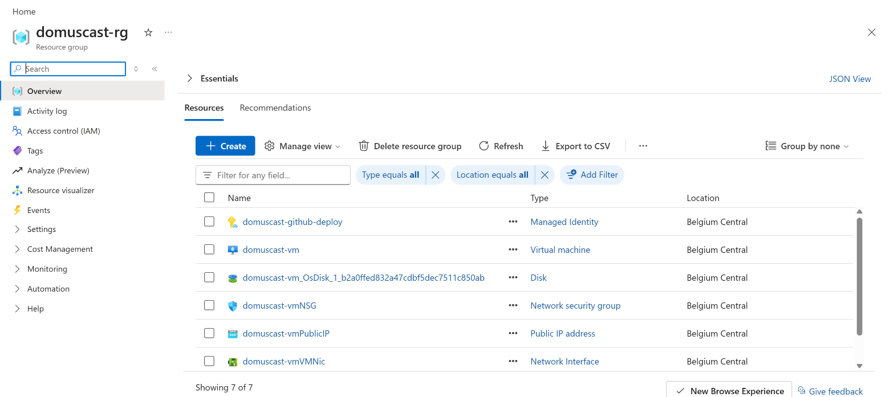
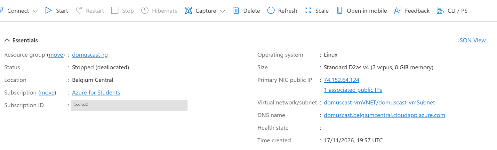
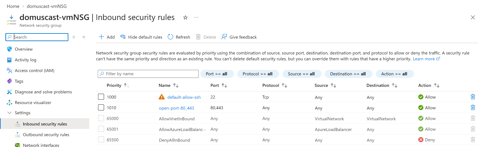
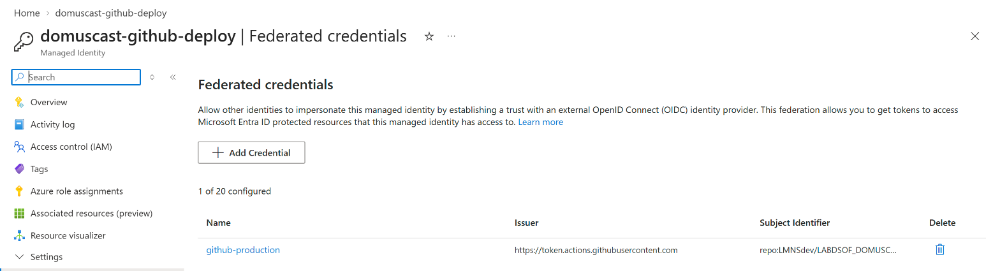
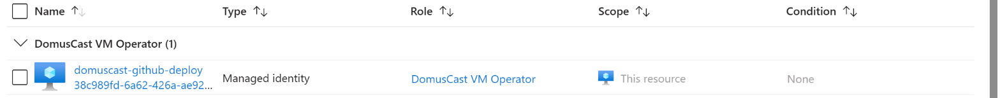
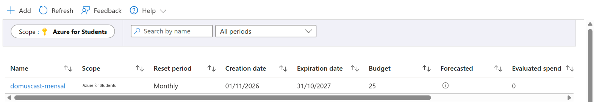
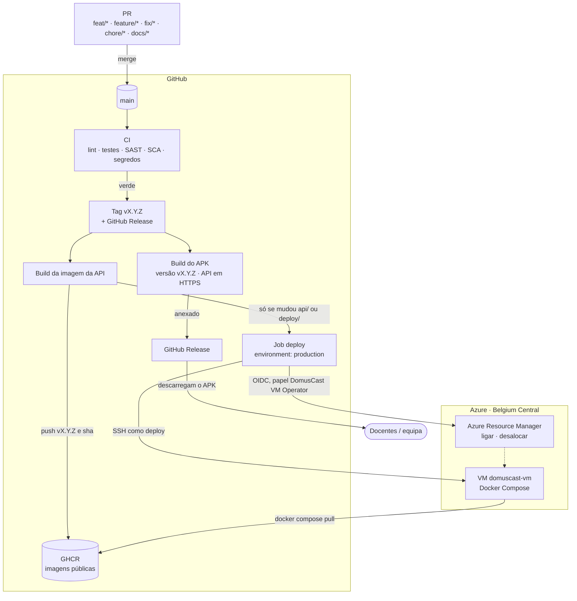
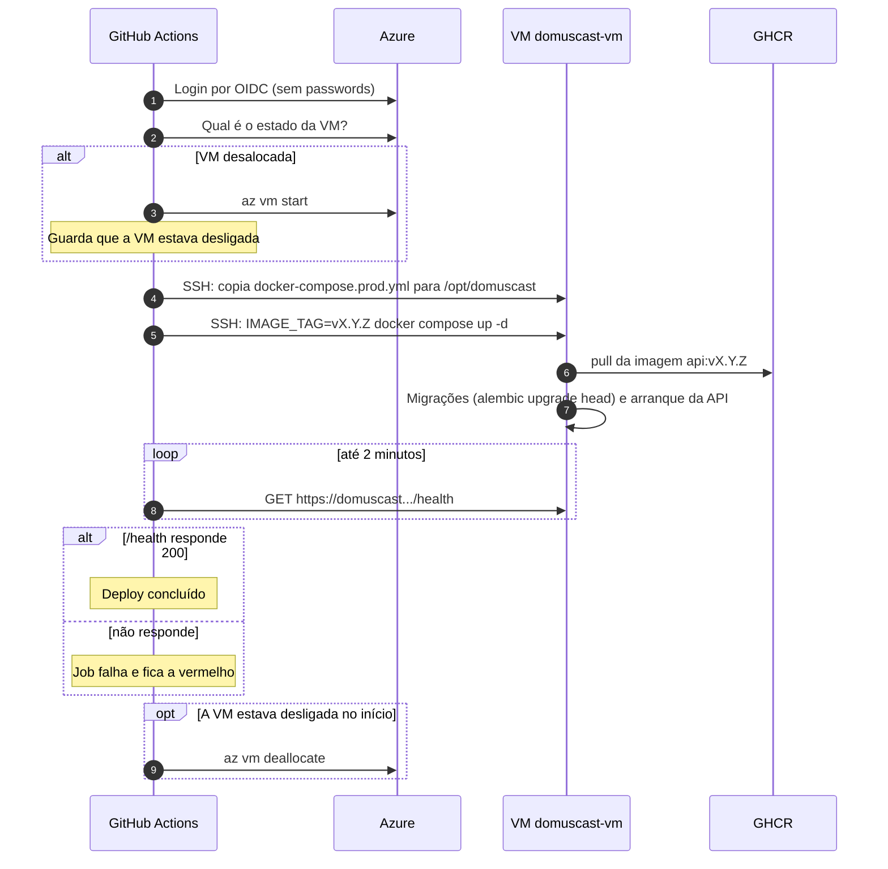
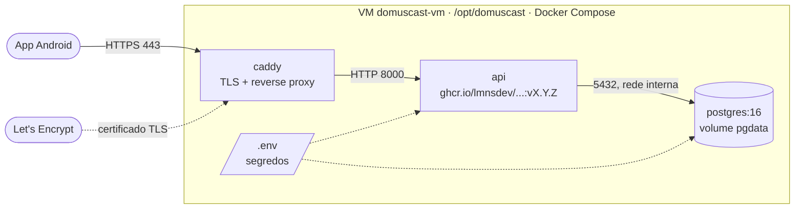
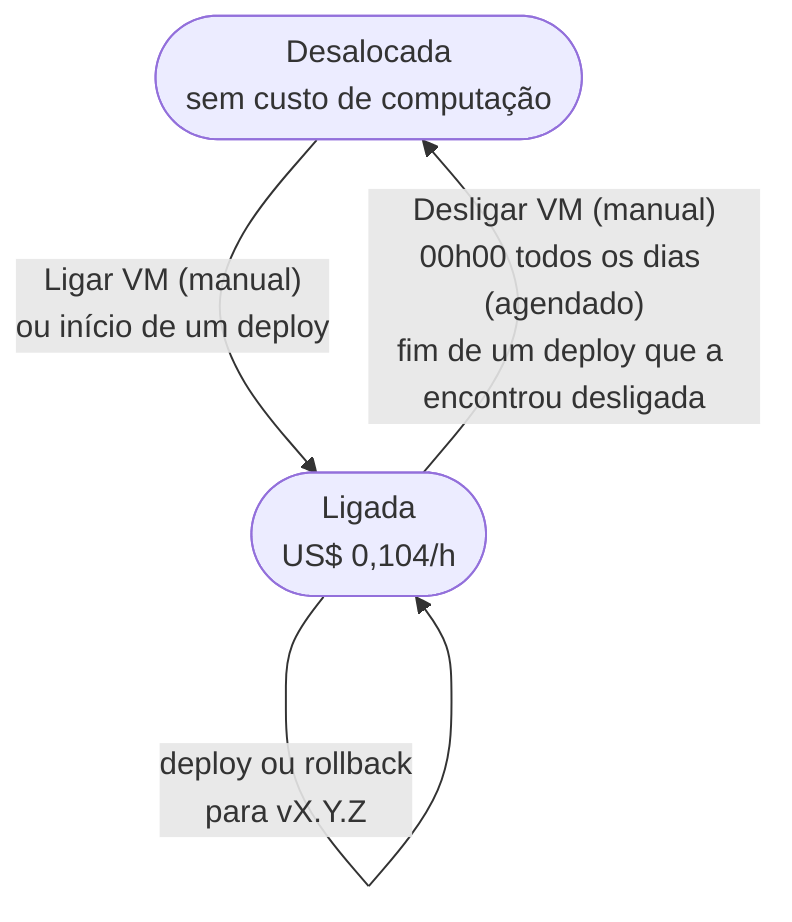

# Ambiente de produção: VM na Azure

Onde corre o DomusCast fora das nossas máquinas, como foi criado e como se opera no dia a dia. Concretiza a [vista de deployment (8.8)](../../sprintA/sprintA.md#88-vista-de-deployment) e o [ADR-011](../../sprintA/sprintA.md#adr-011-entrega-por-containers-docker-compose-numa-vm-única-imagens-no-ghcr-e-pipeline-github-actions), que no Sprint A deixaram o fornecedor da VM "por escolher".

## Resumo

| | |
|---|---|
| **Fornecedor** | Microsoft Azure, subscrição *Azure for Students* (US$ 100 de crédito, sem cartão) |
| **Região** | Belgium Central (`belgiumcentral`) |
| **VM** | `domuscast-vm`, `Standard_D2as_v4` (2 vCPU, 8 GB), Ubuntu 24.04 LTS, disco Standard SSD 30 GB |
| **Endereço** | `domuscast.belgiumcentral.cloudapp.azure.com` (IP público estático) |
| **Portas abertas** | 22 (SSH, só com chave), 80 e 443 (HTTP/HTTPS) |
| **Grupo de recursos** | `domuscast-rg` (apagar o grupo apaga tudo o que está nesta página) |
| **Modo de funcionamento** | Ligada só quando é precisa; desalocada todas as noites às 00:00 |
| **Custo** | US$ 0,104/h ligada; ~US$ 18/mês com 8 h por dia útil, mais ~US$ 4–6/mês de disco e IP |

## Porquê a Azure e esta VM

**Fornecedor.** O projeto não tem orçamento, por isso só considerámos ofertas gratuitas ou de estudante (confirmadas a 2026-11-17):

| Opção | Oferta | Cartão | Decisão |
|---|---|---|---|
| **Azure for Students** | US$ 100 por 12 meses, renovável enquanto estudante | Não | **Escolhida**: única sem cartão e sem custo |
| DigitalOcean (GitHub Student Pack) | Saiu do pack em julho/agosto de 2026 | — | Indisponível |
| Oracle Cloud Always Free | 2 OCPU / 12 GB ARM, sem prazo (limite cortado a meio em 2026) | Sim | Plano B: imagens ARM, risco de suspensão da conta |
| Google Cloud | US$ 300 por 90 dias | Sim | Exige cartão |
| AWS Free plan | US$ 100–200 por 6 meses | Sim | Exige cartão |

**Região e tamanho.** A subscrição de estudante do ISEP só permite cinco regiões (`italynorth`, `switzerlandnorth`, `francecentral`, `austriaeast`, `belgiumcentral`) e bloqueia toda a série B (a mais barata). Cruzando os tamanhos disponíveis com a quota da subscrição, a opção mais barata com pelo menos 2 vCPU e 4 GB foi a `Standard_D2as_v4` em Belgium Central. Tem 8 GB em vez dos 4 GB previstos no ADR-011, o que dá folga para o Worker, o Prometheus e o Grafana dos sprints seguintes.

**Ligada só quando é precisa.** Ligada 24/7, a VM custa ~US$ 76/mês e esgotaria o crédito em pouco mais de um mês. Ligada ~8 h por dia útil, o crédito dura cerca de 5 meses. Se acabar, cada membro da equipa tem direito ao seu próprio crédito e a VM pode ser recriada noutra subscrição com a secção [Recriar do zero](#recriar-do-zero).

> A VM tem de ser **desalocada** (`deallocate`) para deixar de ser cobrada. Desligar o sistema operativo por dentro (`shutdown`) deixa-a parada mas continua a cobrar computação.

## Recursos criados

| Recurso | Nome | Para quê |
|---|---|---|
| Grupo de recursos | `domuscast-rg` | Agrupa tudo; apagá-lo remove o ambiente |
| Máquina virtual | `domuscast-vm` | Corre os containers com Docker Compose |
| IP público estático + nome DNS | `domuscast` | Endereço fixo, necessário para o certificado HTTPS e para o APK |
| Network security group | `domuscast-vmNSG` | Regras `default-allow-ssh` (22) e `open-port-80_443` |
| Managed identity | `domuscast-github-deploy` | Identidade que o GitHub Actions usa para ligar/desligar a VM |
| Federated credential | `github-production` | Associa a identidade ao *environment* `production` deste repositório (OIDC, sem passwords) |
| Papel personalizado | `DomusCast VM Operator` | Só ler o estado, ligar e desalocar a VM; atribuído apenas sobre `domuscast-vm` |
| Orçamento | `domuscast-mensal` | US$ 25/mês; email ao dono da subscrição aos 80% gastos e quando a previsão passa os 100% |





Na VM, o script [`DomusCast/deploy/bootstrap-vm.sh`](../../../DomusCast/deploy/bootstrap-vm.sh) instalou o Docker Engine e o plugin Compose, criou o utilizador `deploy` (sem password nem `sudo`, membro do grupo `docker`, entra só com a chave SSH do GitHub Actions) e a pasta `/opt/domuscast`.

## Segurança

- **Sem passwords.** A VM só aceita chaves SSH. Há duas: a do administrador (`azureuser`, na máquina de quem gere a subscrição) e a do deploy (`deploy`, guardada só como secret do GitHub).
- **Rede.** Só entram as portas 22, 80 e 443. O portal assinala a regra SSH aberta a qualquer origem: os IPs dos runners do GitHub Actions mudam, por isso não é possível restringi-la; a mitigação é aceitar apenas chaves.

  

- **GitHub → Azure por OIDC.** O workflow pede um token de curta duração ao GitHub e troca-o por acesso à Azure; não há nenhuma credencial da Azure guardada no repositório. Só jobs que corram no *environment* `production` deste repositório são aceites.

  

- **Menor privilégio.** A identidade do GitHub só consegue ler o estado, ligar e desalocar esta VM. Não cria, apaga nem altera recursos, e não entra na VM (isso é feito com a chave SSH do utilizador `deploy`, que também não tem `sudo`).

  
- **Segredos da aplicação** (password do PostgreSQL, chaves de API) ficam num `.env` em `/opt/domuscast` na VM, fora do repositório, como definido em [8.8](../../sprintA/sprintA.md#88-vista-de-deployment).
- **Limite de gasto.** A subscrição de estudante pára os recursos quando o crédito acaba; não há cobrança no cartão porque não há cartão. O orçamento avisa antes disso.

  

> Nas capturas, o ID da subscrição foi ocultado e os utilizadores com acesso à subscrição foram cortados.

## Operação no dia a dia

Qualquer membro da equipa, sem conta na Azure, liga e desliga a VM em *Actions → VM → Run workflow* (ver [Como usar](#como-usar)). Com a Azure CLI, quem gere a subscrição pode:

```bash
# Ligar (demora ~1 min)
az vm start -g domuscast-rg -n domuscast-vm

# Desligar e deixar de pagar computação
az vm deallocate -g domuscast-rg -n domuscast-vm

# Ver o estado
az vm get-instance-view -g domuscast-rg -n domuscast-vm \
  --query "instanceView.statuses[?starts_with(code,'PowerState')].displayStatus" -o tsv

# Entrar na VM como administrador
ssh -i ~/.ssh/domuscast_azure azureuser@domuscast.belgiumcentral.cloudapp.azure.com

# Gasto do mês até agora
az consumption usage list --query "sum([].pretaxCost)" -o tsv
```

## Recriar do zero

Para reconstruir o ambiente noutra subscrição (por exemplo, quando o crédito acabar). Requer a Azure CLI e `az login` com a subscrição *Azure for Students*. Se a região ou o tamanho deixarem de estar disponíveis, confirmar primeiro com `az vm list-skus -l <região> --size Standard_D2 --all` e `az vm list-usage -l <região>`.

```bash
RG=domuscast-rg; VM=domuscast-vm; LOC=belgiumcentral
REPO=LMNSdev/LABDSOF_DOMUSCAST

# 0. Serviços necessários na subscrição (grátis)
az provider register -n Microsoft.Compute --wait
az provider register -n Microsoft.Network --wait
az provider register -n Microsoft.ManagedIdentity --wait

# 1. Chaves SSH (administrador e deploy)
ssh-keygen -t ed25519 -f ~/.ssh/domuscast_azure  -N "" -C domuscast-azure-admin
ssh-keygen -t ed25519 -f ~/.ssh/domuscast_deploy -N "" -C github-actions-deploy

# 2. Grupo de recursos e VM
az group create -n $RG -l $LOC
az vm create -g $RG -n $VM --image Ubuntu2404 --size Standard_D2as_v4 \
  --admin-username azureuser --ssh-key-values ~/.ssh/domuscast_azure.pub \
  --storage-sku StandardSSD_LRS --os-disk-size-gb 30 \
  --public-ip-sku Standard --public-ip-address-allocation static \
  --public-ip-address-dns-name domuscast --nsg-rule SSH
az vm open-port -g $RG -n $VM --port 80,443 --priority 1010

# 3. Preparar a VM (Docker, utilizador deploy, /opt/domuscast)
ssh -i ~/.ssh/domuscast_azure azureuser@domuscast.$LOC.cloudapp.azure.com \
  "sudo bash -s -- '$(cat ~/.ssh/domuscast_deploy.pub)'" < DomusCast/deploy/bootstrap-vm.sh

# 4. Identidade para o GitHub Actions (OIDC) com permissão mínima sobre a VM
az identity create -g $RG -n domuscast-github-deploy -l $LOC
az identity federated-credential create -g $RG --identity-name domuscast-github-deploy \
  -n github-production --issuer https://token.actions.githubusercontent.com \
  --subject "repo:$REPO:environment:production" --audiences api://AzureADTokenExchange
SUB=$(az account show --query id -o tsv)
cat > role.json <<EOF
{
  "Name": "DomusCast VM Operator",
  "Description": "Ler estado, ligar e desalocar a VM do DomusCast (GitHub Actions)",
  "Actions": [
    "Microsoft.Compute/virtualMachines/read",
    "Microsoft.Compute/virtualMachines/instanceView/read",
    "Microsoft.Compute/virtualMachines/start/action",
    "Microsoft.Compute/virtualMachines/deallocate/action"
  ],
  "NotActions": [],
  "AssignableScopes": ["/subscriptions/$SUB/resourceGroups/$RG"]
}
EOF
az role definition create --role-definition @role.json
az role assignment create --role "DomusCast VM Operator" \
  --assignee-object-id "$(az identity show -g $RG -n domuscast-github-deploy --query principalId -o tsv)" \
  --assignee-principal-type ServicePrincipal \
  --scope "$(az vm show -g $RG -n $VM --query id -o tsv)"

# 5. Orçamento de US$ 25/mês com alertas ao dono da subscrição (ver nota abaixo)
```

O orçamento foi criado com `az rest` (o comando `az consumption budget create` não permite definir alertas): `PUT .../providers/Microsoft.Consumption/budgets/domuscast-mensal?api-version=2023-05-01` com `amount: 25`, `timeGrain: Monthly` e duas notificações para `contactRoles: ["Owner"]` (80% real e 100% previsto). Também pode ser criado no portal em *Cost Management → Budgets*.

**Limitação conhecida:** o desligar automático da própria Azure (*auto-shutdown*) não existe em Belgium Central, e o agendamento tem de estar na mesma região da VM. Por isso, a desalocação noturna é feita por um workflow agendado do GitHub Actions.

## Pipeline de deploy

Os diagramas abaixo são escritos em [Mermaid](https://mermaid.js.org/) e o GitHub desenha-os diretamente; para os alterar basta editar o texto.

### Visão geral: do merge à VM

Cada merge na `main` passa pelo CI; se ficar verde, o workflow `Release` cria a versão e publica a imagem e o APK. O deploy só corre se o merge mudou o que corre no servidor (`DomusCast/api/` ou `DomusCast/deploy/`): um merge só de documentação, da app ou de configuração do GitHub deixaria o servidor igual.



### O job de deploy, passo a passo

O deploy funciona com a VM ligada ou desligada: se estava desligada, liga-a só durante o deploy e volta a desalocá-la no fim.



### O que corre dentro da VM

Só o Caddy está exposto à Internet. A API e o PostgreSQL falam numa rede interna do Docker, e os segredos vêm do `.env` que existe apenas na VM.



### Ligar, desligar e voltar atrás

Além do deploy automático, há três ações manuais no separador *Actions* do GitHub (*Run workflow*), que qualquer membro da equipa pode usar sem conta na Azure, e uma ação agendada.



O **rollback** é o mesmo job de deploy com uma versão escolhida à mão (por exemplo, `v0.3.0`): a imagem dessa versão continua no GHCR e as migrações são aditivas, por isso voltar atrás não exige reverter o esquema da base de dados.

### Resumo do desenho e onde está implementado

| O quê | Onde |
|---|---|
| Tag, imagem, APK e chamada ao deploy | [`.github/workflows/release.yml`](../../../.github/workflows/release.yml) |
| Deploy e rollback | [`.github/workflows/deploy.yml`](../../../.github/workflows/deploy.yml) |
| Ligar/desligar e desalocação noturna | [`.github/workflows/vm.yml`](../../../.github/workflows/vm.yml) |
| Login OIDC e estado da VM | [`.github/scripts/azure-login.sh`](../../../.github/scripts/azure-login.sh), [`.github/scripts/vm.sh`](../../../.github/scripts/vm.sh) |
| Stack e script na VM | [`DomusCast/deploy/`](../../../DomusCast/deploy/) (`docker-compose.prod.yml`, `Caddyfile`, `deploy.sh`, `bootstrap-vm.sh`) |

1. **Imagem da API.** Depois de o workflow `Release` criar a tag `vX.Y.Z`, a imagem é construída e publicada no GitHub Container Registry com a tag da versão e a do commit. O repositório é público, por isso a VM descarrega a imagem sem token.
2. **Compose de produção.** `docker-compose.prod.yml` com `postgres` (sem porta exposta), `api` (imagem do GHCR, sem build na VM) e `caddy` à frente, que obtém e renova o certificado HTTPS (Let's Encrypt) para `domuscast.belgiumcentral.cloudapp.azure.com`. Worker, Prometheus e Grafana entram quando existirem.
3. **Deploy a cada merge que muda o servidor** (`DomusCast/api/` ou `DomusCast/deploy/`, comparando com a versão anterior), no *environment* `production`: ver o estado da VM → ligá-la se estiver desligada → copiar o compose e fazer `pull`/`up` da nova versão por SSH → confirmar que o `/health` responde → voltar a desalocá-la se estava desligada.
4. **Rollback** por *Run workflow* no GitHub, indicando a versão (ex.: `v0.3.0`). As migrações são aditivas, por isso voltar atrás não exige reverter o esquema.
5. **Ligar/desligar pelo GitHub** por *Run workflow*, para quem não tem acesso à subscrição.
6. **Desalocar todas as noites às 00:00** com um workflow agendado.
7. **APK** gerado com a versão da tag (`--build-name`) e o endereço HTTPS da VM (`--dart-define`), anexado à GitHub Release.

### Configuração no GitHub

| Nome | Tipo | Onde | Valor |
|---|---|---|---|
| `AZURE_CLIENT_ID` | variável | environment `production` | `clientId` da identidade `domuscast-github-deploy` |
| `AZURE_TENANT_ID` | variável | environment `production` | tenant do ISEP |
| `AZURE_SUBSCRIPTION_ID` | variável | environment `production` | subscrição *Azure for Students* |
| `DEPLOY_HOST` | variável | repositório (também usada pelo build do APK) | `domuscast.belgiumcentral.cloudapp.azure.com` |
| `DEPLOY_SSH_KEY` | secret | environment `production` | chave privada `~/.ssh/domuscast_deploy` |
| `DEPLOY_KNOWN_HOSTS` | secret | environment `production` | chaves públicas da VM (`ssh-keyscan`), para o runner confirmar que fala com o servidor certo |

O *environment* `production` só aceita jobs que corram na `main` (*deployment branch policy*): um workflow noutro branch não recebe a chave SSH nem o acesso à Azure.

### Como usar

- **Deploy:** automático, a cada merge na `main` com o CI verde que mude `DomusCast/api/` ou `DomusCast/deploy/`. Acompanhar em *Actions → Release*: o resumo do job `Tag + GitHub Release` diz se houve deploy e porquê, e o do job `Deploy` diz a versão e se a VM foi ligada só para o deploy. Para implantar uma versão sem alterações no servidor, usar *Actions → Deploy → Run workflow*.
- **Rollback:** *Actions → Deploy → Run workflow*, com a versão anterior (ex.: `v0.3.0`). Só há imagens a partir da primeira versão publicada por esta pipeline (`v0.3.0`); uma versão mal escrita ou sem imagem no GHCR falha logo no primeiro passo, sem ligar a VM.
- **Ligar/desligar a VM:** *Actions → VM → Run workflow → ligar* (ou *desligar*). Ligar demora cerca de 1 minuto; a API arranca sozinha (`restart: unless-stopped`).
- **Desalocação noturna:** o mesmo workflow `VM` corre todos os dias às 00:00 **UTC** (00:00 em Lisboa no inverno, 01:00 no verão), porque o cron do GitHub não tem fuso horário.
- **APK:** em cada GitHub Release, ficheiro `domuscast-vX.Y.Z.apk`, já a apontar para `https://domuscast.belgiumcentral.cloudapp.azure.com`.
- **Na VM** (como `deploy`): `cd /opt/domuscast && docker compose -f docker-compose.prod.yml ps` (ou `logs api`). A versão em uso está em `VERSION` e a password do PostgreSQL no `.env` (modo 600), criado no primeiro deploy e nunca alterado depois.

### Manutenção

- **Imagem pública no GHCR:** a VM descarrega a imagem sem token. Se o GitHub criar o pacote `domuscast-api` como privado na primeira publicação, torná-lo público uma vez em *Packages → domuscast-api → Package settings → Change visibility*.
- **VM recriada:** a VM nova tem chaves de servidor novas; atualizar o secret `DEPLOY_KNOWN_HOSTS` com `ssh-keyscan domuscast.belgiumcentral.cloudapp.azure.com`, e repetir o `bootstrap-vm.sh` (ver [Recriar do zero](#recriar-do-zero)).
- **Certificado HTTPS:** o Caddy renova-o sozinho e guarda-o no volume `caddy_data`; não apagar este volume, para não esbarrar nos limites do Let's Encrypt.
