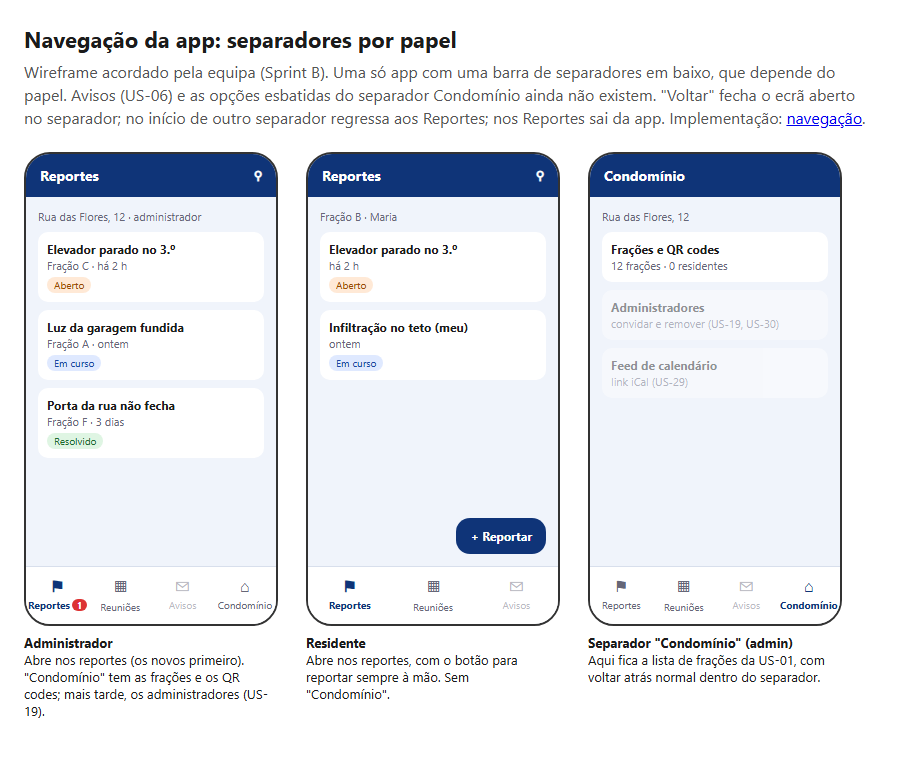
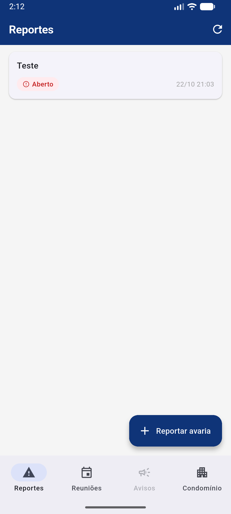
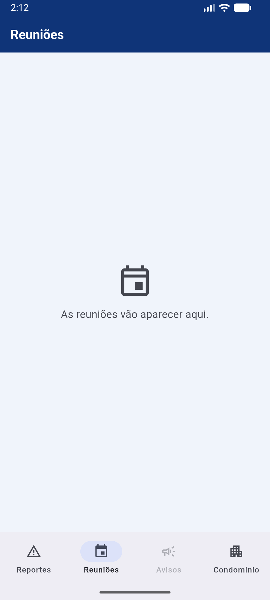
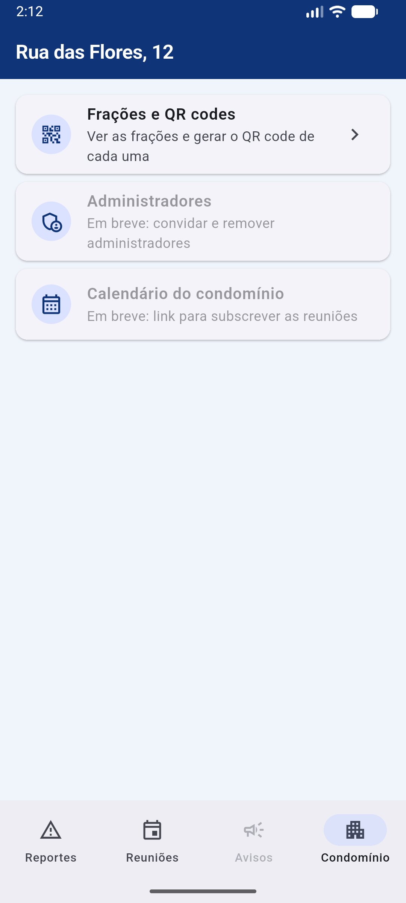
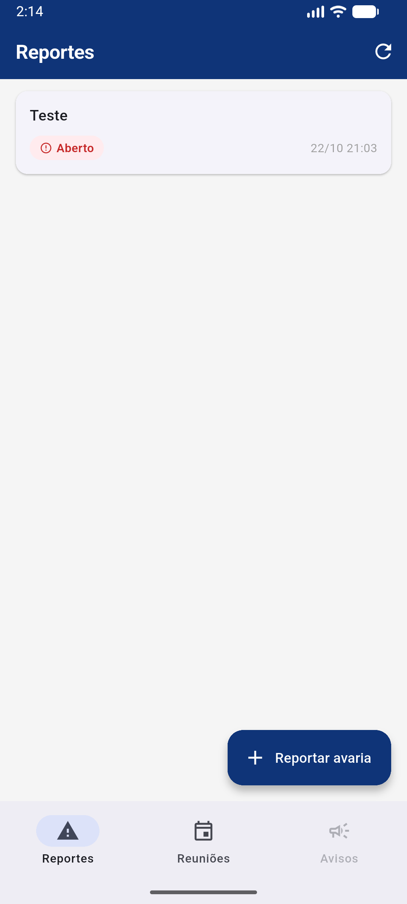

# Navegação da app

A app passou a ter uma **barra de separadores em baixo**, que depende do papel de quem a usa. Antes, depois de criar o condomínio, o administrador ficava preso na lista de frações: não havia forma de voltar atrás nem de chegar aos reportes.

## Estrutura

| Papel | Separadores | Abre em |
|---|---|---|
| Administrador | Reportes, Reuniões, Avisos, Condomínio | Reportes (logo depois de criar o condomínio, abre no Condomínio para gerar os QR codes) |
| Residente | Reportes, Reuniões, Avisos | Reportes |

- **Reportes:** o uso diário (ver os reportes novos, reportar uma avaria). Por agora é a lista de reportes que já existia; o detalhe e a mudança de estado chegam com a US-03 e a US-05.
- **Reuniões:** por agora só o estado vazio, até à US-13 e à US-27.
- **Avisos:** visível mas desativado, até à US-06.
- **Condomínio** (só administrador): o que se configura de vez em quando. Frações e QR codes (US-01); administradores (US-19, US-30) e calendário do condomínio (US-29) aparecem como "em breve".
- **Voltar:** fecha o ecrã aberto dentro do separador; no início de outro separador regressa aos Reportes; nos Reportes sai da app. Cada separador guarda o seu ponto de navegação ao trocar de separador.
- **Entrada:** o ecrã com "Entrar" e "Sou administrador" só aparece a quem ainda não tem sessão. Para o residente, "Entrar" abre a leitura do QR code e o pedido do nome ([US-15](us-15.md)); quem já tem identidade no telemóvel entra diretamente nos Reportes.

## Desenho da interface

Wireframe acordado antes da implementação: [design/navegacao.html](design/navegacao.html).

Diferença na implementação: o contador de reportes novos no separador do administrador fica para a US-03, que é a que distingue os reportes por ler.

## Testes automáticos

[`DomusCast/mobile/test/navegacao_test.dart`](../../DomusCast/mobile/test/navegacao_test.dart), 8 testes: separadores do administrador e do residente, Avisos desativado, abrir as frações dentro do separador com seta para voltar, "voltar" do Android dentro do separador e no início de outro separador, abrir num separador escolhido, estado vazio das Reuniões. Suite da app: 21 testes, todos a passar; `flutter analyze` sem problemas.

## Screenshots

App no emulador Android, ligada à API em Docker.

| | |
|---|---|
|  **Administrador:** abre nos Reportes |  **Reuniões:** estado vazio |
|  **Condomínio** (só administrador) |  **Residente:** três separadores, sem Condomínio |
