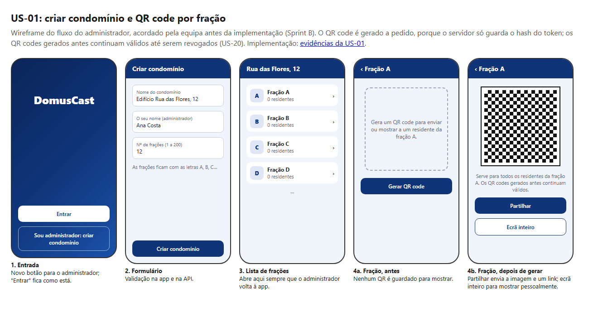
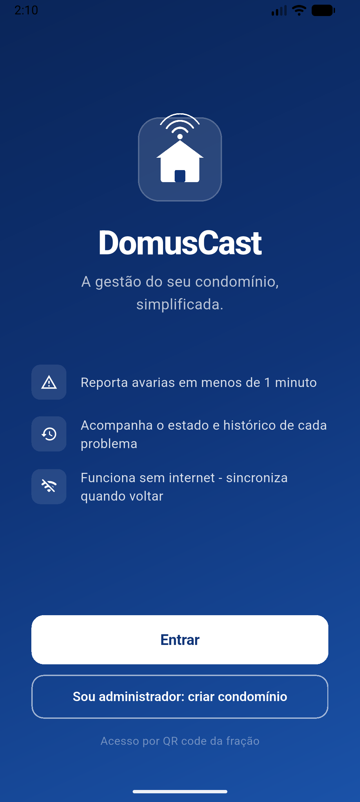
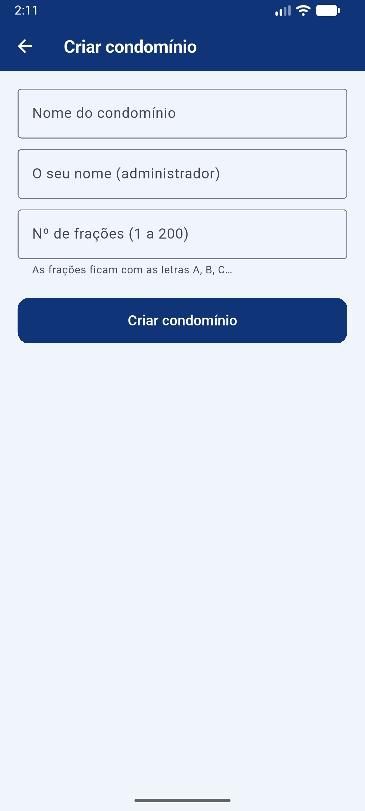
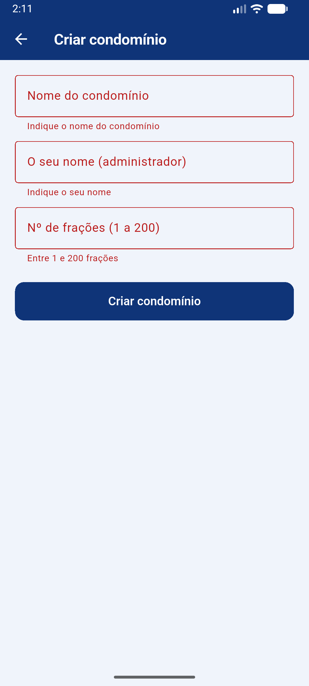
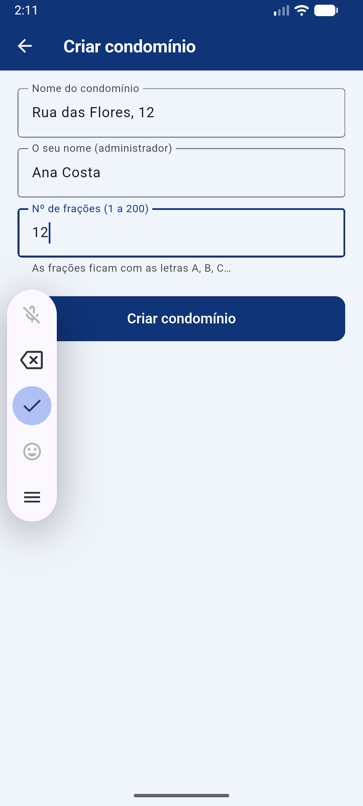
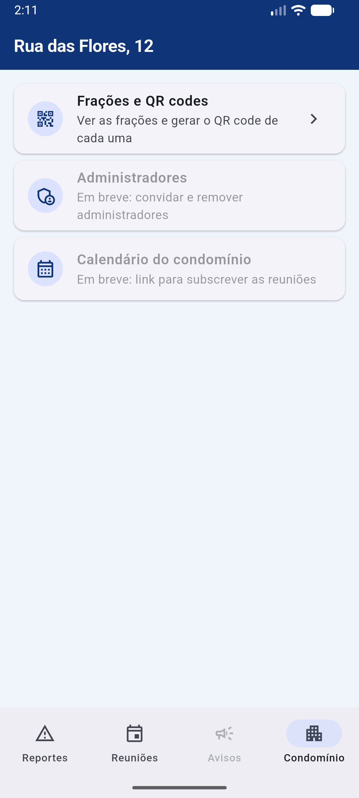
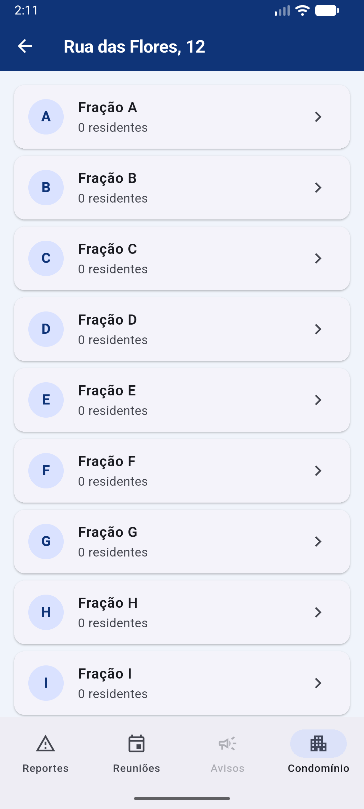
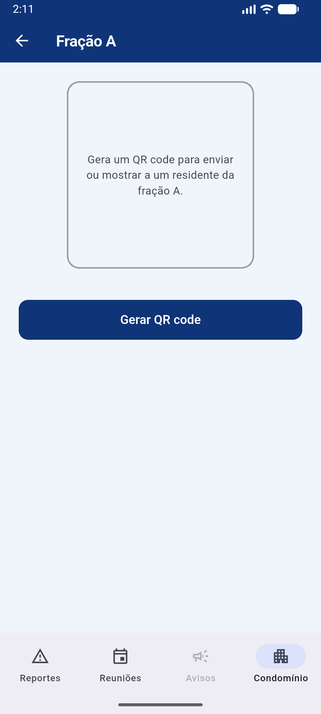
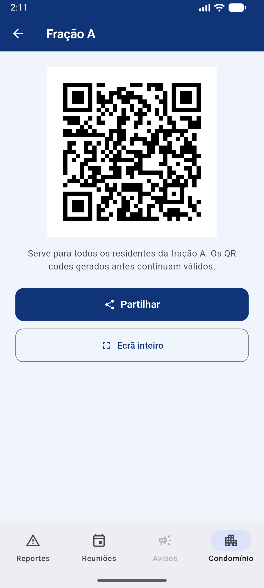
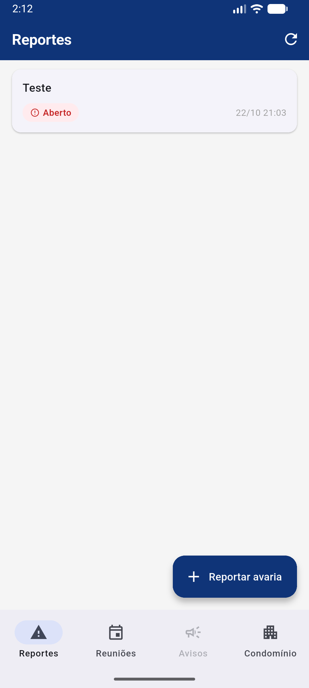

# US-01: Criar condomínio + QR code

> Como **administrador**, quero criar a conta do condomínio e gerar um QR code por fração, para que cada residente associe a sua conta em segundos. ([Product Backlog](../backlog.md#1-product-backlog))

Esta página reúne as evidências da US-01 no Sprint B: o desenho da interface, os testes automáticos e os screenshots da app a correr no emulador Android contra a API em Docker (PostgreSQL).

## Decisões tomadas na implementação

- **O QR code é gerado a pedido.** O servidor só guarda o hash do token ([10.5](../sprintA/sprintA.md#105-qr-code-revogação-e-abuso)), por isso um QR code não pode ser mostrado outra vez depois de gerado. O administrador gera um no ecrã da fração sempre que precisa de o enviar ou mostrar.
- **Os QR codes anteriores continuam válidos.** Gerar um novo não revoga os outros, para não invalidar um QR code já enviado mas ainda por ler. A revogação, de todos os da fração ou de um específico, é a [US-20](../backlog.md#1-product-backlog).
- **Partilhar envia a imagem e um link** `domuscast://entrar?t=<token>`, porque quem recebe o QR code no próprio telemóvel não o consegue ler com a câmara. O link abre a app a partir da US-15.
- **Limites:** 1 a 200 frações por condomínio; 5 criações por hora por IP (só contam os pedidos aceites). Propostas da equipa, já que a arquitetura só exige que existam limites ([TM-09](../sprintA/sprintA.md#106-modelo-de-ameaças-inicial)).
- **Frações:** ficam com as letras A, B, C… (depois de Z: AA, AB…).
- **Credencial do administrador:** gerada na criação do condomínio, guardada no telemóvel em armazenamento seguro (Android Keystore) e no servidor só como hash ([ADR-008](../sprintA/sprintA.md#adr-008-autenticação-do-administrador-mock-no-mvp-autorização-real)). Com sessão guardada, a app abre diretamente na app do administrador.
- **Onde fica na app:** a lista de frações está no separador **Condomínio** do administrador, com seta para voltar ([navegação](navegacao.md)). Logo depois de criar o condomínio, a app abre nesse separador; nas vezes seguintes abre nos Reportes.

## Desenho da interface

Wireframe acordado antes da implementação: [design/us-01.html](design/us-01.html).



Diferenças na implementação: o ecrã de entrada mantém a lista de funcionalidades que já existia; o ecrã inteiro não altera o brilho do telemóvel; e a lista de frações deixou de ser o ecrã principal do administrador e passou para o separador Condomínio, depois de a equipa rever a navegação ([wireframe da navegação](design/navegacao.html)).

## Critérios de aceitação e evidências

| Critério | Evidência |
|---|---|
| Criar o condomínio com nome e nº de frações; quem cria é o primeiro administrador; limites de frações e de pedidos por IP na criação | API: `test_criar_condominio_devolve_credencial_e_fracoes`, `test_criador_e_o_primeiro_administrador`, `test_limite_de_fracoes[0/201]`, `test_aceita_o_maximo_de_200_fracoes`, `test_limite_de_pedidos_por_ip`. App: testes "Criar condomínio". Screenshots 02 a 05 |
| QR code único por fração, com token aleatório não adivinhável (não o nº da fração) | API: `test_tokens_sao_unicos_e_nao_derivam_da_fracao`, `test_token_guardado_so_como_hash_e_aponta_para_a_fracao`. O token tem 256 bits (`secrets.token_urlsafe(32)`) |
| O administrador consulta as frações e gera, a pedido, o QR code de cada uma; os anteriores continuam válidos | API: `test_admin_consulta_as_fracoes`, `test_gerar_qr_devolve_token_e_link`, `test_qr_anteriores_continuam_ativos`, testes de 401/403/404. App: "lista de frações…", "QR da fração". Screenshots 06 a 10 |
| O scan associa o residente à fração correta; o mesmo QR code serve vários residentes da fração | Parcial: o token do QR aponta para a fração certa (teste `test_token_guardado_so_como_hash_e_aponta_para_a_fracao`, e na demo o QR lido do screenshot 08 corresponde ao hash de um token ativo da fração A na base de dados). O ecrã de leitura e a criação da identidade são a US-15 |

## Testes automáticos

| Onde | Ficheiro | Testes | Resultado |
|---|---|---|---|
| API (pytest) | [`DomusCast/api/tests/test_condominios.py`](../../DomusCast/api/tests/test_condominios.py) | 23 novos (27 na suite) | 27 passed; `ruff check .` sem erros |
| App (flutter test) | [`DomusCast/mobile/test/us01_admin_test.dart`](../../DomusCast/mobile/test/us01_admin_test.dart) | 11 (21 na suite, com os [8 da navegação](navegacao.md#testes-automáticos)) | 21 passed; `flutter analyze` sem problemas |

Casos de falha cobertos: nº de frações fora dos limites (422), nomes vazios (422), 6.º pedido na mesma hora (429), sem credencial ou credencial inválida (401), administrador removido (401), credencial de outro condomínio (403), fração inexistente (404), erro de rede ou 429 na app (mensagem ao utilizador).

Como correr:

```powershell
cd DomusCast\api; pip install -r requirements-dev.txt; pytest tests/ -v
cd DomusCast\mobile; flutter test
```

## Screenshots

App em modo debug no emulador Android (API 37), ligada à API em Docker com PostgreSQL.

| | |
|---|---|
| <br>**1. Entrada** com o novo botão do administrador | <br>**2. Formulário** de criação |
| <br>**3. Validação** dos campos vazios | <br>**4. Formulário preenchido** (12 frações) |
| <br>**5. Separador Condomínio**, logo depois de criar | <br>**6. Lista de frações**, com seta para voltar |
| <br>**7. Fração A** antes de gerar | <br>**8. QR code gerado** para a fração A |
| <br>**9. Ecrã inteiro** para mostrar pessoalmente | <br>**10. Partilhar**: imagem do QR e link |
| <br>**11. Reabrir a app**: abre nos Reportes | |
