# US-02: Reportar avaria

> Como **residente**, quero reportar uma avaria com foto e descrição, para que o administrador saiba do problema sem o contactar diretamente. ([Product Backlog](../backlog.md#1-product-backlog))

Esta página reúne as evidências da US-02 no Sprint B: o contrato implementado, as decisões tomadas, os testes automáticos e os screenshots da app no emulador Android.

## Decisões tomadas na implementação

- **`Idempotency-Key` obrigatória:** sem o cabeçalho, a API responde 422. A app gera sempre uma chave por reporte, e a fila offline reenvia com a mesma chave.
- **Reenvio devolve 200:** um reenvio com a mesma chave e o mesmo autor devolve o reporte já criado, sem alterar o conteúdo, como pede o [refinamento](refinamento.md#us-02-e-us-09-reportar-avaria-e-privacidade-do-autor).
- **Foto reprocessada:** a API abre a imagem com o Pillow, recusa o que não é JPEG nem PNG e grava uma cópia nova, sem EXIF, em `media/reportes/`. O caminho fica em `reporte.foto_path` e o volume `reportes_media` preserva os ficheiros no Docker Compose. A entrega da foto à app fica para a US-03, cujo wireframe aprovado já mostra a foto com o texto alternativo no ecrã de detalhe.
- **Formato de erro em todas as rotas:** os handlers em `main.py` passam a devolver `{codigo, mensagem, request_id}` (8.4) também para os `HTTPException` e para os 422 de validação, com o mesmo valor no cabeçalho `X-Request-ID`. Antes, só os erros da US-15 tinham este formato.
- **Base de dados em baixo:** a criação responde 503 com `Retry-After`, e a app trata-o como falta de ligação.
- **Sem migração nova:** a chave única por autor já existe na migração `0004` da `main` (US-09).
- **"Você" em toda a app:** os textos seguem o registo dos wireframes ("Descreva", "Não inclua", "Toque em", "Reporte avarias"), também nos ecrãs anteriores que usavam "tu" (entrada, lista vazia e mensagem de partilha do QR code).
- **Data no cartão da lista:** a data fica no texto do autor, como no wireframe da US-09 ("Residente - há 5 min"). Uma segunda data à direita cortava a etiqueta "O meu reporte - nome oculto aos vizinhos" no telemóvel e foi retirada.

## Desenho da interface

Wireframe acordado antes da implementação: [design/us-02.html](design/us-02.html), com a opção da US-09 no mesmo formulário.

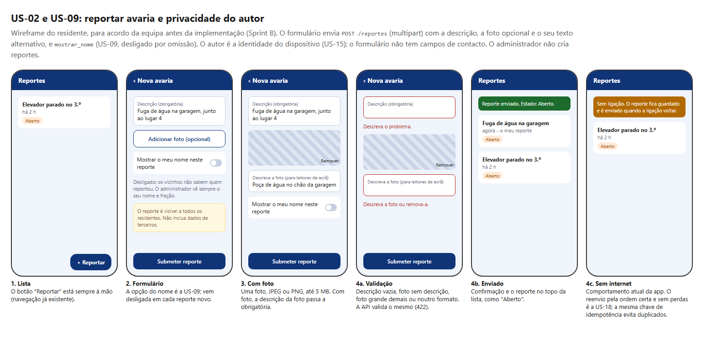

Diferenças na implementação:

- **Sem ligação com foto:** o estado 4c do wireframe (volta à lista com "Sem ligação. O reporte fica guardado e é enviado quando a ligação voltar.") aplica-se aos reportes sem foto (screenshot 4c). A fila local ainda não guarda fotos (US-18), por isso um reporte com foto fica no formulário com "Tentar novamente", que reutiliza a mesma chave (screenshot 4d). Aprovada por Pedro Soares (Scrum Master) a 19/11/2026.
- **Pré-visualização da foto:** a foto escolhida pode ser ampliada em ecrã inteiro. Não está no wireframe e não altera o fluxo.

## Critérios de aceitação e evidências

| Critério | Evidência |
|---|---|
| Formulário com descrição obrigatória e foto opcional; avisa que o reporte é visível a todos e que não deve incluir dados de terceiros | pytest: `test_descricao_vazia_e_rejeitada`, `test_foto_sem_texto_alternativo_e_rejeitada`, `test_foto_acima_de_5_mb_e_rejeitada`, `test_foto_com_formato_nao_suportado_e_rejeitada`. App: "formulário apresenta foto opcional e privacidade desligada", "foto escolhida exige texto alternativo", "recusa foto acima de 5 MB" |
| Reporte visível a todos os residentes e ao administrador | pytest: `test_residente_sem_mostrar_nome_nao_e_identificado_a_outro_residente`, `test_administrador_ve_nome_e_fracao`, `test_residente_de_outro_condominio_nao_ve_os_reportes`. App: "administrador carrega os Reportes com a sua credencial" |
| Autor = identidade do residente (US-15); a visibilidade do nome segue a US-09 | pytest: `test_criar_reporte_sem_foto`, `test_criacao_devolve_o_reporte_como_o_autor_o_ve`, `test_autor_removido_deixa_de_ser_identificado`, `test_administrador_nao_pode_criar_reporte`. App: "aberto a partir do HomeScreen, o formulário usa o nome do residente" |
| Estado inicial "Aberto" e confirmação de submissão | pytest: `test_criar_reporte_sem_foto`. App: "confirma reporte no topo da lista após criar". Screenshot 4b |
| Reenviar o mesmo reporte não cria duplicados | pytest: `test_reenvio_com_mesma_chave_devolve_reporte_existente`, `test_chave_de_idempotencia_e_isolada_por_autor`, `test_pedidos_simultaneos_do_mesmo_autor_devolvem_o_mesmo_reporte`. App: "com foto, sem ligação fica no formulário e a nova tentativa reutiliza a chave" |

## Contrato implementado

`POST /reportes` exige `Authorization: Bearer <credencial>` de uma identidade ativa e `Idempotency-Key` (1 a 64 caracteres). O corpo é `multipart/form-data`:

| Campo | Regra |
|---|---|
| `descricao` | Obrigatória; espaços exteriores removidos; 1 a 2000 caracteres |
| `foto` | Opcional; uma imagem JPEG ou PNG até 5 MB |
| `foto_alt` | Obrigatório quando há foto; máximo de 300 caracteres |
| `mostrar_nome` | Booleano; falso por omissão |

Campos a mais (telefone, e-mail ou outros) recebem 422. O autor e o condomínio vêm da credencial, nunca do corpo. Respostas: 201 criado, 200 no reenvio com a mesma chave, 401 sem credencial, com credencial inválida ou com identidade removida, 403 administrador, 422 dados inválidos e 503 base de dados em baixo. A resposta é o reporte visto pelo autor (`meu: true`).

## Testes automáticos

| Onde | Ficheiro | Testes | Resultado |
|---|---|---|---|
| API (pytest) | [`DomusCast/api/tests/test_reportes.py`](../../DomusCast/api/tests/test_reportes.py) | 32 (70 na suite) | 70 passed; `ruff check .` sem erros |
| App (flutter test) | [`DomusCast/mobile/test/us02_reportes_test.dart`](../../DomusCast/mobile/test/us02_reportes_test.dart), [`us09_privacidade_test.dart`](../../DomusCast/mobile/test/us09_privacidade_test.dart), [`navegacao_test.dart`](../../DomusCast/mobile/test/navegacao_test.dart) | 14 na US-02 (69 na suite) | 69 passed; `flutter analyze` sem problemas (Flutter 3.47, como no CI) |

Casos de falha cobertos: 401 sem credencial, com credencial inválida e com identidade removida; 403 administrador; 422 descrição vazia ou acima de 2000 caracteres, foto sem `foto_alt`, foto acima de 5 MB ou noutro formato, campos de contacto, pedido sem multipart e sem `Idempotency-Key`; falta de ligação e 5xx na app.

Também foi confirmado que as migrações têm uma só head (`alembic heads` devolve `0004`).

Como correr:

```powershell
cd DomusCast\api; pip install -r requirements-dev.txt; pytest tests/ -v; ruff check .
cd DomusCast\mobile; flutter analyze; flutter test
```

## Screenshots

App em modo debug no emulador Android (pt-PT), ligada à API em Docker com PostgreSQL, a 19/11/2026, depois da revisão do PR. O condomínio e o QR code foram criados pela API; a residente entrou pelo link do QR code. A foto é uma imagem de teste gerada para o efeito ("Foto de teste"), sem dados pessoais.

| | |
|---|---|
| 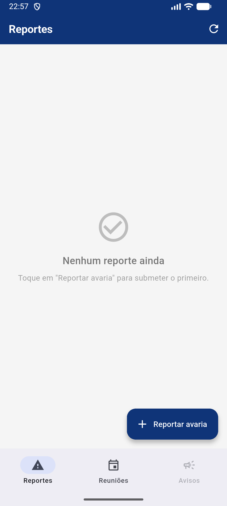<br>**1. Lista** com "Reportar avaria" | 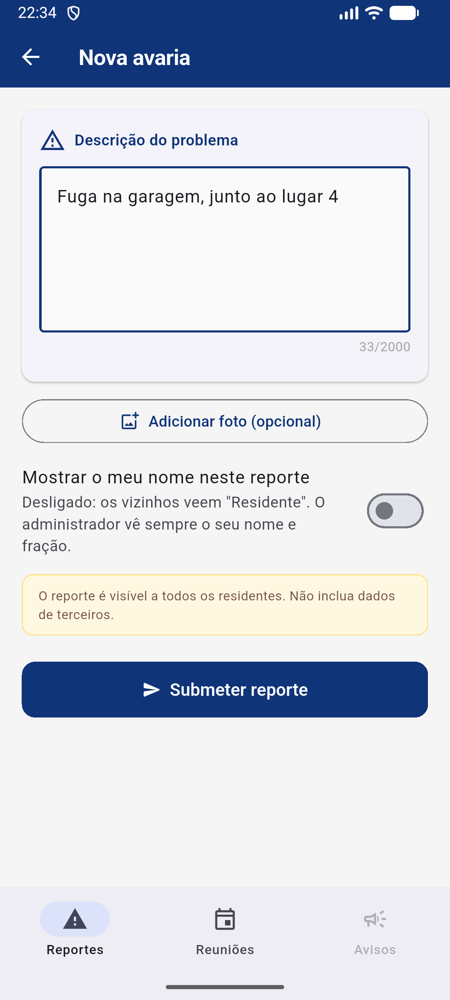<br>**2. Formulário**: nome desligado por omissão e aviso de privacidade |
| 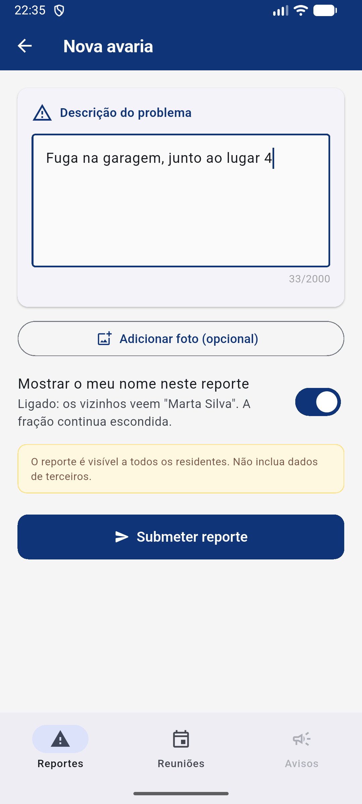<br>**2b. Nome ligado** (US-09): mostra o nome da residente | 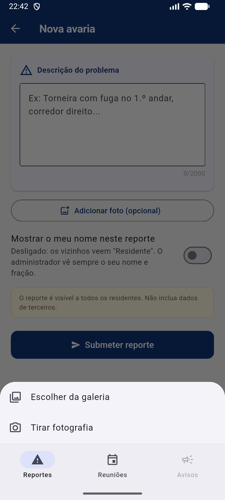<br>**3a. Origem da foto**: galeria ou câmara |
| 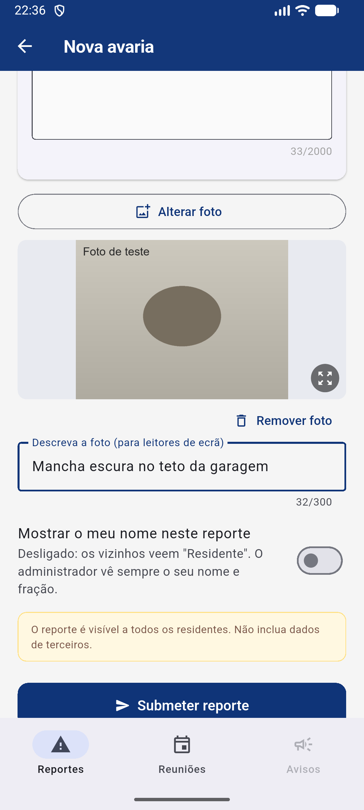<br>**3. Com foto** e texto alternativo | 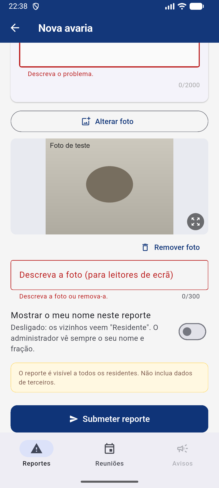<br>**4a. Validação**: descrição vazia e foto sem descrição |
| 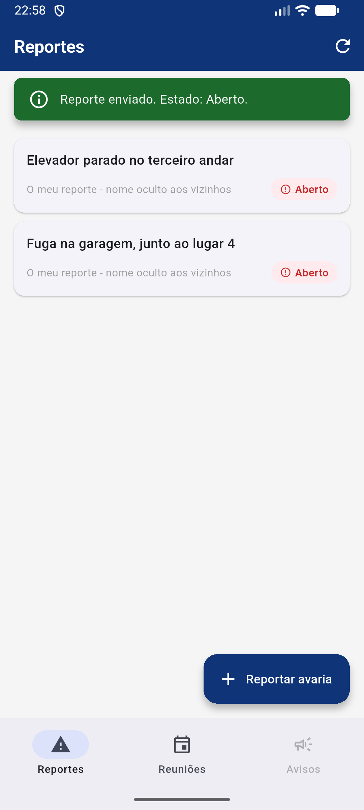<br>**4b. Enviado**: confirmação e reporte "Aberto" no topo | 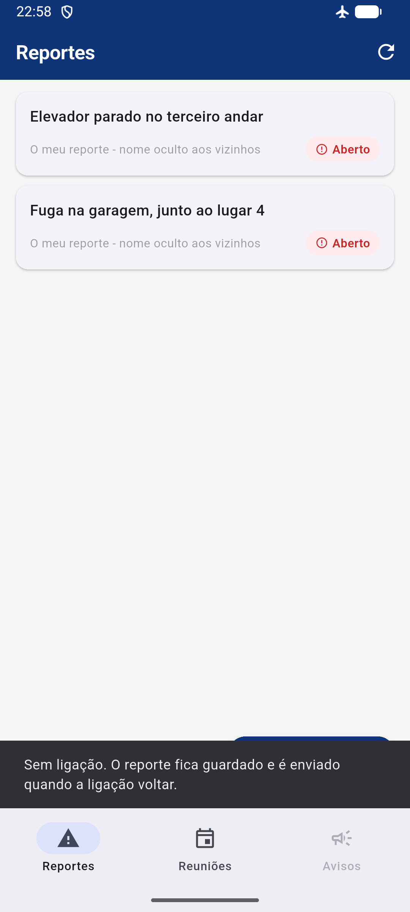<br>**4c. Sem internet** (sem foto): fica guardado na fila |
| 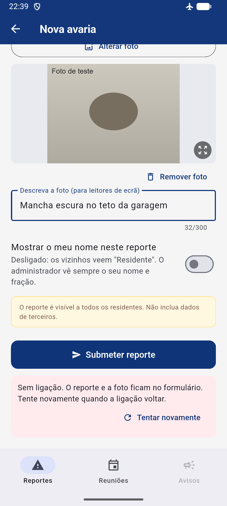<br>**4d. Sem internet com foto**: fica no formulário (diferença ao wireframe) | 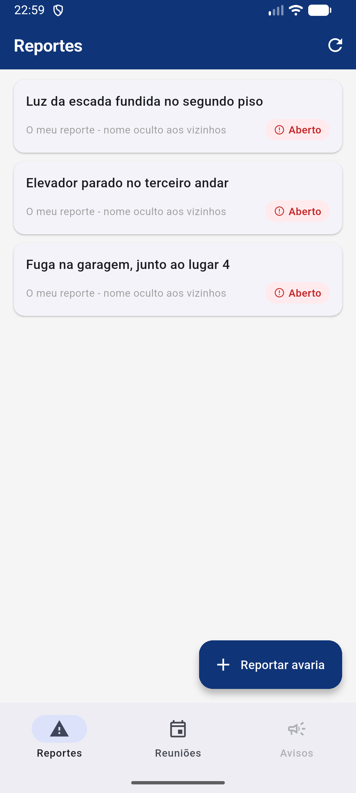<br>**5. Ligação de volta**: o reporte da fila foi enviado |

Em cada passagem ficaram na base de dados 3 reportes da residente, todos "aberto", sem duplicados: a nova tentativa do 4d reutilizou a chave e o reporte da fila do 4c foi enviado uma vez. Só o reporte com foto tem `foto_path` e `foto_alt`.
