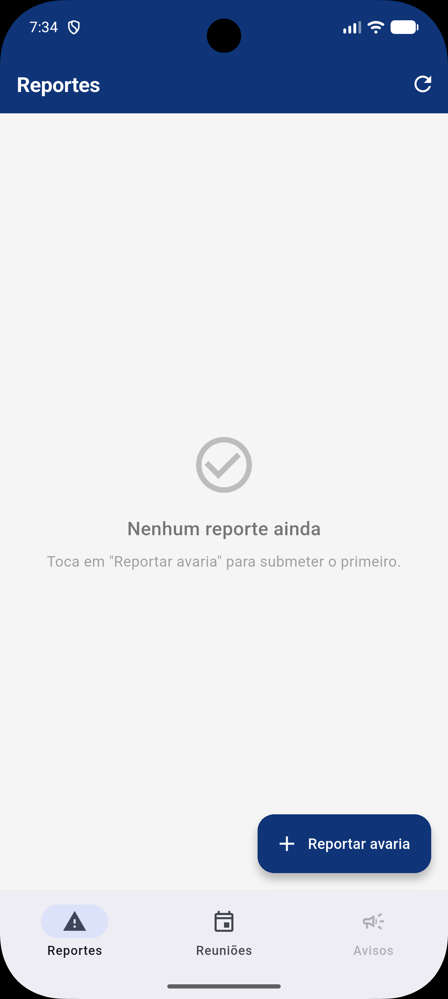
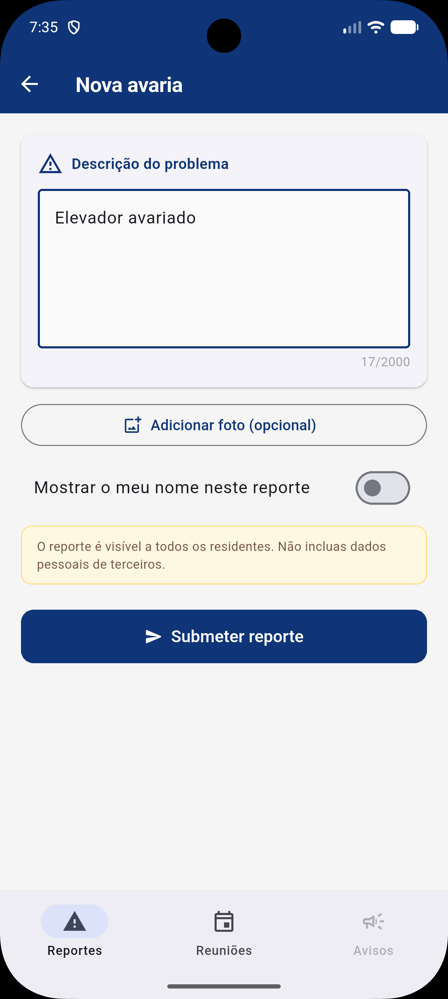
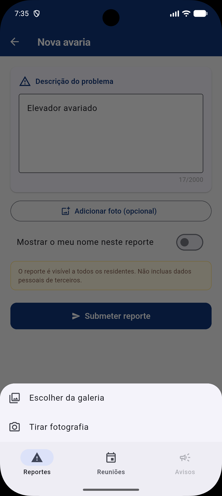
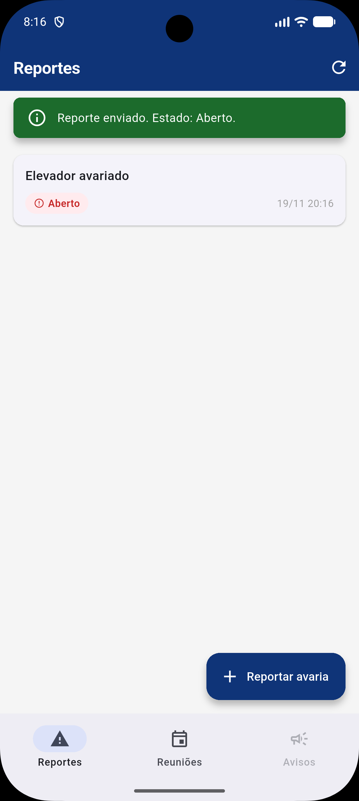
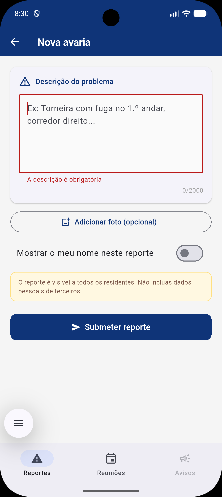

# US-02: Reportar avarias

> Estado: criação implementada na API e integrada na app móvel com a sessão residente da US-15. Esta história cobre o formulário e a criação autenticada do reporte; a consulta/listagem partilhada e a entrega das fotos pertencem à US-03.

Esta nota regista o contrato e o fluxo de criação da US-02, conforme o [refinamento](./refinamento.md#us-02-e-us-09-reportar-avaria-e-privacidade-do-autor) e o [wireframe](./design/us-02.html).

## Âmbito e dependência da US-03

| US-02 entrega | Fica para a US-03 |
|---|---|
| Formulário móvel para residente com descrição obrigatória, foto opcional e texto alternativo obrigatório quando há foto; aviso para não incluir dados pessoais de terceiros. | Lista partilhada de reportes para residentes e administrador, filtros, ordenação, atualização e detalhe do reporte. |
| `POST /reportes` autenticado pela credencial da identidade da US-15, validação do pedido, persistência do reporte e da foto, estado inicial `aberto` e idempotência por autor. | Autorização e regras de privacidade da consulta: o que cada residente pode ver, nome do autor conforme a US-09 e informação do autor/fração visível ao administrador. |
| Confirmação de submissão na app; em falhas, mantém o formulário e permite nova tentativa com a mesma chave. | Disponibilização da foto guardada para consulta na app e apresentação dos dados e anexos na lista/detalhe. |

Assim, o critério do Product Backlog de que o reporte é visível aos residentes e ao administrador é um resultado de ponta a ponta que depende da US-03. A criação e persistência de US-02 não significam que essa visibilidade esteja já disponível: o `GET /reportes` atual é apenas o walking skeleton e não deve ser usado para concluir que as regras de autorização e privacidade foram implementadas. A identidade usada na criação vem da US-15; a opção de expor ou ocultar o nome é da US-09.

## Contrato implementado

`POST /reportes` exige `Authorization: Bearer <credencial>` de uma identidade ativa e `Idempotency-Key` (1 a 64 caracteres). O corpo tem de ser `multipart/form-data`:

| Campo | Regra |
|---|---|
| `descricao` | Obrigatória; espaços exteriores removidos; 1 a 2000 caracteres |
| `foto` | Opcional; uma imagem JPEG ou PNG até 5 MiB |
| `foto_alt` | Obrigatório quando há foto; máximo de 300 caracteres |
| `mostrar_nome` | Booleano; falso por omissão |

O formulário recusa campos adicionais (incluindo telefone e e-mail). A identidade e o condomínio são determinados pela credencial, nunca por campos enviados pelo cliente. Uma credencial de administrador recebe `403`; credencial em falta, inválida ou removida recebe `401`.

A criação devolve `201` e define o estado `aberto`. Um reenvio com a mesma chave e identidade devolve `200` com o reporte já criado. A chave é única por autor. A foto é reprocessada pela API para remover metadados, guardada em `media/reportes/` e referenciada em `reporte.foto_path`; o volume `reportes_media` preserva os ficheiros no Docker Compose.

Os erros usam `{codigo, mensagem, request_id}` e o cabeçalho `X-Request-ID`. Se a base de dados estiver indisponível, a resposta é `503` com `Retry-After`.

Esta alteração não implementa a consulta/listagem de reportes nem a entrega da foto à app; esses percursos pertencem à US-03, conforme a separação de âmbito acima.

## App móvel e integração com a US-15

Na app, a pré-visualização mostra a imagem inteira numa área centrada e abre uma vista de ecrã inteiro com zoom. Durante o envio, o botão fica desativado e apresenta progresso; em caso de falha, os dados ficam no formulário e "Tentar novamente" reutiliza a chave de idempotência. A descrição, o controlo de ampliação da pré-visualização e as mensagens de estado/erro incluem apoio para leitores de ecrã.

O formulário Flutter envia `multipart/form-data` com Bearer e `Idempotency-Key`. Permite escolher uma foto da galeria ou tirar uma fotografia com a câmara; aceita JPEG/PNG até 5 MiB, exige texto alternativo e permite optar por mostrar o nome, desligado por omissão. Em falhas de ligação, mantém os dados para nova tentativa e reutiliza a chave de idempotência. A submissão não é colocada na fila offline, que continua a pertencer à US-18.

Depois de entrar pelo QR code, a US-15 guarda a credencial, o nome e a fração no armazenamento seguro do dispositivo. Tanto no primeiro acesso como na abertura seguinte da app, a credencial da sessão residente é encaminhada para o formulário e enviada no cabeçalho `Authorization`. A app não envia nome, fração ou identidade no corpo do reporte: a API determina o autor pela credencial. A sessão de administrador não recebe a ação de criar reporte.

## Validação

Resultados registados:

| Onde | Comando | Resultado |
|---|---|---|
| API (`DomusCast\api`) | `python -m pytest tests\ -q` | 42 testes passaram |
| API (`DomusCast\api`) | `python -m ruff check app tests alembic\versions\0003_report_idempotency_by_author.py` | Sem erros |
| API (`DomusCast\api`) | `alembic history` | Migração `0004_identidade_qr_token_id` aparece como `head`; preserva a revisão `0003` já aplicada |
| API (`DomusCast\api`) | `alembic upgrade head --sql` | SQL PostgreSQL das migrações gerado com sucesso (sem aplicar à base de dados) |
| App (`DomusCast\mobile`) | `flutter test test\us02_reportes_test.dart` | 13 testes passaram; inclui pré-visualização ampliada, progresso do envio e nova tentativa com a mesma chave |
| App (`DomusCast\mobile`) | `flutter analyze lib\screens\novo_reporte_screen.dart lib\widgets\aviso_popup.dart test\us02_reportes_test.dart` | Sem problemas |
| App (`DomusCast\mobile`) | `flutter build apk --debug` | Compilação concluída; APK debug gerado |

Os testes cobrem criação com e sem foto, remoção de EXIF, limites e formatos de imagem, descrição alternativa, rejeição de campos extra, permissões, formato multipart e idempotência por autor.

## Screenshots

Capturas da app no emulador Android, feitas em 19/11/2026:

| Evidência | Screenshot                                                                                               |
|---|----------------------------------------------------------------------------------------------------------|
| Lista inicial vazia, com a ação para iniciar um reporte |              |
| Formulário preenchido; opção de mostrar o nome desligada e aviso de privacidade visível |  |
| Seletor de origem da fotografia (galeria ou câmara) |                                |
| Submissão concluída: confirmação e reporte no estado "Aberto", visível sob o aviso |                |
| Validação no formulário quando a descrição obrigatória está vazia |               |
| Foto de formato horizontal selecionada; captura anterior ao ajuste da pré-visualização |                                                                                                          |
| Foto selecionada no formulário e controlo para ampliar |    |

As capturas de foto foram feitas antes do último ajuste de layout: na captura de formato retrato, a imagem aparece estreita e desalinhada; o layout foi entretanto ajustado para centrar a foto numa área de largura total. Falta tirar uma captura desse estado final. As capturas atuais também não mostram texto alternativo preenchido; a validação desse campo está coberta pelos testes automatizados.
