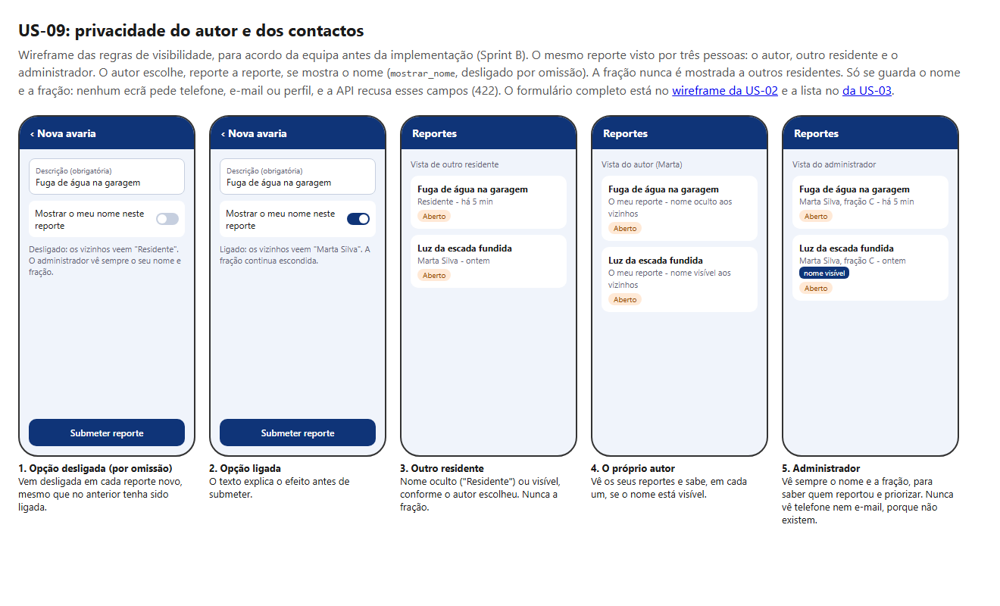
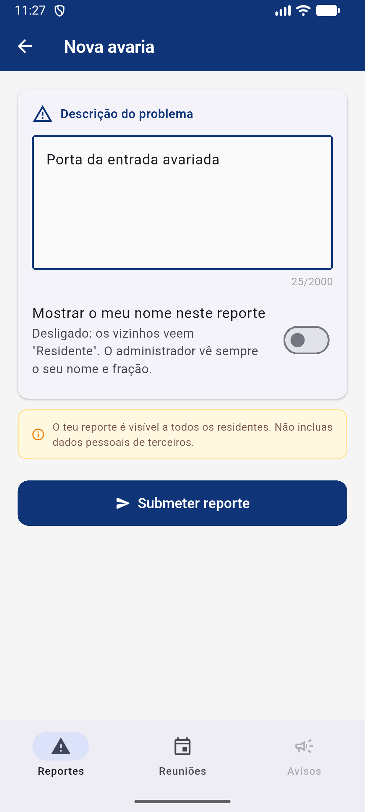
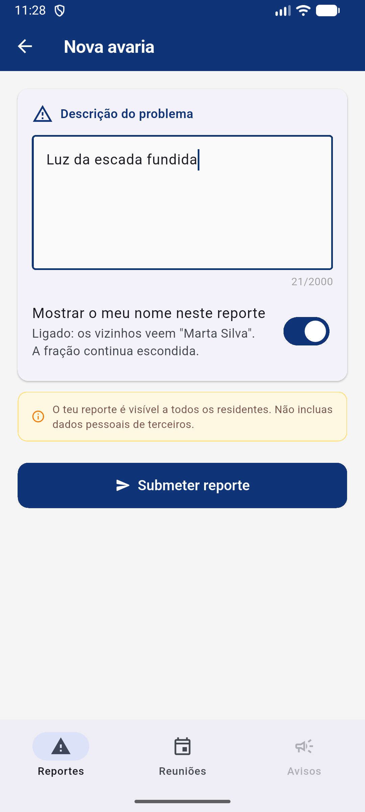
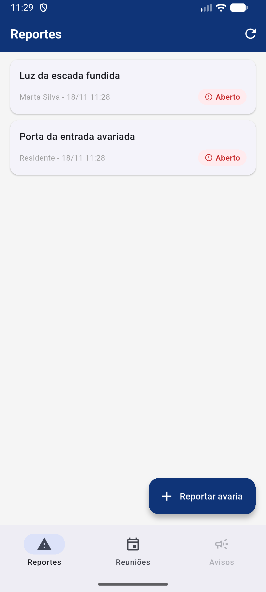
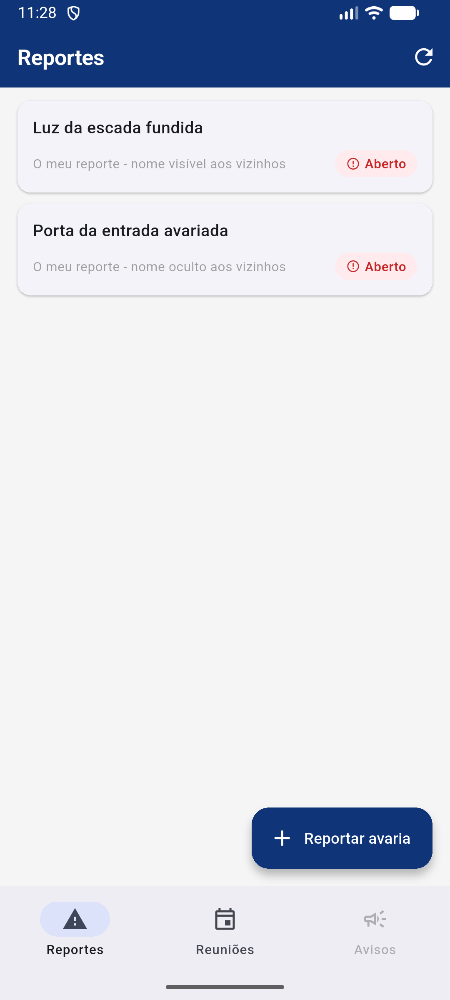
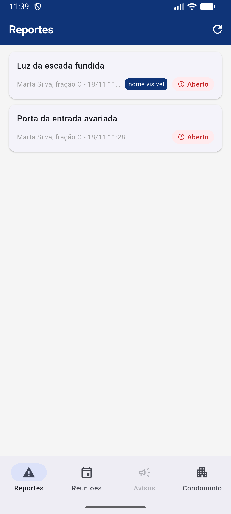

# US-09: Privacidade do autor e dos contactos

> Como **residente**, quero decidir se o meu nome aparece nos meus reportes e que a app não guarde o meu telefone nem outros dados pessoais, para preservar a privacidade. ([Product Backlog](../backlog.md#1-product-backlog))

Esta página reúne as evidências da US-09 no Sprint B: o desenho da interface, os testes automáticos e os screenshots da app a correr no emulador Android contra a API em Docker (PostgreSQL).

## Decisões tomadas na implementação

- **Escolha por reporte:** `mostrar_nome` é falso por omissão e fica guardado em cada reporte. O formulário abre sempre com a opção desligada.
- **Uma só regra de visibilidade na API:** `GET /reportes` e `POST /reportes` usam a mesma função. O administrador recebe sempre `autor_nome` e `fracao`. O residente nunca recebe `fracao` e só recebe `autor_nome` quando o autor mostrou o nome. Cada pessoa só vê os reportes do seu condomínio.
- **Campo `meu`:** a resposta ao residente indica se o reporte é dele, para a app mostrar "O meu reporte" (ecrã 4 do wireframe) sem enviar o nome nem a fração.
- **Autenticação:** a dependência `utilizador_atual` aceita a credencial do administrador ou do residente (US-15); `residente_atual` devolve 403 a um administrador. Sem credencial, inválida ou de uma identidade removida: 401.
- **Dados pessoais:** o pedido usa um modelo Pydantic com `extra="forbid"`, por isso `telefone`, `email`, `perfil` ou qualquer outro campo desconhecido dá 422. A tabela `identidade` não tem campos de contacto.
- **Formato do pedido:** `POST /reportes` continua em JSON. O formulário multipart com foto é da US-02, que ainda não está implementada; quando for, o modelo do formulário tem de manter `extra="forbid"`.
- **Idempotência por autor:** a `idempotency_key` é única por autor (migração `0004`, como no [modelo de dados](../sprintA/sprintA.md#83-modelo-de-dados)) e não em toda a tabela: dois residentes com a mesma chave criam cada um o seu reporte (201), e um reenvio só devolve o reporte se for do mesmo autor. Se dois pedidos do mesmo autor chegarem ao mesmo tempo, o `IntegrityError` é apanhado e devolve-se o reporte gravado, em vez de 500. Levantado na revisão do PR.
- **Administrador:** não vê "Reportar avaria", porque a API recusa reportes de administradores (403).
- **Fila offline:** um erro da API (401, 403, 422) mostra uma mensagem e não vai para a fila, porque reenviar não o resolve; um 5xx (servidor indisponível) e qualquer outra falha (sem rede, TLS, timeout) guardam o reporte na fila, como antes ([ADR-006](../sprintA/sprintA.md#adr-006-fila-local-no-dispositivo-offline-first-para-escrita)). A preferência `mostrar_nome` fica na fila SQLite e é reenviada com o reporte. Ao enviar a fila: o administrador não a envia (daria 403); 401 e 5xx param e tentam no próximo refresh; outro 4xx tira o reporte da fila, para não bloquear os seguintes. Levantado na revisão do PR.
- **Defeito corrigido:** depois de pedir o nome (US-15), os Reportes abriam sem a credencial do residente e davam 401. Encontrado no emulador; o teste da US-15 passou a verificar o cabeçalho `Authorization`.

## Desenho da interface

Wireframe acordado antes da implementação: [design/us-09.html](design/us-09.html).



Diferenças na implementação:

- As descrições dos reportes de demonstração são "Porta da entrada avariada" e "Luz da escada fundida": o teclado do emulador, conduzido por `adb`, não escreve acentos.
- As datas aparecem como "18/11 11:28" (formato já existente na lista), não "há 5 min" ou "ontem"; o formato relativo é da US-03.
- Na vista do administrador, a data é cortada ("11...") quando aparece a etiqueta "nome visível".
- Aprovação da equipa: diferenças aprovadas por Pedro Soares a 2026-11-16.

## Critérios de aceitação e evidências

| Critério | Evidência |
|---|---|
| Nome oculto aos outros residentes por omissão; opção "mostrar o meu nome" por reporte, desligada por omissão | pytest: `test_mostrar_nome_desligado_por_defeito`, `test_residente_sem_mostrar_nome_nao_e_identificado_a_outro_residente`, `test_residente_com_mostrar_nome_e_identificado_a_outro_residente`. Flutter: "1. opção do nome começa desligada e explica o efeito", "2. ligar a opção mostra o nome e envia mostrar_nome verdadeiro", "sem ligar a opção envia mostrar_nome falso". Screenshots 1, 2 e 3 |
| A fração nunca é mostrada a outros residentes | pytest: `test_residente_com_mostrar_nome_e_identificado_a_outro_residente`, `test_autor_ve_os_seus_reportes_como_meus`, `test_criar_reporte` (`fracao` nula também na resposta ao autor). Flutter: "3. outro residente vê "Residente" ou o nome mostrado, nunca a fração". Screenshot 3 |
| Só se guarda fração e nome; sem telefone, e-mail nem perfil | pytest: `test_campos_de_contacto_sao_rejeitados` (`telefone`, `email`, `perfil`), `test_pedido_com_foto_e_so_campos_previstos_e_aceite`, `test_identidade_nao_tem_campos_de_contacto`. Na API em Docker: `telefone` e `email` deram 422 e a tabela `identidade` no PostgreSQL só tem `id`, `fracao_id`, `nome`, `nome_normalizado`, `papel`, `credencial_hash`, `criado_em`, `removida_em`, `qr_token_id` |
| Nenhum residente vê o contacto de outro nem o autor de um reporte (salvo se o autor o mostrar) | pytest: `test_residente_sem_mostrar_nome_nao_e_identificado_a_outro_residente`, `test_residente_de_outro_condominio_nao_ve_os_reportes`, `test_administrador_ve_nome_e_fracao`. Flutter: "4. o autor vê "O meu reporte" e se o nome está visível", "5. o administrador vê nome e fração, e a etiqueta "nome visível"". Screenshots 3, 4 e 5 |

## Testes automáticos

| Onde | Ficheiro | Testes | Resultado |
|---|---|---|---|
| API (pytest) | [`DomusCast/api/tests/test_reportes.py`](../../DomusCast/api/tests/test_reportes.py) | 17 novos e 3 ajustados (21 no ficheiro, 59 na suite) | 59 passed; `ruff check .` sem erros; migração `0004` testada em PostgreSQL (upgrade, downgrade e upgrade) |
| App (flutter test) | [`DomusCast/mobile/test/us09_privacidade_test.dart`](../../DomusCast/mobile/test/us09_privacidade_test.dart) e [`us15_residente_test.dart`](../../DomusCast/mobile/test/us15_residente_test.dart) | 14 novos e 1 ajustado (52 na suite) | 52 passed; `flutter analyze` sem problemas (Flutter do CI, com [`flutter-docker.ps1`](../../DomusCast/mobile/flutter-docker.ps1)) |

Casos de falha cobertos: 401 sem credencial (criar e listar) e com credencial inválida, 403 administrador a criar reporte, 422 com `telefone`, `email` ou `perfil`, residente de outro condomínio não vê os reportes; na app, 401 ao submeter mostra a mensagem e não guarda o reporte na fila offline, e 5xx ao submeter guarda-o na fila.

Como correr:

```powershell
cd DomusCast\api; pip install -r requirements-dev.txt; pytest tests/ -v; ruff check .
cd DomusCast\mobile; flutter analyze; flutter test
```

## Screenshots

App em modo debug no emulador Android, ligada à API em Docker com PostgreSQL. O condomínio "Torre Aurora" foi criado na app pela administradora (US-01) e os QR codes das frações A e C foram gerados na app. A Marta Silva (fração C) e o Rui Costa (fração A) entraram pelo link do QR code (US-15). Para voltar à sessão da administradora depois de mudar de residente, usou-se um snapshot do emulador guardado logo após a criação do condomínio.

| | |
|---|---|
| <br>**1. Opção desligada (por omissão)** | <br>**2. Opção ligada** |
| <br>**3. Outro residente (Rui Costa)** | <br>**4. O próprio autor (Marta Silva)** |
| <br>**5. Administrador** | |
