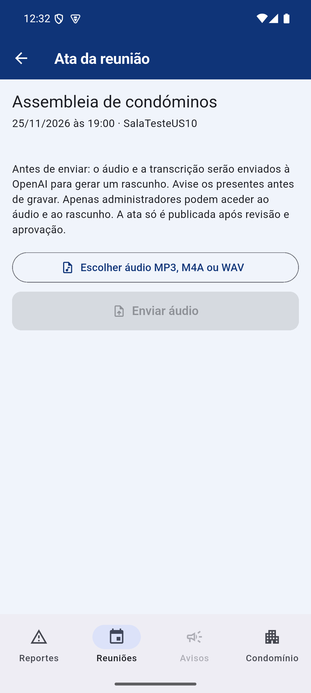
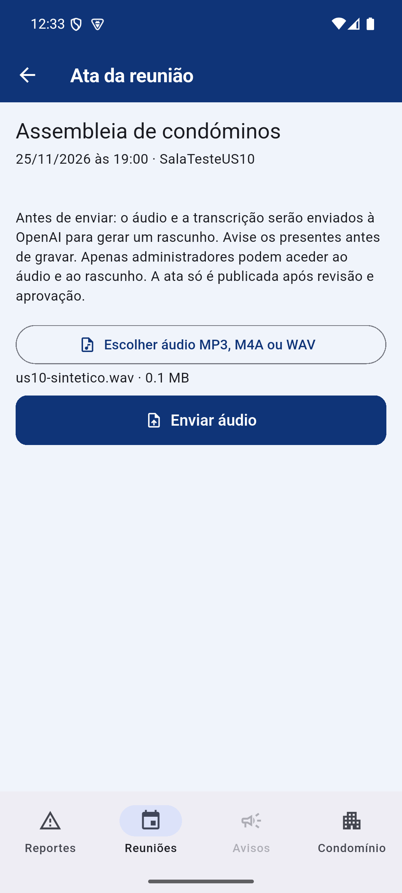
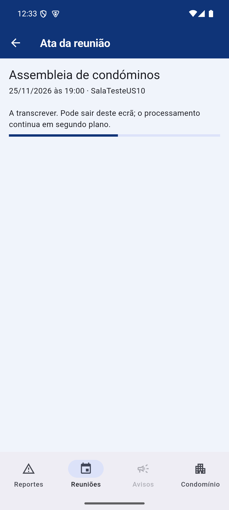
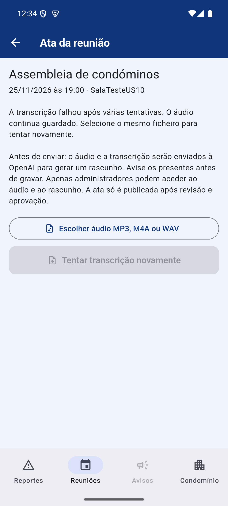
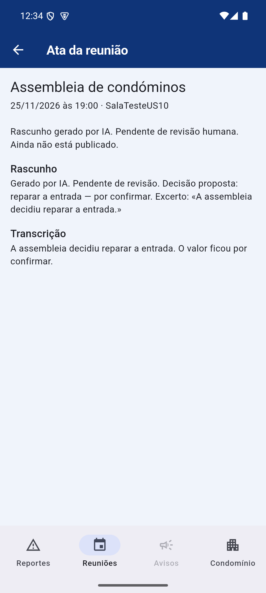

# US-10: Transcrição de ata por IA

> Como **administrador**, quero carregar o áudio de uma assembleia e obter uma transcrição e um rascunho de ata, para não a escrever do zero. ([Product Backlog](../backlog.md#1-product-backlog), [issue #88](https://github.com/LMNSdev/LABDSOF_DOMUSCAST/issues/88))

Esta página reúne as decisões, os testes e as capturas da US-10. O percurso segue o [refinamento](refinamento.md#us-10-transcrição-de-ata-por-ia), o [Technical Design](../sprintA/sprintA.md#71-fluxo-assistido-por-ia) e o [wireframe](design/us-10.html).

## Decisões tomadas na implementação

- **Acesso e privacidade:** apenas administradores do mesmo condomínio podem enviar áudio e consultar o original, a transcrição e o rascunho. A app avisa antes do envio à OpenAI. As respostas privadas têm `Cache-Control: private, no-store`; o pedido de rascunho à Responses API usa `store: false` ([referência da OpenAI](https://developers.openai.com/api/reference/resources/responses/methods/create)). As condições de retenção do fornecedor continuam a exigir a avaliação prevista no [modelo de ameaças](../sprintA/sprintA.md#106-modelo-de-ameaças-inicial).
- **Upload e estado:** `POST /reunioes/{id}/ata/audio` guarda o original num volume partilhado e cria a ata e o job na mesma transação. Responde `202` com `a_transcrever`. A app consulta `GET /reunioes/{id}/ata` a cada 15 segundos durante o processamento. O Caddy limita o corpo multipart desta rota a 201 MB antes da API; o ficheiro tem limite de 200 MB.
- **Idempotência e recuperação:** o SHA-256 identifica um reenvio do mesmo ficheiro. Após falha, `POST /reunioes/{id}/ata/repetir` reutiliza o áudio e o job. Um áudio inválido ou demasiado longo pode ser substituído por outro, mantendo uma única ata e um único job. Repetir enquanto já processa devolve o estado atual.
- **Processamento:** o Worker reserva jobs `transcrever` por `FOR UPDATE SKIP LOCKED`, normaliza com FFmpeg e divide gravações longas em partes de até 15 minutos e 25 MB. Usa `gpt-transcribe` para transcrever e `gpt-4o-mini` para propor o rascunho. O áudio não é enviado ao modelo de redação. O rascunho compara os excertos das decisões com a transcrição após normalizar espaços e pontuação; uma decisão sem suporte fica marcada para revisão, sem citação atribuída falsamente.
- **Falhas:** há no máximo cinco tentativas para erros transitórios, com quatro esperas de 1, 2, 4 e 8 minutos. Chave ou créditos ausentes, ferramenta de áudio indisponível, ficheiro inválido ou duração superior a 3 horas falham logo e mostram o motivo na app. O áudio original permanece guardado. Uma resposta tardia do Worker não altera uma ata aprovada ou manual.
- **Aprovação:** o rascunho nunca é publicado automaticamente. Quando a US-24 marcar a ata como `aprovada`, o Worker apaga o original, a transcrição e o rascunho; a limpeza é retomada depois de uma interrupção. A ata manual em falha pertence à US-25. A fila offline para áudio pertence à US-18.

| Decisão | Valor implementado | Estado documental |
|---|---|---|
| Formatos e tamanho total | MP3, M4A e WAV; 200 MB | A confirmar pela equipa no refinamento |
| Duração | Até 3 horas | A amostra de 60 minutos no Technical Design é uma meta de avaliação, não um limite do produto |
| Partes enviadas à OpenAI | Até 15 minutos e 25 MB por pedido | Limite de tamanho do serviço externo e redução do risco de timeout |
| Tentativas | 5 no total; esperas de 1, 2, 4 e 8 minutos | O refinamento enumera também 16 minutos, que só caberiam antes de uma sexta tentativa; decisão da equipa pendente |
| Chave da OpenAI | `OPENAI_API_KEY` apenas no Worker | Definir em `DomusCast/.env` no desenvolvimento ou `/opt/domuscast/.env` na VM; nunca versionar |

## Desenho da interface

O [wireframe aprovado](design/us-10.html) prevê envio, processamento, rascunho e falha. A implementação acrescenta o aviso explícito sobre a OpenAI antes da escolha do ficheiro, a consulta de reuniões passadas, a repetição sem novo upload e a substituição de áudio inválido. Estas diferenças foram introduzidas para cumprir a privacidade e permitir recuperação após falha.

Aprovação específica destas diferenças pela equipa: **pendente de registo**. Os testes de semântica Flutter verificam rótulos, ações e anúncio de estados; falta uma sessão manual documentada com TalkBack em PT-PT.

## Critérios de aceitação e evidências

| Critério da issue #88 | Evidência / limite |
|---|---|
| Carregar áudio associado a uma assembleia | Endpoint privado, teste de upload e screenshots 1 e 2 |
| Processamento assíncrono com transcrição, rascunho e novas tentativas | Outbox, Worker, testes de estados e cinco tentativas; screenshot 3. O contrato HTTP da OpenAI foi testado com respostas simuladas. Uma chamada real devolveu `credit_balance_exhausted`, pelo que o resultado real ainda não foi validado |
| Rascunho identificado como IA, pendente de revisão, com incerteza assinalada | Validação do esquema, marcação `por confirmar`, testes de excertos e screenshot 5 com texto sintético. A aprovação é da US-24 |
| Áudio guardado mesmo se a transcrição falhar | Testes de falha e consulta privada do original; screenshot 4 e volume Docker verificado |
| Áudio apagado após aprovação | Worker de limpeza e teste de recuperação implementados. A validação ponta a ponta depende da aprovação da US-24 |

## Testes automáticos

- API: `cd DomusCast/api && pytest tests/ -q && ruff check .` cobre autorização, isolamento entre condomínios, 413/415/422/503, deduplicação, falhas definitivas e transitórias, substituição de áudio, resposta tardia, limpeza retomável e contrato HTTP simulado.
- App: `cd DomusCast/mobile && flutter test` cobre upload multipart, aviso de privacidade, estados, erros, reuniões passadas e semântica de acessibilidade.
- Integração local: migração Alembic testada em PostgreSQL; API e Worker iniciados no Docker Compose; FFmpeg processou WAV sintético. O emulador Android 15 mostrou envio, processamento, falha e repetição com uma ata e um job.
- A transcrição real com chave OpenAI foi tentada, mas a API respondeu `429 credit_balance_exhausted`. A avaliação de gravações de 10 a 15 e 60 minutos prevista em [7.4](../sprintA/sprintA.md#74-abordagem-de-avaliação) depende de créditos e das amostras da equipa.

## Screenshots

As capturas usam o condomínio local `TesteUS10` e um WAV sintético. A última mostra texto sintético inserido na base de teste para verificar o ecrã; **não é uma resposta da OpenAI**.

| | |
|---|---|
|  **1. Aviso antes do envio** |  **2. Ficheiro selecionado** |
|  **3. Processamento assíncrono** |  **4. Falha com áudio preservado** |
|  **5. Rascunho sintético pendente de revisão** | |
