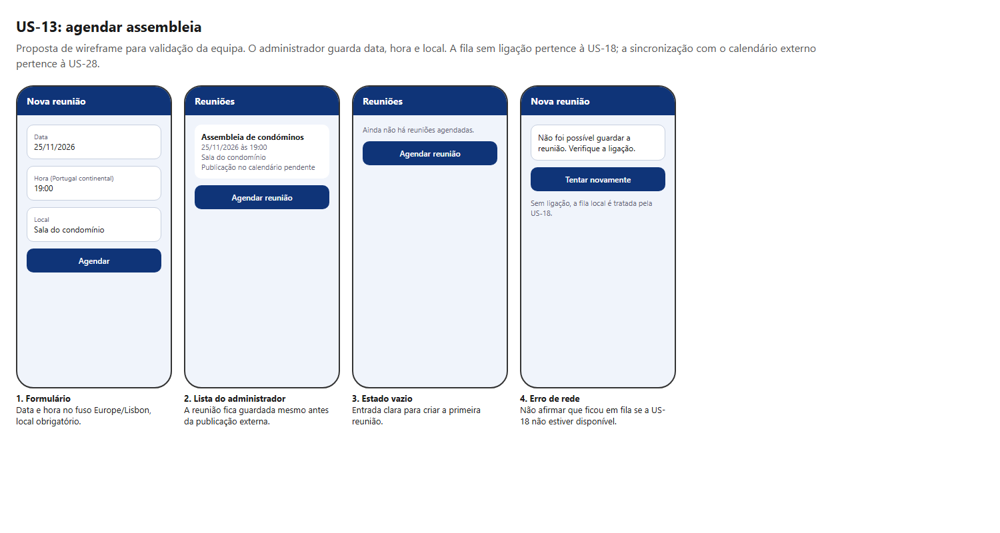
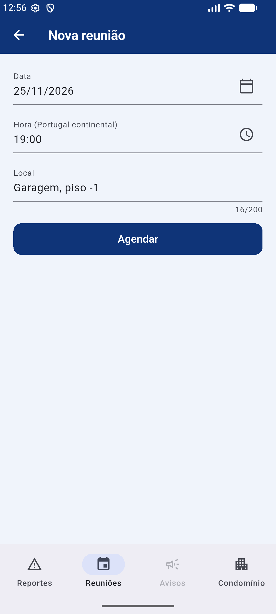
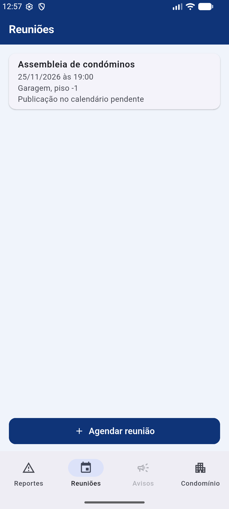
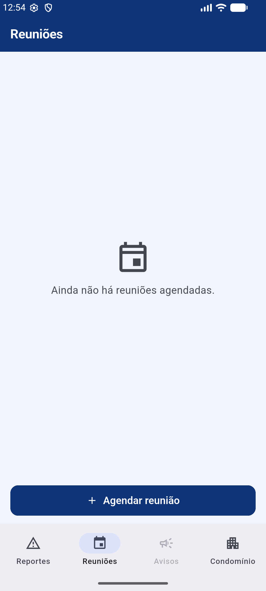
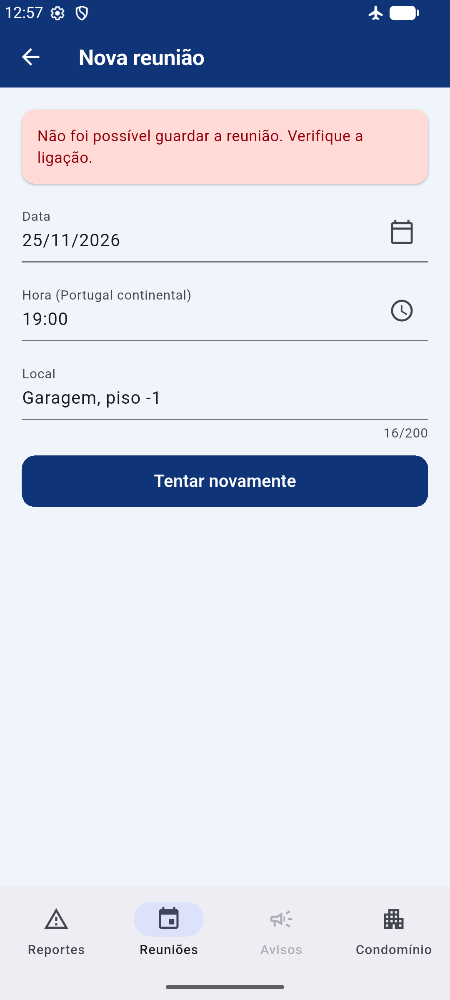
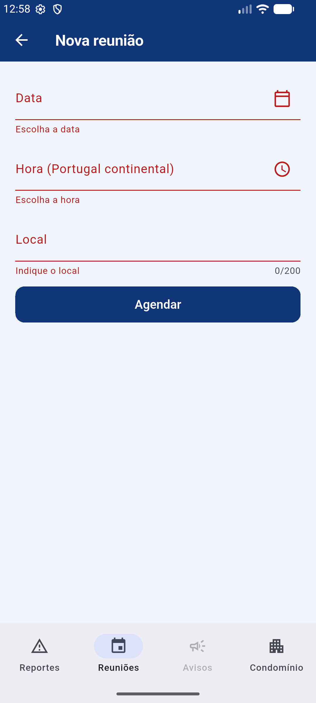
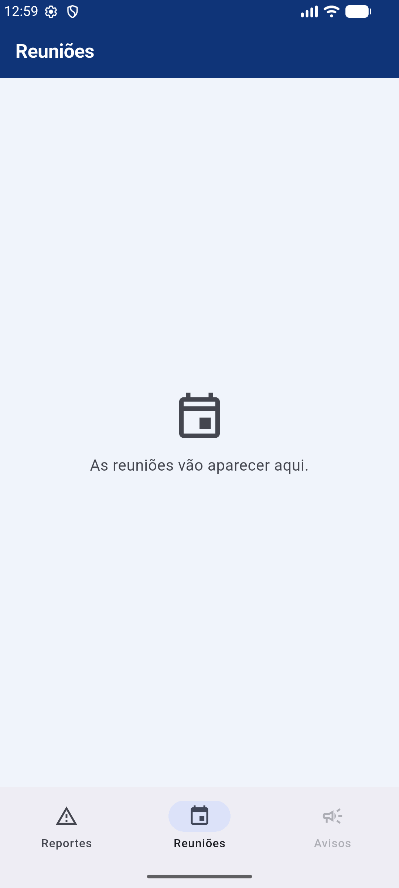

# US-13: Agendar reunião

> Como **administrador**, quero agendar uma assembleia (data, hora e local), para que os residentes saibam quando é. ([Product Backlog](../backlog.md#1-product-backlog))

Esta página reúne as evidências da US-13 no Sprint B: o desenho da interface, os testes automáticos e os screenshots da app a correr no emulador Android contra a API em Docker (PostgreSQL).

## Decisões tomadas na implementação

- **Data e hora:** o administrador escolhe a data e a hora de Portugal continental; a app envia-as em UTC, com fuso (ISO 8601). A API recusa datas no passado, sem fuso ou noutro formato (422), e o local tem de ter entre 1 e 200 caracteres, como proposto no [refinamento](refinamento.md#us-13-agendar-reunião).
- **Publicação no calendário (US-28):** `POST /reunioes` guarda a reunião com `estado_sync` `pendente` e cria o job `publicar_calendario` na mesma transação ([8.5](../sprintA/sprintA.md#85-workflow-assíncrono)). A reunião fica guardada mesmo que a publicação falhe; o Worker que a publica é a US-28.
- **`GET /reunioes`:** sem `desde`, devolve as reuniões de hoje em diante (dia de Portugal continental), por data. Com `desde`, devolve as criadas a partir dessa data, para a app sincronizar só o que mudou. Administrador e residentes veem apenas as do seu condomínio.
- **Erros:** 401 sem credencial, 403 `sem_permissao` para residente ao criar, 422 `dados_invalidos`, 503 `servico_indisponivel` com `Retry-After`, todos no formato `{codigo, mensagem, request_id}` ([8.4](../sprintA/sprintA.md#84-api-esboço)).
- **Sem internet:** a reunião não fica guardada e a app não diz que ficou em fila; mostra o erro e "Tentar novamente", com os dados preenchidos. A fila local é a US-18.
- **Residente:** o separador Reuniões mostra só "As reuniões vão aparecer aqui.", sem o botão de agendar. Ver as reuniões na app é a US-27; a API já as devolve ao residente.
- **Acessibilidade dos seletores:** no Flutter, um campo só de leitura não expõe o toque ao leitor de ecrã. Os campos Data e Hora juntam o toque ao rótulo e são anunciados como botões, para o TalkBack abrir o seletor.

## Desenho da interface

Wireframe acordado antes da implementação: [design/us-13.html](design/us-13.html).



Diferenças na implementação, aprovadas pela equipa:

- O botão "Agendar reunião" fica fixo no fundo do ecrã, na lista e no estado vazio; no wireframe está logo abaixo do conteúdo.
- O estado vazio e a vista do residente têm um ícone de calendário.
- O campo Local mostra o contador de caracteres (por exemplo, "16/200").
- O formulário abre dentro do separador Reuniões, com a barra de separadores visível.
- A nota do ecrã 4 ("Sem ligação, a fila local é tratada pela US-18") é uma anotação do wireframe e não aparece na app.

## Critérios de aceitação e evidências

| Critério | Evidência |
|---|---|
| Agendar reunião com data, hora e local | pytest: `test_admin_agenda_reuniao_com_publicacao_pendente`, `test_hora_com_offset_e_guardada_no_instante_certo`, `test_data_invalida_devolve_422` (passado, sem fuso, formato inválido), `test_local_vazio_ou_acima_de_200_devolve_422`, `test_local_com_200_caracteres_e_aceite`, `test_campo_desconhecido_devolve_422`, `test_dados_invalidos_nao_criam_reuniao_nem_job`, `test_agendar_sem_credencial_401`, `test_residente_nao_agenda_403`, `test_base_de_dados_indisponivel_devolve_503`. App: "1. envia a data e a hora em UTC e o local, e fecha", "campos vazios mostram os erros e não chamam a API", "data no passado é recusada sem chamar a API", "erro 422/403/503 mostra a mensagem própria e mantém os dados", "residente não vê o agendamento nem chama a API". Screenshots 01, 05 e 06 |
| A reunião fica guardada e disponível para publicação (US-28) e para o feed iCal (US-29) | pytest: `test_agendar_cria_um_job_publicar_calendario`, `test_admin_e_residente_veem_as_reunioes_do_condominio_por_data`, `test_lista_vazia_devolve_200`, `test_nao_ve_reunioes_de_outro_condominio`, `test_sem_desde_nao_mostra_reunioes_de_dias_anteriores`, `test_desde_devolve_as_criadas_depois_dessa_data`. App: "2. mostra data, hora, local e a publicação pendente", "mostra os outros estados da publicação", "3. estado vazio convida a agendar", "quando o formulário confirma, volta à lista atualizada com a confirmação". Screenshots 02 e 03. Na demo, a reunião ficou na tabela `reuniao` do PostgreSQL com `data_hora` 2026-11-25 19:00 UTC e `estado_sync` `pendente`. A publicação é a US-28 e o feed é a US-29 |
| Sem internet, a reunião fica em fila local (US-18) | Não cumprido nesta US: a fila local é a US-18, ainda por refinar, como decidido no [refinamento](refinamento.md#us-13-agendar-reunião). Até lá, a app não afirma que guardou: "4. sem ligação não diz que guardou e Tentar novamente reenvia". Screenshot 04 (modo de avião) e 02 (a mesma reunião criada depois de "Tentar novamente") |

**TalkBack:** testado no emulador a 2026-11-21, com o TalkBack em PT-PT. Na [gravação do TalkBack](screenshots/us-13/07-talkback.mp4) vê-se o percurso pelos gestos: o estado vazio, a ativação de "Agendar reunião", os seletores da Data e da Hora abertos a partir do foco do leitor de ecrã, o preenchimento do Local e a reunião criada na lista. O leitor de ecrã leu tudo em português. Os erros dos campos vazios foram anunciados ao carregar em "Agendar", e sem rede o erro "Não foi possível guardar a reunião. Verifique a ligação." foi anunciado sozinho (ambos verificados fora da gravação). Os testes de widgets verificam as etiquetas, a ação de toque e o contraste (`labeledTapTargetGuideline`, `textContrastGuideline`).

## Testes automáticos

| Onde | Ficheiro | Testes | Resultado |
|---|---|---|---|
| API (pytest) | [`DomusCast/api/tests/test_reunioes.py`](../../DomusCast/api/tests/test_reunioes.py) | 21 novos (92 na suite) | 92 passed; `ruff check .` sem erros |
| App (flutter test) | [`DomusCast/mobile/test/us13_reunioes_test.dart`](../../DomusCast/mobile/test/us13_reunioes_test.dart) | 14 novos (83 na suite) | 83 passed; `flutter analyze` sem problemas (Flutter 3.47.9, como no CI) |

Casos de falha cobertos: data no passado, sem fuso ou em formato inválido (422), local vazio, só com espaços ou acima de 200 caracteres (422), campo desconhecido (422), sem credencial (401), residente a agendar (403), base de dados indisponível (503), reuniões de outro condomínio não aparecem. Na app: campos vazios e data no passado recusados sem chamar a API, cada erro com a sua mensagem e os dados mantidos, erro ao carregar a lista com "Tentar novamente", e sem ligação a reunião não é dada como guardada.

Como correr:

```powershell
cd DomusCast\api; pip install -r requirements-dev.txt; pytest tests/ -v
cd DomusCast\mobile; flutter test
```

## Screenshots

App em modo debug no emulador Android (API 37), ligada à API em Docker com PostgreSQL, a 2026-11-21. O emulador estava no fuso GMT, que em novembro coincide com Portugal continental. Os dados do residente (condomínio, reunião e QR code) foram criados pela API. O local "Garagem, piso -1" não tem acentos porque o `adb` só escreve texto ASCII.

| | |
|---|---|
| <br>**1. Formulário** preenchido | <br>**2. Lista do administrador**, com a publicação pendente |
| <br>**3. Estado vazio**, antes da primeira reunião | <br>**4. Erro de rede** (modo de avião): não diz que guardou |
| <br>**5. Campos vazios**, recusados na app | <br>**6. Residente**: sem o botão de agendar |
