# US-15: Identificar residente pelo nome (QR code partilhado)

> Como **residente**, quero indicar o meu nome no primeiro acesso pelo QR code da fração, para que o administrador saiba quem reportou, mesmo com QR code partilhado. ([Product Backlog](../backlog.md#1-product-backlog))

Esta página reúne as evidências da US-15 no Sprint B: o desenho da interface, os testes automáticos e os screenshots da app a correr no emulador Android contra a API em Docker (PostgreSQL).

## Decisões tomadas na implementação

- **Formato dos erros:** o `POST /identidades` responde a 404 e 409 com `{codigo, mensagem, request_id}` ([8.4](../sprintA/sprintA.md#84-api-esboço)), como acordado no [refinamento](refinamento.md), através de uma exceção `ErroApi` e de um handler na API. O 422 (validação do FastAPI) e o 429 (limite partilhado com a US-01) continuam com `{"detail": ...}`; a app só precisa do código HTTP nesses casos. O `request_id` é gerado em cada erro; o cabeçalho `X-Request-ID` e os logs estruturados (8.7) ficam para quando forem implementados.
- **Códigos:** `nome_duplicado` e `fracao_cheia` no 409; `qr_invalido` no 404, igual para token inválido e revogado (TM-01).
- **Limite de tentativas:** 30 por hora por QR code, contadas sem IP; 20 tentativas com token inválido ou revogado por hora por IP, como decidido no refinamento. Os contadores ficam em memória, como os da US-01.
- **Fração completa antes de nome repetido:** com 10 identidades ativas a resposta é `fracao_cheia`, mesmo que o nome também esteja repetido, porque mudar o nome não resolve.
- **Nome repetido:** a comparação ignora maiúsculas, acentos e todos os espaços, por isso "Ana Maria" e "AnaMaria" contam como o mesmo nome.
- **Resposta:** `{id, nome, fracao, credencial}`, com a designação da fração para o ecrã 5 ("Entrou na fração A").
- **Identidade no telemóvel:** credencial, nome e fração no armazenamento seguro (Android Keystore); no servidor só o hash da credencial. Com identidade guardada, a app abre nos Reportes e ignora novos links `domuscast://entrar`.
- **Textos do sistema em PT-PT:** a app passou a declarar a língua portuguesa (`flutter_localizations`). Antes, o leitor de ecrã anunciava o botão de voltar como "Back" e os separadores em inglês, mesmo num telemóvel em português.
- **QR code que não é do DomusCast:** a app mostra logo "QR code inválido", sem chamar a API.

## Desenho da interface

Wireframe acordado antes da implementação: [design/us-15.html](design/us-15.html).

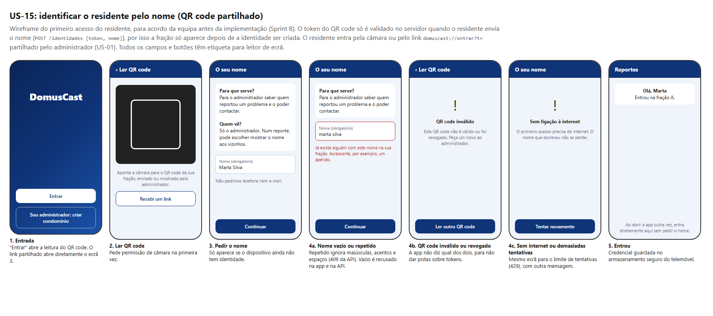

Diferenças na implementação, aprovadas pela equipa em 2026-11-17:

- "Recebi um link" abre uma caixa para colar o link `domuscast://entrar?t=`; o wireframe só mostra o botão.
- No ecrã 5, a saudação "Olá, Marta. Entrou na fração A." aparece numa mensagem temporária sobre os Reportes, não num cartão fixo.
- Novo ecrã "Não foi possível entrar" para erros do servidor (5xx), que o wireframe não tinha.

## Critérios de aceitação e evidências

| Critério | Evidência |
|---|---|
| No primeiro acesso sem identidade, a app pede o nome (obrigatório) antes de reportar, explicando para que serve e quem o vê | App: "o link domuscast://entrar abre o ecrã do nome", "explica para que serve o nome e quem o vê", "nome vazio é recusado sem chamar a API". pytest: `test_nome_vazio_devolve_422`. Screenshots 01 a 05 e 07 |
| Rejeita nome vazio ou igual ao de outra identidade da fração (ignorando maiúsculas, acentos e espaços); o mesmo nome noutra fração é permitido | pytest: `test_nome_vazio_devolve_422`, `test_nome_repetido_na_fracao_devolve_409_nome_duplicado` (4 variantes), `test_mesmo_nome_noutra_fracao_e_aceite`. App: "nome repetido na fração mostra a mensagem no campo". Screenshots 06 e 07 |
| Vários residentes da mesma fração têm identidades distintas com o mesmo QR code | pytest: `test_varios_residentes_com_o_mesmo_qr_tem_identidades_distintas`, `test_11a_identidade_da_fracao_devolve_409_fracao_cheia`. App: "fração com 10 residentes mostra Fração completa". Screenshot 08. Na demo, a "Marta Silva" (criada antes) e o "Rui Costa" (screenshot 11) ficaram na fração A com o mesmo `qr_token_id` e credenciais diferentes (consulta à tabela `identidade` no PostgreSQL) |
| A identidade fica no dispositivo e não volta a pedir o nome | App: "entra, guarda a identidade no telemóvel e abre os Reportes", "com identidade guardada abre os Reportes sem pedir o nome". pytest: `test_cria_identidade_e_devolve_credencial_e_fracao` (só o hash da credencial). Screenshots 11 e 12 |
| Ecrã utilizável com leitor de ecrã; primeiro acesso requer internet | App: "botões e campos do ecrã do nome têm etiqueta" e "botões do ecrã de ler o QR code têm etiqueta" (`labeledTapTargetGuideline`, `textContrastGuideline`), "sem internet avisa e Tentar novamente envia o mesmo nome". Screenshot 10 (modo de avião) e 11 (o mesmo nome enviado ao tentar novamente). No emulador, com o TalkBack 17 ligado e a explorar pelo toque, todos os elementos do ecrã do nome ficam focados e têm etiqueta: voltar, título, explicação, campo "Nome (obrigatório)", "Não pedimos telefone nem e-mail." e "Continuar". Verificado em [gravação do TalkBack de 18/11/2026](screenshots/us-15/15-talkback.mp4): os gestos percorrem o ecrã do nome e os erros são anunciados pelo leitor de ecrã. |

## Testes automáticos

| Onde | Ficheiro | Testes | Resultado |
|---|---|---|---|
| API (pytest) | [`DomusCast/api/tests/test_identidades.py`](../../DomusCast/api/tests/test_identidades.py) | 15 novos (42 na suite) | 42 passed; `ruff check .` sem erros |
| App (flutter test) | [`DomusCast/mobile/test/us15_residente_test.dart`](../../DomusCast/mobile/test/us15_residente_test.dart) | 14 novos, mais 1 em `widget_test.dart` (36 na suite) | 36 passed; `flutter analyze` sem problemas (Flutter 3.47.9, como no CI) |

Casos de falha cobertos: nome vazio (422), campo de contacto no pedido (422), nome repetido com maiúsculas, acentos e espaços (409 `nome_duplicado`), 11.ª identidade da fração (409 `fracao_cheia`), token inválido e revogado com a mesma resposta (404), 31.ª tentativa no mesmo QR code, mesmo de outro IP (429), 21.ª tentativa com token inválido no mesmo IP (429), 11 vizinhos no mesmo IP com QR codes válidos sem 429. Na app: cada erro mostra o seu ecrã, e sem internet o nome escrito não se perde.

Como correr:

```powershell
cd DomusCast\api; pip install -r requirements-dev.txt; pytest tests/ -v
cd DomusCast\mobile; flutter test
```

Para abrir o link no emulador sem câmara:

```powershell
adb shell am start -a android.intent.action.VIEW -d "domuscast://entrar?t=<token>"
```

## Screenshots

App em modo debug no emulador Android (API 37), ligada à API em Docker com PostgreSQL. Dados da demo: a fração A já tinha a "Marta Silva", a fração B tinha 10 residentes e o QR code da fração C foi revogado na base de dados (a revogação na app é a US-20).

| | |
|---|---|
| 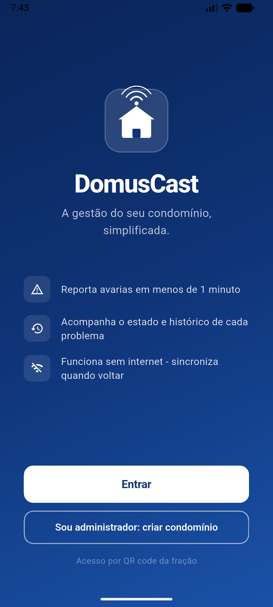<br>**1. Entrada**: "Entrar" abre a leitura do QR code | 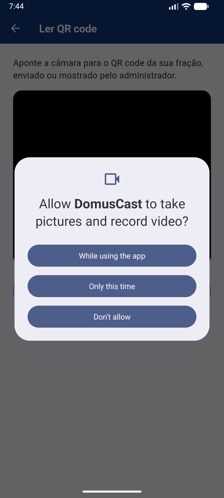<br>**2. Permissão da câmara**, só na primeira vez |
| 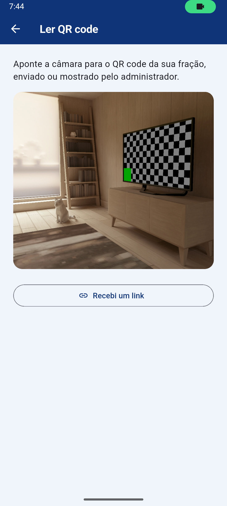<br>**3. Ler QR code** (no emulador, a câmara mostra a cena virtual) | 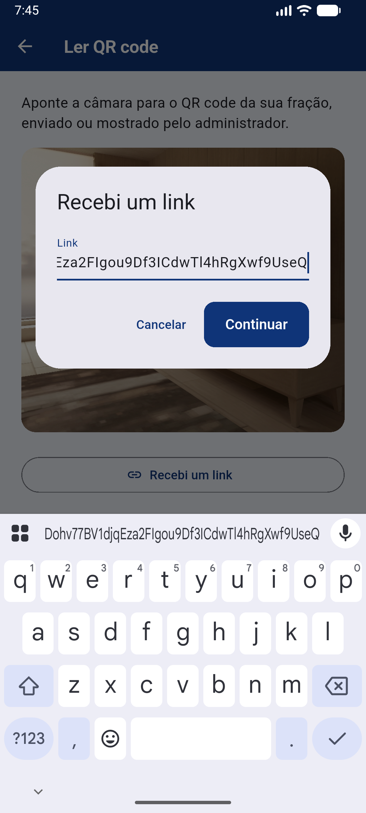<br>**4. Recebi um link**: colar o link enviado pelo administrador |
| 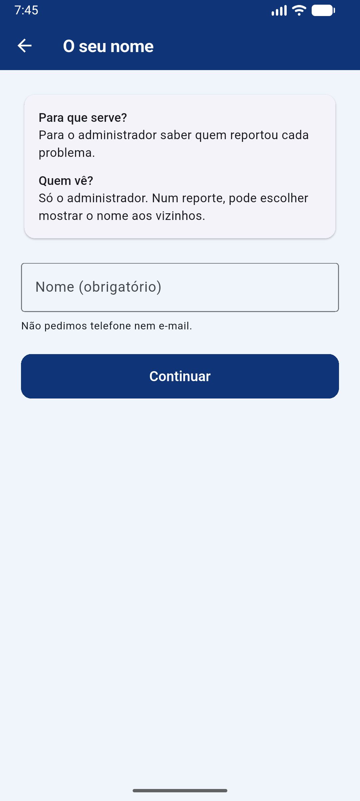<br>**5. Pedir o nome**, aberto pelo link `domuscast://entrar` | 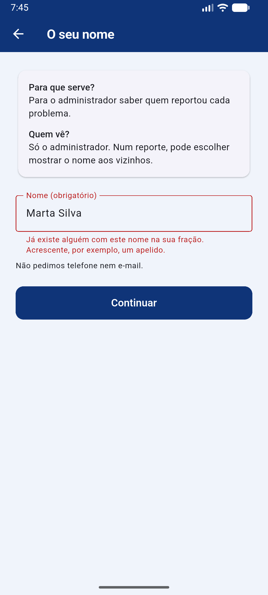<br>**6. Nome repetido** na fração A (409 `nome_duplicado`) |
| 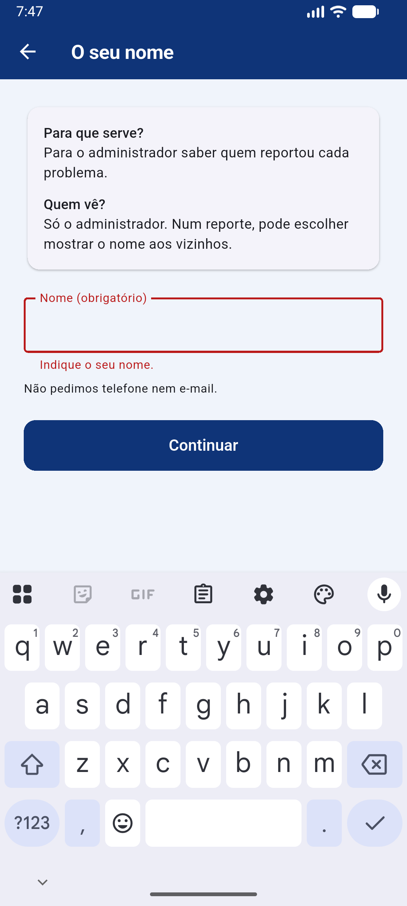<br>**7. Nome vazio**, recusado na app | 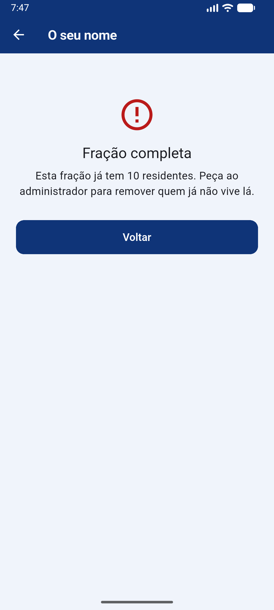<br>**8. Fração completa** (fração B, 409 `fracao_cheia`) |
| 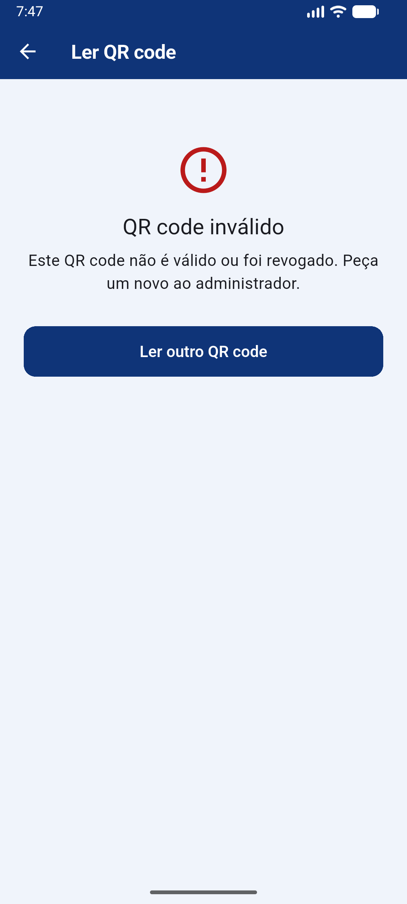<br>**9. QR code revogado** (fração C, 404) | 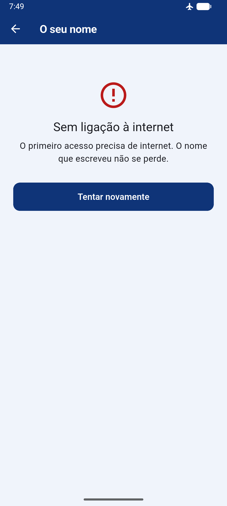<br>**10. Sem internet** (modo de avião) |
| 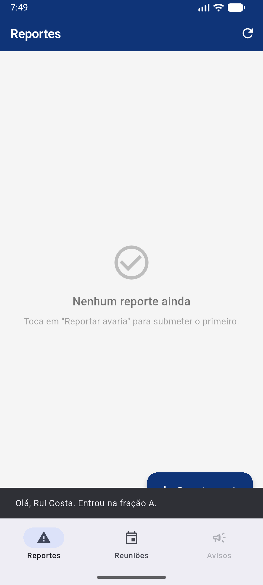<br>**11. Entrou**: depois de "Tentar novamente", com o mesmo nome | <br>**12. Reabrir a app** pelo link: abre nos Reportes sem pedir o nome |

| <br>**13. QR code lido pela câmara**: abre o ecrã do nome | 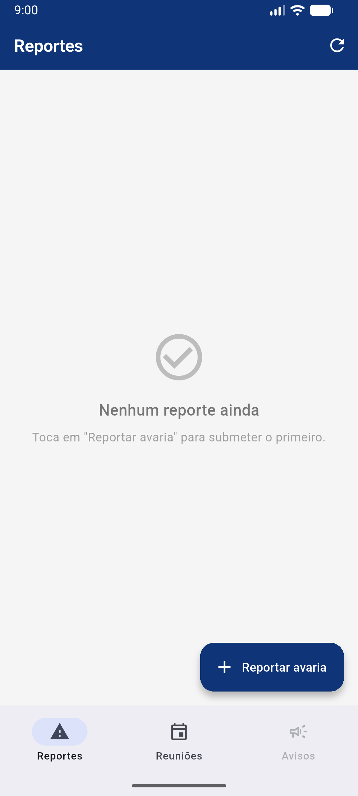<br>**14. Entrou** com o nome "Ana Lopes" |

**Leitura de um QR code real (screenshots 13 e 14):** o emulador usou a webcam do portátil como câmara traseira (`-camera-back webcam0`) e foi-lhe mostrado, num telemóvel, o QR code de uma fração nova, com o link `domuscast://entrar?t=` criado pela API. A app leu-o e abriu o ecrã do nome; a identidade "Ana Lopes" ficou na base de dados com o `qr_token_id` desse QR code (o hash do token lido da imagem coincide com o `token_hash` guardado). Não há screenshot da câmara para não incluir a cara de quem fez o teste.

**Gravação do leitor de ecrã:** [Gravação do TalkBack de 18/11/2026](screenshots/us-15/15-talkback.mp4). A gravação mostra os gestos de deslizar e ativar no ecrã do nome e a leitura dos erros em português.