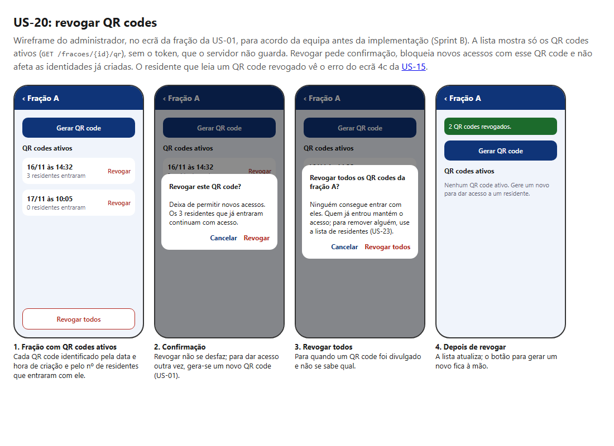
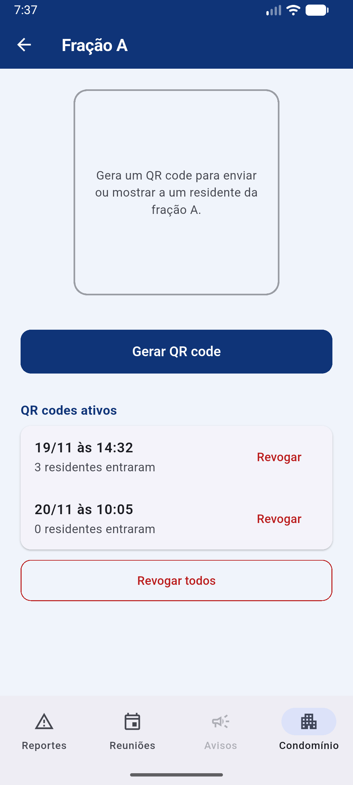
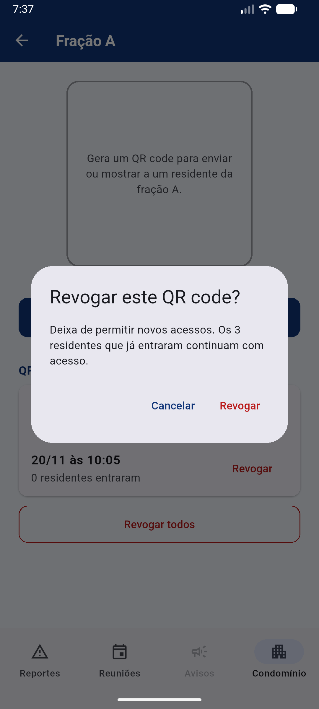
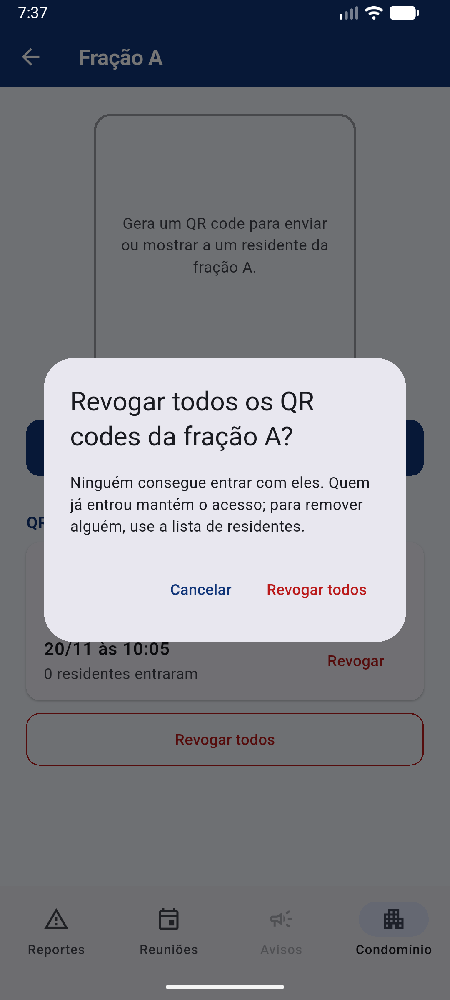
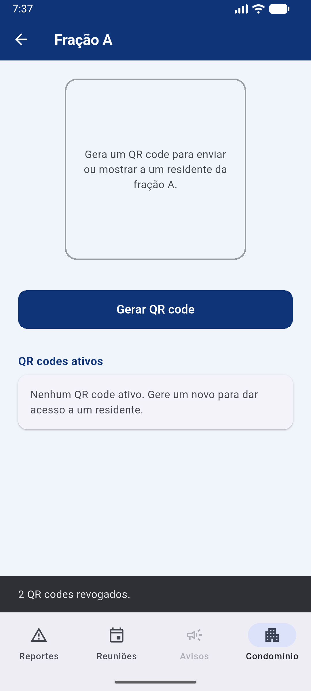
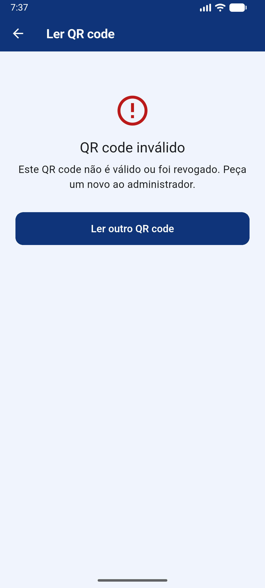

# US-20: Revogar QR codes

> Como **administrador**, quero revogar os QR codes de uma fração, para travar o acesso quando são divulgados a terceiros. ([Product Backlog](../backlog.md#1-product-backlog))

Esta página reúne as evidências da US-20 no Sprint B: o desenho da interface, os testes automáticos e os screenshots da app a correr no emulador Android contra a API em Docker (PostgreSQL).

## Decisões tomadas na implementação

- **Três endpoints, como no [esboço da API](../sprintA/sprintA.md#84-api-esboço):** `GET /fracoes/{id}/qr` lista os QR codes ativos, `POST /fracoes/{id}/qr/revogar` revoga todos os da fração e `POST /qr/{id}/revogar` revoga um. Os dois `POST` devolvem `{revogados}` (0 quando não havia ativos, 1 ao revogar um). A coluna `qr_token.revogado_em` já existia e o `POST /identidades` já recusava QR codes revogados (US-15).
- **Quem revogou fica registado:** nova coluna `qr_token.revogado_por` (migração `0006`), com o administrador que revogou, como pede a [secção 10.2](../sprintA/sprintA.md#102-controlo-de-acessos) ("a ação fica registada com o seu id"). É a mesma solução da US-23 (`identidade.removida_por`). Levantado na revisão do branch.
- **Sem o token na lista:** o servidor só guarda o hash, por isso cada QR code é identificado pela data e hora de criação e pelo nº de residentes que entraram com ele.
- **Nº de residentes:** conta só as identidades que entraram com esse QR code e ainda têm acesso (não removidas, US-23). É o número que a confirmação usa para dizer quem continua com acesso.
- **Autorização:** 401 sem credencial ou com credencial inválida; 403 se a credencial for de um residente (nova dependência `admin_do_pedido`, porque a `admin_atual` dava 401 a residentes); 404 se a fração ou o QR code não existir, já foi revogado ou é de outro condomínio, para não revelar o que existe noutro condomínio ([TM-01](../sprintA/sprintA.md#106-modelo-de-ameaças-inicial)).
- **Confirmação sempre:** revogar não se desfaz, por isso a app pede confirmação para um e para todos ([refinamento](refinamento.md#us-20-revogar-qr-codes)).
- **QR code mostrado no ecrã:** `POST /fracoes/{id}/qr` passou a devolver também o `id` do QR code gerado, o mesmo da lista. Se o QR code mostrado for revogado (sozinho ou com "Revogar todos"), a app tira-o do ecrã e volta o botão "Gerar QR code" (ecrã 4 do wireframe). Revogar outro QR code, por exemplo o antigo que foi divulgado depois de gerar um novo, mantém o novo no ecrã. Levantado na revisão do branch.
- **Erros na app:** revogar um QR code que entretanto foi revogado noutro telemóvel (404) mostra "Este QR code já tinha sido revogado." e recarrega a lista; sem ligação, "Sem ligação. O QR code não foi revogado."; outro erro da API, "Não foi possível revogar. Tente novamente.". A lista recarrega sempre depois de revogar.
- **Gerar um QR code novo atualiza a lista** dos ativos no mesmo ecrã.
- **Defeito encontrado num teste da US-01:** o teste "gerar mostra o QR com o link e as ações" passava por acaso depois desta alteração: o `expect` do mock falhava no novo pedido da lista e o erro era apanhado pelo widget. O mock passou a responder `[]` a esse pedido.

## Desenho da interface

Wireframe acordado antes da implementação: [design/us-20.html](design/us-20.html). Antes de implementar, foram revistos esboços com o aspeto real da app, iguais aos screenshots abaixo.



Diferenças na implementação:

- Os botões "Revogar" e "Revogar todos" estão a vermelho, por serem ações que não se podem desfazer.
- A confirmação de um QR code sem residentes diz só "Deixa de permitir novos acessos.", sem a frase sobre quem mantém o acesso.
- A mensagem depois de revogar aparece na barra inferior do ecrã (SnackBar), não no topo.
- Aprovação da equipa: Luis Santos, a 2026-11-21.

## Critérios de aceitação e evidências

| Critério | Evidência |
|---|---|
| Revogar de uma vez todos os QR codes ativos da fração | pytest: `test_revogar_todos_devolve_numero_e_bloqueia_entradas`, `test_revogar_todos_sem_ativos_devolve_0`, `test_revogar_todos_so_afeta_a_fracao`, `test_revogar_regista_o_administrador`. Flutter: "3. revogar todos pede confirmação com a fração e mostra 2 QR codes revogados". Screenshots 3 e 4 |
| Revogar um QR code específico, escolhido numa lista com a data e hora de criação e o nº de residentes que entraram com ele | pytest: `test_lista_qr_ativos_sem_token_com_data_e_residentes`, `test_residente_removido_nao_conta`, `test_revogar_um_so_afeta_esse`. Flutter: "1. lista os QR codes ativos com data e residentes", "2. revogar um pede confirmação e Cancelar não chama a API", "2b. confirmar revoga, mostra 1 QR code revogado e recarrega", "um QR code sem residentes só avisa que deixa de dar acesso". Screenshots 1 e 2 |
| Um QR code revogado deixa de permitir novos acessos; para voltar a dar acesso, o administrador gera um novo (US-01) | pytest: `test_revogar_todos_devolve_numero_e_bloqueia_entradas`, `test_revogar_um_so_afeta_esse`, `test_lista_nao_inclui_revogados`, `test_revogar_duas_vezes_404`. pytest: `test_gerar_devolve_o_id_que_aparece_na_lista`. Flutter: "4. sem QR codes ativos mostra o convite para gerar um novo", "revogar o QR mostrado tira-o do ecrã e volta Gerar QR code", "revogar na lista o QR mostrado tira-o do ecrã", "revogar outro QR code mantém no ecrã o que acabou de ser gerado", "gerar um QR novo atualiza a lista". Screenshot 4 |
| As identidades já criadas não são afetadas | pytest: `test_revogar_nao_afeta_identidades`. Na API em Docker, depois de revogar os 2 QR codes da fração A, as 3 identidades continuam ativas (`removida_em` vazio). Screenshots 2 e 3 (o texto da confirmação diz que quem entrou mantém o acesso) |
| Um QR code revogado mostra um erro claro ao residente | pytest: `test_token_invalido_e_revogado_tem_a_mesma_resposta_404` (US-15) e `test_revogar_todos_devolve_numero_e_bloqueia_entradas` (`codigo` `qr_invalido`). Flutter: "QR code inválido ou revogado pede para ler outro" (US-15). Screenshot 5 |

## Testes automáticos

| Onde | Ficheiro | Testes | Resultado |
|---|---|---|---|
| API (pytest) | [`DomusCast/api/tests/test_qr_codes.py`](../../DomusCast/api/tests/test_qr_codes.py) | 19 novos (90 na suite) | 90 passed; `ruff check .` sem erros; migração `0006` testada em PostgreSQL (upgrade, downgrade e upgrade) |
| App (flutter test) | [`DomusCast/mobile/test/us20_revogar_qr_test.dart`](../../DomusCast/mobile/test/us20_revogar_qr_test.dart) e [`us01_admin_test.dart`](../../DomusCast/mobile/test/us01_admin_test.dart) | 13 novos e 1 ajustado (82 na suite) | 82 passed; `flutter analyze` sem problemas (Flutter 3.47, a versão do CI) |

Casos de falha cobertos: 401 sem credencial, 403 com credencial de residente, 404 com fração inexistente, QR code inexistente, QR code já revogado e administrador de outro condomínio (o QR code continua válido); na app, Cancelar não chama a API, 404 ao revogar recarrega a lista com a mensagem própria, sem ligação ao revogar e erro ao carregar a lista.

Como correr:

```powershell
cd DomusCast\api; pip install -r requirements-dev.txt; pytest tests/ -v; ruff check .
cd DomusCast\mobile; flutter analyze; flutter test
```

## Screenshots

App em modo debug no emulador Android, ligada à API em Docker com PostgreSQL. O condomínio "Torre Aurora" (4 frações) foi criado na app pela administradora (US-01). Os dois QR codes da fração A foram inseridos na base de dados com tokens conhecidos, porque a app só mostra o token dentro da imagem do QR code; três residentes entraram com o primeiro pela API (`POST /identidades`). Para o screenshot 5, os dados da app foram limpos e o link do QR code revogado foi aberto como um residente novo.

| | |
|---|---|
|  |  |
| 1. QR codes ativos da fração, com data, hora e nº de residentes | 2. Confirmação de revogar um QR code, com quem mantém o acesso |
|  |  |
| 3. Confirmação de revogar todos os QR codes da fração | 4. Depois de revogar: mensagem, lista vazia e "Gerar QR code" à mão |
|  | |
| 5. Um residente novo com o QR code revogado vê o erro da US-15 | |
