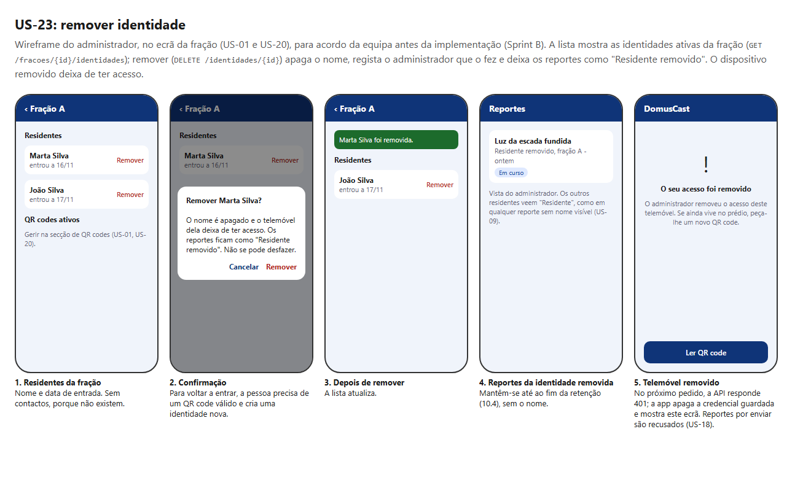
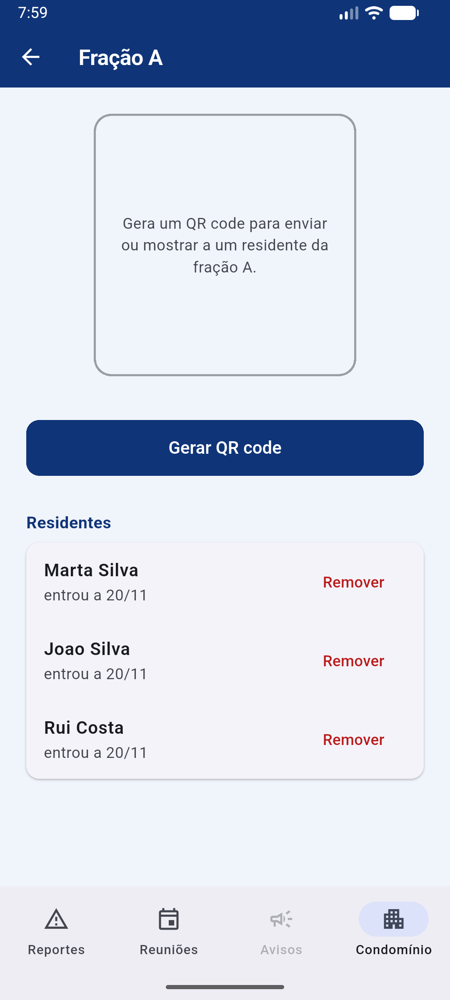
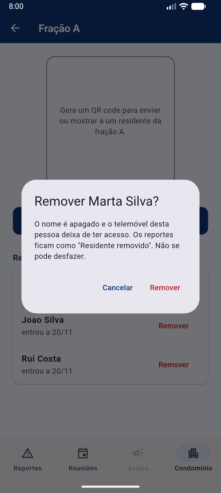
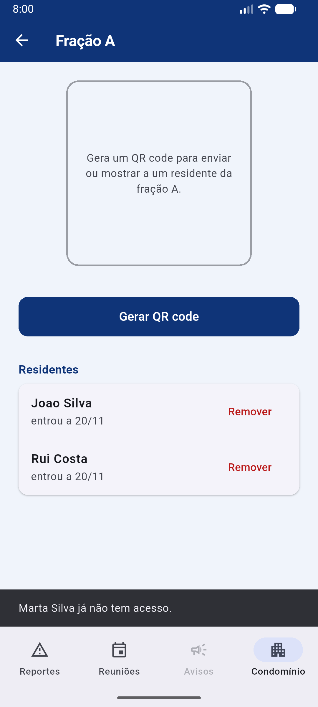
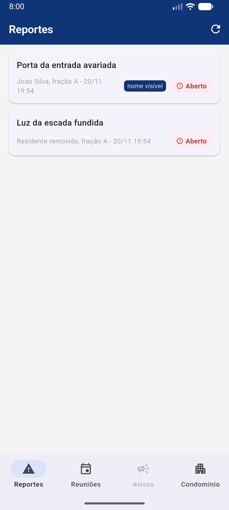
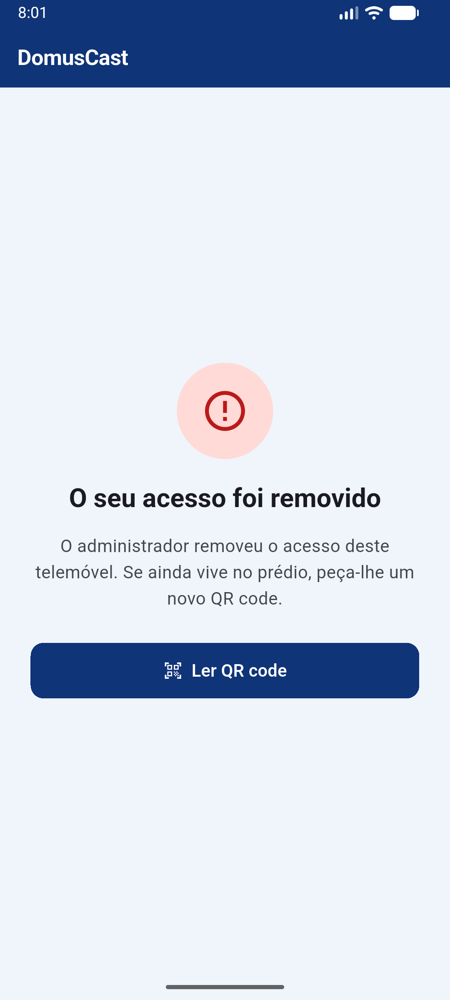

# US-23: Remover identidade

> Como **administrador**, quero remover a identidade de um residente que saiu da fração, para respeitar a sua privacidade e impedir acessos antigos. ([Product Backlog](../backlog.md#1-product-backlog))

Esta página reúne as evidências da US-23 no Sprint B: o desenho da interface, os testes automáticos e os screenshots da app a correr no emulador Android contra a API em Docker (PostgreSQL).

## Decisões tomadas na implementação

- **Dois endpoints, como no [refinamento](refinamento.md#us-23-remover-identidade):** `GET /fracoes/{id}/identidades` lista os residentes ativos (id, nome e data de entrada) e `DELETE /identidades/{id}` remove (204).
- **O que a remoção faz:** apaga `nome` e `nome_normalizado`, preenche `removida_em` e a nova coluna `removida_por` com o administrador (migração `0007`, [10.2](../sprintA/sprintA.md#102-controlo-de-acessos)). Como o nome normalizado fica vazio, a restrição `uq_identidade_nome_fracao` deixa de o contar e o mesmo nome volta a ser aceite na fração.
- **Telemóvel removido:** a API já recusava com 401 qualquer pedido com a credencial de uma identidade removida (US-09). Na app, quando a lista de reportes ou o envio de um reporte recebe 401 com uma sessão de residente, a credencial guardada é apagada e aparece o ecrã "O seu acesso foi removido", com "Ler QR code" para voltar a entrar com um QR code válido.
- **Fila offline:** os reportes por enviar não são apagados; ficam no telemóvel e a recusa do envio é da US-18.
- **Reportes da identidade removida:** continuam na lista. O administrador vê "Residente removido, fração A" (a API devolve a fração e `autor_removido`); os outros residentes veem "Residente", como em qualquer reporte sem nome visível (US-09). A etiqueta "nome visível" não aparece num reporte de alguém removido.
- **Autorização:** 401 sem credencial ou com credencial inválida; 403 se a credencial for de um residente (dependência `admin_do_pedido`, a mesma da US-20); 404 se a identidade não existir, já foi removida ou é de outro condomínio, para não revelar o que existe noutro condomínio ([TM-01](../sprintA/sprintA.md#106-modelo-de-ameaças-inicial)).
- **Erros na app:** remover alguém que entretanto foi removido (404) mostra "Esta pessoa já tinha sido removida." e recarrega a lista; sem ligação, "Sem ligação. Ninguém foi removido."; outro erro da API, "Não foi possível remover. Tente novamente.".
- **Migração `0007`:** a US-20 usa a `0006` (`qr_token.revogado_por`). Quando este branch for atualizado com a `main` depois da US-20, a `0007` passa a vir depois da `0006`.
- **Defeito encontrado num teste da US-01:** o teste "gerar mostra o QR com o link e as ações" passava por acaso depois desta alteração: o `expect` do mock falhava no novo pedido da lista e o erro era apanhado pelo widget. O mock passou a responder `[]` aos pedidos `GET`.

## Desenho da interface

Wireframe acordado antes da implementação: [design/us-23.html](design/us-23.html). Antes de implementar, foram revistos esboços com o aspeto real da app, iguais aos screenshots abaixo.



Diferenças na implementação:

- Os textos não assumem o género pelo nome: a confirmação diz "o telemóvel desta pessoa" (o wireframe diz "telemóvel dela") e a mensagem depois de remover é "Marta Silva já não tem acesso." (o wireframe diz "Marta Silva foi removida.").
- A secção "Residentes" fica no fim do ecrã da fração, depois do QR code e da lista de QR codes ativos da US-20; no wireframe aparece em cima.
- O botão "Remover" está a vermelho, por ser uma ação que não se pode desfazer.
- A mensagem depois de remover aparece na barra inferior do ecrã (SnackBar), não no topo.
- O reporte da identidade removida aparece com o estado real ("Aberto" nos screenshots), não "Em curso".
- Aprovação da equipa: Luis Santos, a 2026-11-21.

## Critérios de aceitação e evidências

| Critério | Evidência |
|---|---|
| O nome é apagado e os reportes passam a "Residente removido" | pytest: `test_remover_apaga_nome_e_regista_admin`, `test_reportes_mantem_se_sem_autor`, `test_autor_removido_deixa_de_ser_identificado` (ajustado), `test_mesmo_nome_volta_a_entrar_depois_de_remover`, `test_lista_identidades_ativas_com_nome_e_data`. Flutter: "1. lista residentes com nome e data de entrada", "2. remover pede confirmação e Cancelar não chama a API", "3. confirmar envia DELETE, mostra a mensagem e a lista atualiza", "4. o administrador vê Residente removido, fração A", "reporte de alguém removido não mostra a etiqueta nome visível". Na API em Docker, as identidades removidas ficaram com `nome` e `nome_normalizado` vazios e a Marta Silva voltou a entrar com o mesmo nome (201). Screenshots 1 a 4 |
| O dispositivo removido deixa de aceder e os itens que enviar depois da remoção são recusados | pytest: `test_credencial_removida_recebe_401` (`GET /reportes` e `POST /reportes` dão 401). Flutter: "5. 401 nos reportes apaga a credencial e mostra O seu acesso foi removido", "401 ao submeter um reporte também apaga a credencial e mostra o aviso", "ao abrir a app com a identidade removida, a credencial guardada é apagada", "a fila offline mantém os reportes por enviar", "Ler QR code abre o leitor", "o administrador com 401 não vê o ecrã de residente removido". Screenshot 5 |
| A ação fica registada com o administrador que a fez | pytest: `test_remover_apaga_nome_e_regista_admin` (`removida_por`). Na API em Docker, as duas identidades removidas ficaram com `removida_por` da administradora "Ana Lopes"; migração `0007` testada em PostgreSQL (upgrade, downgrade e upgrade) |

## Testes automáticos

| Onde | Ficheiro | Testes | Resultado |
|---|---|---|---|
| API (pytest) | [`DomusCast/api/tests/test_remover_identidade.py`](../../DomusCast/api/tests/test_remover_identidade.py) e [`test_reportes.py`](../../DomusCast/api/tests/test_reportes.py) | 13 novos e 1 ajustado (84 na suite) | 84 passed; `ruff check .` sem erros; migração `0007` testada em PostgreSQL (upgrade, downgrade e upgrade) |
| App (flutter test) | [`DomusCast/mobile/test/us23_remover_identidade_test.dart`](../../DomusCast/mobile/test/us23_remover_identidade_test.dart) e [`us01_admin_test.dart`](../../DomusCast/mobile/test/us01_admin_test.dart) | 16 novos e 1 ajustado (85 na suite) | 85 passed; `flutter analyze` sem problemas (Flutter 3.47, a versão do CI) |

Casos de falha cobertos: 401 sem credencial (listar e remover), 403 com credencial de residente (a identidade continua ativa), 404 ao remover duas vezes, identidade inexistente e administrador de outro condomínio (a identidade continua ativa); na app, Cancelar não chama a API, 404 ao remover recarrega a lista com a mensagem própria, sem ligação ao remover, erro ao carregar a lista e um administrador com 401 não vê o ecrã de residente removido.

Como correr:

```powershell
cd DomusCast\api; pip install -r requirements-dev.txt; pytest tests/ -v; ruff check .
cd DomusCast\mobile; flutter analyze; flutter test
```

## Screenshots

App em modo debug no emulador Android, ligada à API em Docker com PostgreSQL. O condomínio "Torre Aurora" (4 frações) foi criado na app pela administradora (US-01). O QR code da fração A foi inserido na base de dados com um token conhecido, porque a app só mostra o token dentro da imagem do QR code. A Marta Silva e o "Joao Silva" (escrito sem acento nos dados de teste) entraram pela API e cada um criou um reporte com o nome visível; o Rui Costa entrou na app pelo link do QR code. Para alternar entre o telemóvel do Rui e a sessão da administradora usaram-se snapshots do emulador. A administradora removeu a Marta Silva (screenshots 2 a 4) e o Rui Costa; o screenshot 5 é o telemóvel do Rui depois de atualizar a lista.

| | |
|---|---|
|  |  |
| 1. Residentes da fração, com o nome e a data de entrada | 2. Confirmação de remover |
|  |  |
| 3. Depois de remover: mensagem e a lista atualiza | 4. O reporte da Marta Silva aparece como "Residente removido, fração A" |
|  | |
| 5. O telemóvel do Rui Costa depois de removido | |
