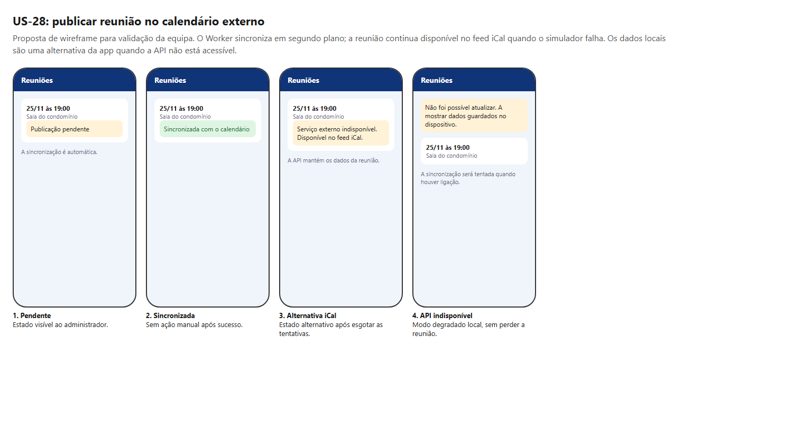
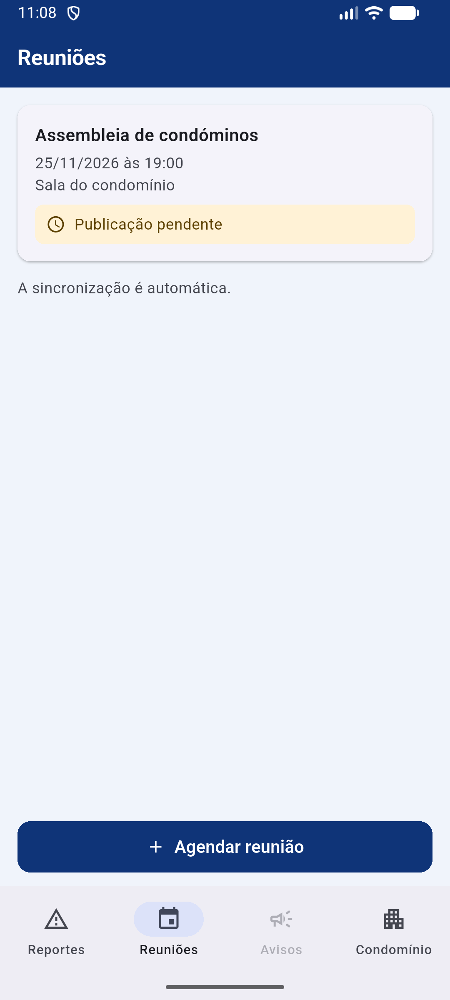
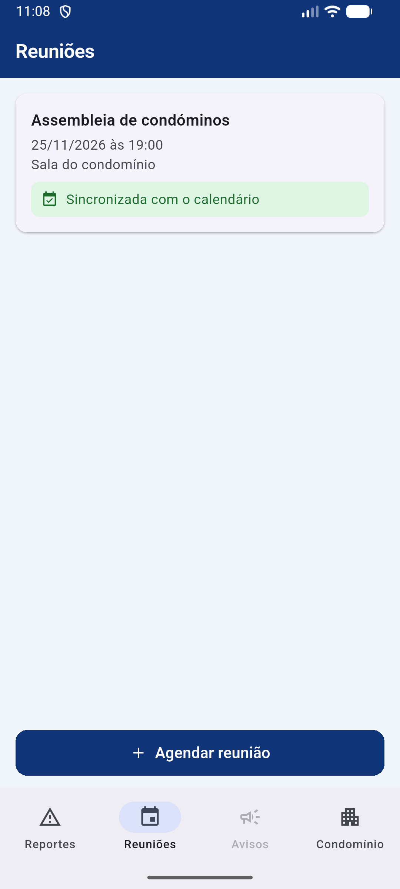
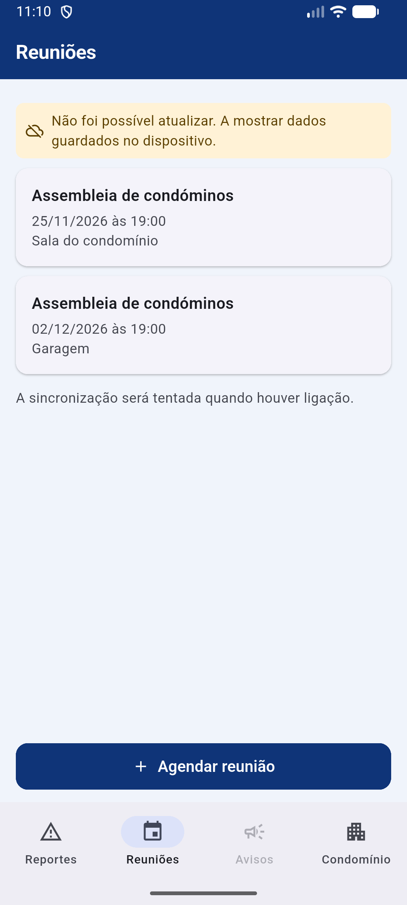
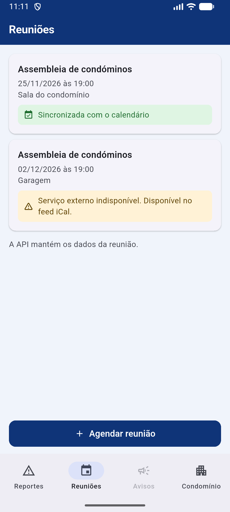

# US-28: Publicar reunião no calendário externo

> Como **administrador**, quero que a reunião agendada seja publicada num serviço de calendário externo, para que apareça automaticamente nos calendários dos residentes (integração externa). ([Product Backlog](../backlog.md#1-product-backlog))

Esta página reúne as evidências da US-28 no Sprint B: o desenho da interface, os testes automáticos, os cenários de falha corridos contra o Docker e os screenshots da app no emulador Android, ligada à API em Docker (PostgreSQL).

## Decisões tomadas na implementação

- **Percurso:** `POST /reunioes` (US-13) guarda a reunião `pendente` e o job `publicar_calendario:{reuniao_id}` na mesma transação. O Worker do calendário reserva o job com `SKIP LOCKED`, chama o simulador e grava `estado_sync` e `calendario_externo_id` ([8.5](../sprintA/sprintA.md#85-workflow-assíncrono), [8.6](../sprintA/sprintA.md#86-integração-externa)). Ao arrancar, repõe como `pendente` só os jobs `publicar_calendario` que ficaram `em_curso` (Worker que caiu); os de transcrição (US-10) são de outro processo.
- **Worker num pacote, um processo por tipo de job:** `app/worker/calendario.py` (job) e `app/worker/calendario_provider.py` (cliente HTTP), arrancado com `python -m app.worker.calendario` no serviço `worker-calendario`. Fica separado do Worker da transcrição (US-10, PR #130), para uma transcrição longa não atrasar a publicação; o `app/worker/__init__.py` é igual nos dois PRs. `GET /health` na porta 8082 verifica a base de dados e conta os jobs pendentes; o Docker usa-o como healthcheck.
- **Simulador:** container `calendario`, com a mesma imagem da API e outro comando (`uvicorn simulador.main:app`). Assim passa pelo mesmo `ruff`, `pip-audit`, Semgrep e Trivy da API e é testado no `pytest`. Guarda os eventos em memória, um calendário por condomínio (`condominio<id>`).
- **Sem duplicar eventos:** o Worker escolhe o id do evento (`domuscast<reuniao_id>`), como o Google Calendar permite. Se publicar e cair antes de gravar o resultado, a nova tentativa recebe `409` e conta como já publicada. Acrescentado ao contrato em 8.6 e validado no [refinamento de 2026-11-24](refinamento.md#2026-11-24).
- **Falhas (aprovado no [refinamento de 2026-11-24](refinamento.md#2026-11-24)):** cada falha conta como uma tentativa, incluindo o `400` (falha normal, com nova tentativa) e o `429` (a seguinte espera o maior entre o backoff e o `Retry-After`). Resposta sem `id`, `status`, `start` ou `end` é incompleta; datas mal formadas, sem fuso, `end` antes de `start` ou `status` diferente de `confirmed` são inválidas. Timeout de 10 s por pedido.
- **Tentativas:** 5 tentativas, com esperas de 1, 2, 4 e 8 minutos entre elas; à 5.ª falha o job fica `falhou` e a reunião `alternativo`. Com 5 tentativas só há 4 esperas, por isso os 16 minutos da lista de 8.5 nunca chegam a ser usados (validado no refinamento de 2026-11-24).
- **Modo `limite`:** o contrato de 8.6 prevê o `429`, mas a lista de modos do `/_chaos` não tinha forma de o provocar. Acrescentado o modo `limite` (`429` com `Retry-After: 30`).
- **Duração do evento:** a reunião só tem início; o evento é publicado com 2 horas (`end` = início + 2 h), porque o contrato exige `end`.
- **Robustez do Worker:** um job com `payload` inválido fica `falhou` com "payload inválido" e não para o Worker; outro erro inesperado fica no log e o ciclo continua. Encontrado na demonstração (um job criado à mão com JSON mal formado parou o Worker) e coberto por `test_job_com_payload_invalido_falha_sem_parar_o_worker`.
- **Logs:** cada tentativa fica no log do Worker numa linha JSON com `timestamp`, `componente: "calendario"`, `evento` (`publicada`, `tentativa_falhou`, `publicacao_falhou`), `reuniao_id`, `tentativa` e `motivo`.
- **`GET /reunioes?desde=`** (nota da revisão do PR #124): nova coluna `reuniao.atualizado_em` (migração `0008`, preenchida com `criado_em` nas reuniões existentes), que muda quando o Worker altera o estado. O filtro `desde` passou a usar esta coluna. A aprovação da ata (US-24) também tem de mudar `atualizado_em`, para a app a ver pelo `desde` (registado em 8.4).
- **App:** o separador Reuniões do administrador mostra o estado de cada reunião com os textos do wireframe. Enquanto houver reuniões pendentes, volta a pedir a lista de 30 em 30 segundos, para o administrador ver a mudança sem fazer nada; com a app em segundo plano deixa de pedir e, ao voltar, pede logo. Cada lista recebida fica guardada no telemóvel por condomínio (SQLite, `reunioes.db`), para um administrador nunca ver a lista de outro condomínio. Se a API não responder (sem ligação, erro 5xx, timeout de 15 s, erro de TLS ou resposta que não é JSON), mostra a lista desse condomínio com o aviso do ecrã 4 e tenta de novo de 30 em 30 segundos. Um erro 4xx não usa a lista guardada. A fila de reuniões criadas sem internet continua a ser a US-18. Validado no refinamento de 2026-11-24.
- **Demonstrações:** `WORKER_BACKOFF_UNIDADE_S=1` faz as esperas em segundos (1, 2, 4 e 8 s). Por omissão são minutos; em produção não se define.
- **Produção:** `worker-calendario` e `calendario` foram acrescentados a `deploy/docker-compose.prod.yml`, com a imagem da API e sem portas publicadas.
- **Fallback iCal:** a US-28 garante que, quando o serviço externo falha, a reunião fica guardada e marcada `alternativo`. Verificar que essa reunião aparece no feed iCal é um critério da US-29 (#92), que gera o feed a partir da tabela `reuniao`. Até a US-29 ser integrada, o texto "Disponível no feed iCal" antecipa esse feed. Validado no refinamento de 2026-11-24; o critério está na #92.

## Desenho da interface

Wireframe acordado antes da implementação: [design/us-28.html](design/us-28.html).



Diferenças na implementação, aprovadas no [refinamento de 2026-11-24](refinamento.md#2026-11-24) por toda a equipa:

- Cada cartão mantém o título "Assembleia de condóminos" e a data com o ano, como na US-13.
- Os estados têm um ícone, além da cor: relógio (pendente), calendário com visto (sincronizada) e aviso (alternativo). As cores (amarelo e verde, como no wireframe) ficaram em `theme.dart`.
- O botão "Agendar reunião" aparece em todos os ecrãs, fixo no fundo, como na US-13.

## Critérios de aceitação e evidências

| Critério | Evidência |
|---|---|
| A publicação é assíncrona, com novas tentativas e sem duplicar eventos | pytest: `test_worker_publica_e_marca_sincronizada`, `test_job_espera_pela_hora_da_nova_tentativa`, `test_backoff_1_2_4_8_minutos_e_alternativo_a_quinta_falha`, `test_worker_que_caiu_depois_de_publicar_nao_duplica_o_evento`, `test_reinicio_so_repoe_jobs_de_publicacao`, `test_job_de_reuniao_ja_sincronizada_nao_chama_o_servico`, `test_simulador_cria_evento_e_recusa_o_mesmo_id_com_409`, `test_job_com_payload_invalido_falha_sem_parar_o_worker`, `test_agendar_cria_um_job_publicar_calendario` (US-13). No Docker, a reunião 14 foi reposta a `pendente` depois de publicada: o Worker recebeu `409` e o simulador ficou com um só evento `domuscast14` (screenshots 01 e 02) |
| Trata as quatro falhas do serviço externo: indisponível, atrasado, resposta incompleta e inválida | pytest: `test_cada_falha_mantem_pendente_e_agenda_nova_tentativa` (indisponivel, limite, incompleto, invalido), `test_lento_mais_de_10_segundos_conta_como_falha`, `test_pedido_usa_timeout_de_10_segundos`, `test_falhas_do_servico_sao_detetadas` (timeout, ligação recusada, 503, 429, 400, não JSON, sem campos), `test_resposta_incompleta_ou_invalida_conta_como_falha` (6 casos), `test_400_conta_como_falha_normal_com_nova_tentativa`, `test_429_espera_o_maior_entre_backoff_e_retry_after`, `test_simulador_modos_de_falha`. No Docker: ver [Cenários de falha](#cenários-de-falha-no-docker) |
| Se o serviço falhar, a reunião continua disponível pelo feed iCal (US-29) e depois pelos dados locais | Na US-28: a reunião `alternativo` continua guardada e disponível na API (`test_backoff_1_2_4_8_minutos_e_alternativo_a_quinta_falha`, screenshot 03), que é a origem do feed ([8.6](../sprintA/sprintA.md#86-integração-externa)). Dados locais: app "4. sem ligação mostra a lista guardada, sem estado, com o aviso", "API indisponível (503) também mostra a lista guardada", "a lista guardada de outro condomínio não aparece", "API que não responde: ao fim do timeout mostra a lista guardada", "erro inesperado (timeout/TLS/resposta que não é JSON) mostra a lista guardada e não fica a carregar", "quando a ligação volta, a lista atualiza sozinha e o aviso desaparece", screenshots 04 e 05. A presença da reunião no feed iCal verifica-se na US-29, onde é critério de aceitação ([#92](https://github.com/LMNSdev/LABDSOF_DOMUSCAST/issues/92)), como decidido no refinamento de 2026-11-24 |
| O estado da publicação (pendente, sincronizada, alternativo) é visível ao administrador | App: "1. pendente: estado e nota de sincronização automática", "2. sincronizada: sem notas", "3. alternativo: feed iCal e dados mantidos pela API", "com publicação pendente volta a pedir a lista e mostra o novo estado", "em segundo plano não volta a pedir; ao voltar pede logo". pytest: `test_desde_mostra_a_reuniao_quando_o_worker_muda_o_estado`. Screenshots 01 a 03 |

**TalkBack:** testado no emulador a 2026-11-26, com o TalkBack em PT-PT. Na [gravação do TalkBack](screenshots/us-28/06-talkback.mp4) (57 s, com som) vê-se o foco a percorrer, com o rato, o cartão da reunião `alternativo` (02/12, Garagem), o da reunião `sincronizada` (09/12, Sala do condomínio), a nota "A API mantém os dados da reunião." e o botão "Agendar reunião", que abre o formulário com duplo toque; o foco passa depois para "Voltar". O leitor de ecrã leu tudo em português: em cada cartão, o título, a data, o local e o estado da publicação; nos botões, o nome e "botão". O aviso do ecrã 4 (API indisponível) não foi gravado com o TalkBack: fica coberto pelo screenshot 04 e pelos testes de widgets. Os testes de widgets verificam o contraste dos estados e do aviso, a etiqueta do botão (`textContrastGuideline`, `labeledTapTargetGuideline`) e que o estado é lido no cartão.

## Cenários de falha no Docker

Corridos a 2026-11-24 contra `docker compose up --build`, com `WORKER_BACKOFF_UNIDADE_S=1`. Para cada modo, o simulador foi posto nesse modo com `POST /_chaos`, uma reunião foi agendada por `POST /reunioes` e esperou-se pelo fim do job. Resultado na base de dados:

| Modo do simulador | `estado_sync` | Job | Tentativas | `job.erro` |
|---|---|---|---|---|
| `indisponivel` | `alternativo` | `falhou` | 5 | `indisponivel: 503` |
| `lento` (15 s) | `alternativo` | `falhou` | 5 | `atrasado: sem resposta em 10 s` |
| `incompleto` | `alternativo` | `falhou` | 5 | `incompleto: faltam id, start` |
| `invalido` | `alternativo` | `falhou` | 5 | `invalido: datas mal formadas` |
| `limite` (429, `Retry-After: 30`), depois `ok` | `sincronizada` | `concluido` | 2 | - (a 2.ª tentativa foi 30 s depois da 1.ª, e não 1 s) |

## Testes automáticos

| Onde | Ficheiro | Testes | Resultado |
|---|---|---|---|
| API (pytest) | [`DomusCast/api/tests/test_calendario.py`](../../DomusCast/api/tests/test_calendario.py) | 38 novos (170 na suite) | 170 passed em SQLite e em PostgreSQL 16; `ruff check .` sem erros; migrações `upgrade`, `downgrade` e `upgrade` em PostgreSQL sem erros |
| App (flutter test) | [`DomusCast/mobile/test/us28_calendario_test.dart`](../../DomusCast/mobile/test/us28_calendario_test.dart) | 17 novos (143 na suite) | 143 passed; `flutter analyze` sem problemas (Flutter 3.47, como no CI) |

Os testes da US-13 que verificavam os textos antigos do estado ([`us13_reunioes_test.dart`](../../DomusCast/mobile/test/us13_reunioes_test.dart)) passaram a usar os textos do wireframe da US-28.

Verificações de segurança locais, com as versões do CI: `pip-audit -r requirements.txt` sem vulnerabilidades, Semgrep (`p/python`, `p/dockerfile`) sem achados nos ficheiros novos, Trivy na imagem sem HIGH ou CRITICAL com correção, Gitleaks sem fugas.

Casos de falha cobertos: serviço parado (ligação recusada), 503, timeout de 10 s, 429 com `Retry-After`, 400, resposta que não é JSON, sem `id`/`start`/`end`/`status`, datas mal formadas, sem fuso, `end` antes de `start`, `status` diferente de `confirmed`, 409 (já publicado), payload do job inválido. Na app: sem ligação e 503 com e sem lista guardada, 403 sem usar a lista guardada, regresso da ligação.

Como correr:

```powershell
cd DomusCast\api; pip install -r requirements-dev.txt; pytest tests/ -v
cd DomusCast\mobile; flutter test
```

## Screenshots

App em modo debug no emulador Android (API 37), ligada à API em Docker com PostgreSQL, a 2026-11-24. O condomínio "Rua das Flores 28" foi criado na app. As reuniões foram inseridas na base de dados (`reuniao` e `job`, como faz `POST /reunioes`), porque a credencial do administrador só existe no telemóvel. Para os ecrãs 01 e 02, a reunião 14, já publicada, foi reposta a `pendente` com o Worker parado; ao arrancar o Worker, o simulador respondeu `409` e a reunião ficou `sincronizada` sem segundo evento. O ecrã 02 atualizou-se sozinho, sem tocar na app.

| | |
|---|---|
| <br>**1. Pendente**, com o Worker parado | <br>**2. Sincronizada**, atualizada sozinha depois de arrancar o Worker |
| <br>**3. Alternativo**: simulador `indisponivel`, 5 tentativas falhadas | <br>**4. API indisponível** (container `api` parado): lista guardada no telemóvel |
| <br>**5. Ligação reposta**: a lista voltou sozinha ao fim de cerca de 15 s | |
